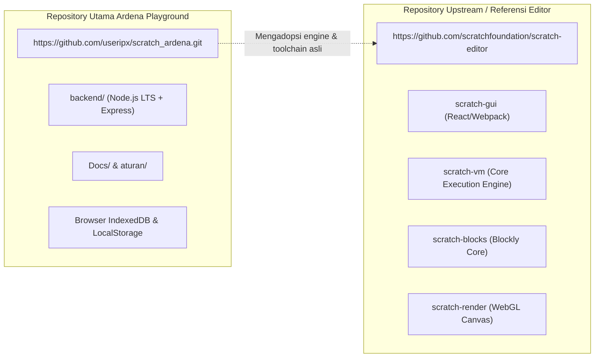
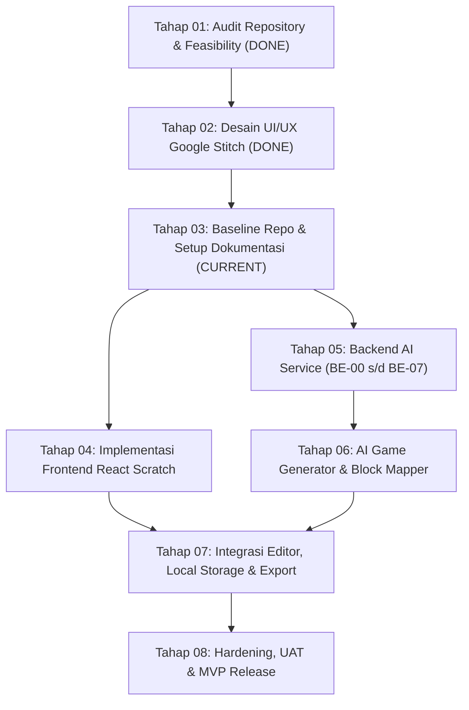
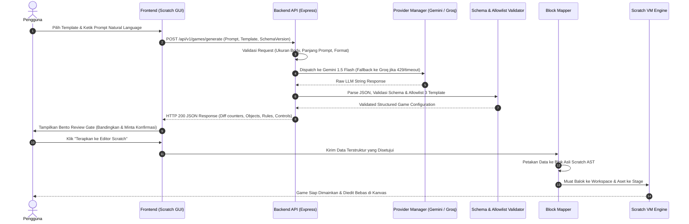

# Master Implementation Plan — Ardena Playground

> **VERSI:** 1.4 (Master Unified Plan)  
> **TANGGAL:** 05 November 2026  
> **STATUS:** DOKUMEN INDUK RESMI ROADMAP & ARSITEKTUR PROYEK  
> **OTORITAS TERTINGGI:** Yogi Ario (Project Owner / Lead Developer)  
> **ACUAN TATA KELOLA:** `aturan/universal-rule.md`, `aturan/AGENTS.md`, `aturan/GEMINI.md`  

---

## 1. Ringkasan Eksekutif & Filosofi Proyek

**Ardena Playground** adalah aplikasi web berbantuan kecerdasan buatan (*AI-assisted*) yang memfasilitasi pembuatan game edukasi berbasis balok visual Scratch melalui instruksi bahasa alami (*natural language*).

Produk ini tidak menggantikan esensi belajar pemrograman visual Scratch, melainkan bertindak sebagai **AI Copilot** yang membantu merumuskan logika game awal, membuatkan sprite dan variabel pendukung, serta memetakan konsep menjadi blok visual Scratch 3.0 asli. Pengguna tetap memegang kendali penuh untuk meninjau, menyetujui, menyunting, dan memainkan game di kanvas Scratch.

### 🧭 Prinsip Tata Kelola Proyek
1. **No Plan, No Code:** Rencana kerja tertulis wajib disusun sebelum kode disentuh.
2. **No Approval, No Code:** Tidak ada perubahan kode/konfigurasi tanpa persetujuan eksplisit Yogi Ario.
3. **No Evidence, No Completion:** Tidak boleh mengklaim tugas selesai tanpa bukti verifikasi nyata (100% PASS).
4. **Consistent Standards, Variable Intelligence:** Kualitas penalaran AI boleh bervariasi, namun standar arsitektur dan kualitas proyek harus konsisten.

---

## 2. Peta Repository & Batasan Komponen



* **Repository Utama:** `https://github.com/useripx/scratch_ardena.git` adalah repositori resmi pengembangan source code, backend service, konfigurasi, dan integrasi fitur Ardena Playground.
* **Repository Upstream:** `https://github.com/scratchfoundation/scratch-editor` adalah acuan resmi engine Scratch 3.0. Toolchain bawaan (Webpack/React) dipertahankan dan tidak dirombak sembarangan.

---

## 3. Matriks Keputusan Teknologi Utama

| Area | Keputusan Teknologi | Rasional & Catatan Operasional |
|---|---|---|
| **Backend Runtime** | Node.js LTS + TypeScript (Strict) | Cepat, type-safe, dan efisien untuk pemrosesan JSON terstruktur. |
| **Backend Framework** | Express (Modular Monolith) | Ringan, stabil, minim overhead, dan mudah diisolasi ke modul terpisah. |
| **Lingkungan Server** | Node.js CLI langsung | **Tanpa Laragon**, tanpa Apache, PHP, atau MySQL. |
| **AI Provider Utama** | Google Gemini 1.5 Flash | Cepat, latensi rendah (~150ms), dan efisien untuk ekstraksi JSON skema. |
| **AI Provider Fallback**| Groq Llama 3 (`llama3-70b-8192`) | Fallback otomatis saat Gemini mengalami HTTP 429, 5xx, atau timeout. |
| **Penyimpanan MVP** | Browser IndexedDB | Data proyek tersimpan lokal di browser; tanpa database server untuk MVP. |
| **Preferensi UI** | LocalStorage | Khusus pengaturan UI ringan (tema, preferensi suara). |
| **Ekspor Proyek** | File format `.sb3` standar | Dapat dibuka langsung pada Scratch Desktop resmi atau website Scratch. |
| **Desain UI/UX** | Google Stitch (19 Layar) | Teruji dan tersimpan di `template/ardenaplayground/` berstatus Read-Only. |

---

## 4. Roadmap Proyek Master (Tahap 01 s/d Tahap 08)



### Rincian 8 Tahapan Proyek:

#### Tahap 01 — Repository Audit & Feasibility
* **Status:** **SELESAI (DONE)**
* **Hasil:** Penetapan URL repositori utama `scratch_ardena`, pemisahan dari upstream `scratch-editor`, serta evaluasi kompatibilitas stack Node.js LTS tanpa Laragon.

#### Tahap 02 — Desain UI/UX Seluruh Halaman dengan Google Stitch
* **Status:** **SELESAI (DONE)**
* **Hasil:** 19 layar antarmuka prototipe selesai dirancang dan disetujui, mencakup landing page, panel prompt, indikator proses 4-tahap, review gate bento, error recovery, dan manajemen proyek lokal di `template/ardenaplayground/`.

#### Tahap 03 — Persiapan Repository dan Baseline
* **Status:** **SEDANG BERJALAN (IN PROGRESS)**
* **Tujuan:** Penyiapan folder dokumentasi terpadu `Docs/`, penataan aturan kerja `aturan/`, dan verifikasi struktur dasar proyek sebelum coding dimulai.

#### Tahap 04 — Implementasi Kode Frontend
* **Status:** **MENUNGGU (PENDING)**
* **Tujuan:** Mengadopsi desain Google Stitch ke dalam komponen React `scratch-gui` secara terisolasi tanpa merusak komponen editor bawaan Scratch.

#### Tahap 05 — Backend AI Service (BE-00 s/d BE-07)
* **Status:** **SEDANG BERJALAN (SUB-TAHAP BE-00 AKTIF)**
* **Tujuan:** Membangun modular monolith backend API Express TypeScript yang mengelola komunikasi aman ke Gemini/Groq, validasi JSON Schema, dan penegakan capability allowlist.

#### Tahap 06 — AI Game Generator & Block Mapping
* **Status:** **MENUNGGU (PENDING)**
* **Tujuan:** Menerjemahkan konfigurasi game terstruktur (JSON) yang disetujui pengguna menjadi struktur visual blok Scratch (AST/XML) yang valid.

#### Tahap 07 — Integrasi Editor, Local Storage, dan Export (.sb3)
* **Status:** **MENUNGGU (PENDING)**
* **Tujuan:** Menghubungkan frontend, backend, generator blok, penyimpanan lokal IndexedDB, serta fitur ekspor format `.sb3`.

#### Tahap 08 — Hardening, UAT, dan MVP Release
* **Status:** **MENUNGGU (PENDING)**
* **Tujuan:** Pengujian akhir menyeluruh, verifikasi 100% PASS pada unit/integration/contract test, audit keamanan kunci API, dan persetujuan rilis resmi dari Yogi Ario.

---

## 5. Roadmap Khusus Backend Service (BE-00 s/d BE-07)

Alur pengerjaan teknis backend mengikuti urutan gerbang persetujuan independen:

```
[BE-00: Desain & Audit] 
       │ (Approval Gate)
       ▼
[BE-01: Fondasi Express TS] 
       │ (Approval Gate)
       ▼
[BE-02: API Contract & Validation] 
       │ (Approval Gate)
       ▼
[BE-03: Gemini Adapter] 
       │ (Approval Gate)
       ▼
[BE-04: Groq Fallback & Manager] 
       │ (Approval Gate)
       ▼
[BE-05: AI Game Gen Use Case] 
       │ (Approval Gate)
       ▼
[BE-06: Hardening & Integrasi FE] 
       │ (Approval Gate)
       ▼
[BE-07: Serah Terima & Dokumentasi]
```

1. **BE-00 (Analisis, Audit, dan Persetujuan Desain):** Mengunci arsitektur, OpenAPI contract, JSON schema, provider strategy, dan risk register.
2. **BE-01 (Fondasi Service Node.js):** Skeleton Express TS, scripts dev/build/test, Request ID, health check endpoint, dan konfigurasi `.env`.
3. **BE-02 (API Layer & Request Validation):** Implementasi route OpenAPI, middleware validasi request, limit body, error responses konsisten.
4. **BE-03 (Gemini Adapter):** Integrasi Gemini 1.5 Flash, timeout (30s), parameter generasi, error normalization, dan mock tests.
5. **BE-04 (Groq Adapter & Provider Manager):** Integrasi Groq Llama 3, interface seragam, logika retry terukur (max 1x), dan fallback otomatis non-paralel.
6. **BE-05 (AI Game Generation & Output Validation):** JSON parsing aman, skema validator, dan allowlist 3 template (*Catching*, *Maze*, *Space Shooter*).
7. **BE-06 (Hardening & Integrasi):** Contract test lintas modul (FE & Block Mapper), rate limiting, sanitasi log, dan failure test.
8. **BE-07 (Serah Terima & Dokumentasi):** Penyusunan panduan operasi, handover, laporan test kelulusan 100% PASS, dan sign-off akhir PO.

---

## 6. Protokol Komunikasi & Kontrak Antarmuka End-to-End



---

## 7. Ketentuan Keamanan & Privasi

* **Zero Secret Leakage:** Nilai API key hanya boleh berada di backend (`.env`). Tidak boleh di-commit ke Git, tidak boleh diekspos ke browser, dan tidak boleh tercetak pada log terminal publik.
* **Perlindungan Berkas Kunci Lokal:** File `template/api` dan `.env` wajib didaftarkan pada `.gitignore` sebelum commit perdana.
* **Zero Arbitrary Code Execution:** Tidak boleh ada fungsi `eval()`, `new Function()`, atau pengeksekusian script JavaScript bebas dari respons AI.
* **Penyimpanan Lokal Mandiri:** Data proyek pengguna tetap berada di sisi klien (`IndexedDB`), menghindarkan risiko kebocoran data pengguna di server.

