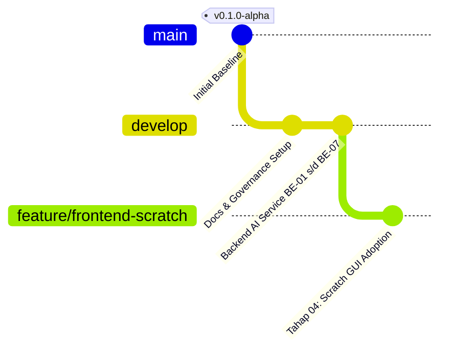
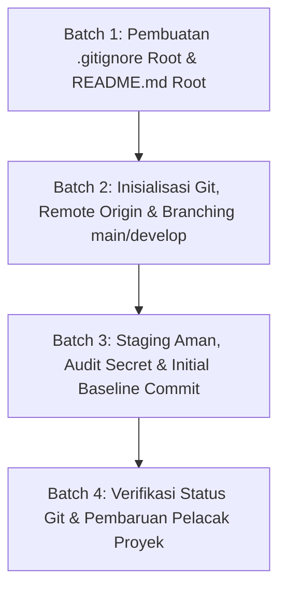

# Implementation Plan — Tahap 03: Persiapan Repository, Git Branching & Baseline Setup

> **TAHAP:** Tahap 03 (Persiapan Repository Git, Branching Strategy & Baseline Project)  
> **DOKUMEN INDUK:** `Docs/Implementation_Plan.md`, `aturan/universal-rule.md`, `aturan/AGENTS.md`, `Docs/Decision_Log.md`  
> **STATUS:** MENUNGGU REVIEW & PERSETUJUAN DARI YOGI ARIO (APPROVAL GATE)  
> **OTORITAS PENYETUJU:** Yogi Ario (Project Owner / Lead Developer)  
> **PRINSIP:** *No Plan, No Code. No Approval, No Code. No Evidence, No Completion.*  

---

## 1. Tujuan & Ruang Lingkup

### 1.1 Tujuan Tahap 03
Setelah pilar **Backend AI Service (Tahap 05: BE-00 s/d BE-07)** tuntas 100% PASS dan terverifikasi, Tahap 03 bertujuan untuk meletakkan fondasi kontrol versi Git resmi pada workspace Ardena Playground:
1. Menginisialisasi repositori Git lokal.
2. Memasang berkas `.gitignore` level *root workspace* yang ketat guna menjamin **Zero Secret Leakage** (mencegah file `.env`, kredensial `template/api`, `node_modules/`, serta file build ter-commit).
3. Mengonfigurasi remote origin ke repositori GitHub resmi: `https://github.com/useripx/scratch_ardena.git`.
4. Menegakkan **Pilar 2 (Protokol Branching Git)**: Membentuk branch `main` (sebagai mahkota produksi yang dikontrol oleh Yogi Ario) dan branch kerja `develop` untuk aktivitas pengembangan.
5. Melakukan *Initial Baseline Commit* di branch `develop` untuk seluruh aset yang telah terverifikasi (`aturan/`, `Docs/`, `changelog/`, dan `backend/`).

---

### 1.2 Skema Alur Branching & Proteksi Git

---

### 1.3 Ruang Lingkup Pekerjaan (In-Scope untuk Tahap 03):
1. **Penyusunan `.gitignore` Root Workspace:**
   - Proteksi rahasia: `.env`, `template/api`, `*.pem`, `*.key`.
   - Proteksi dependensi & build: `node_modules/`, `dist/`, `build/`.
   - Proteksi cache & coverage: `coverage/`, `.cache/`, `*.log`.
   - Proteksi artefak AI sementara: `.system_generated/`, `.gemini/`.
2. **Inisialisasi & Konfigurasi Git:**
   - Menjalankan `git init` di root workspace (`e:\Dokumen\UNP\Teknik Informatika\Projek\ardenaplayground`).
   - Menambahkan remote repository: `git remote add origin https://github.com/useripx/scratch_ardena.git`.
   - Memastikan nama branch utama adalah `main` dan membuat branch `develop`.
3. **Penyusunan `README.md` Root Workspace:**
   - Memberikan overview proyek Ardena Playground, panduan menjalankan backend, dan roadmap 8 tahapan.
4. **Initial Baseline Commit pada Branch `develop`:**
   - Menambahkan berkas-berkas tata kelola, dokumentasi, changelog, dan source code backend.
   - Memastikan tidak ada berkas rahasia yang masuk dalam staging (`git status`).
5. **Verifikasi Integritas:**
   - Memastikan seluruh unit test backend tetap lulus 100% PASS setelah inisialisasi Git.

---

### 1.4 Di Luar Ruang Lingkup (Out-of-Scope untuk Tahap 03):
- ❌ **TIDAK** melakukan `git push --force` ke remote origin yang berpotensi menimpa commit yang sudah ada di GitHub tanpa konfirmasi.
- ❌ **TIDAK** mengubah kode aplikasi backend (telah terkunci di BE-07).
- ❌ **TIDAK** mengubah folder referensi `template/` (tetap berstatus READ-ONLY).

---

## 2. Analisis Kondisi Saat Ini (*Current State*)

* **Status Git Saat Ini:** Belum ada repositori Git (`fatal: not a git repository`).
* **Kondisi Backend:** 100% selesai, 65 test passed, build `dist/` valid.
* **Kondisi Tata Kelola:** `aturan/` (universal-rule, AGENTS, GEMINI) dan `Docs/` telah mutakhir dan memuat ADR-001 s/d ADR-010.

---

## 3. Daftar Berkas Target yang Akan Dibuat / Dimodifikasi

| Path Berkas | Status | Peran & Fungsi Berkas |
|---|---|---|
| `.gitignore` (Root) | **BARU** | Proteksi ketat anti-secret leakage dan pencegahan commit file build/node_modules. |
| `README.md` (Root) | **BARU** | Panduan utama repositori Ardena Playground untuk kontributor. |
| `Docs/Task_Status.md` | **MODIFIKASI** | Pembaruan status Tahap 03 menjadi DONE. |

---

## 4. Rencana Langkah Kerja Bertahap (*Execution Batches*)

### Batch 1: Pembuatan `.gitignore` Root & `README.md` Root
* Membuat `.gitignore` di root workspace dengan konfigurasi komprehensif.
* Membuat `README.md` root workspace yang informatif dan profesional.

### Batch 2: Inisialisasi Git & Branching
* Menjalankan `git init`.
* Menambahkan remote origin: `https://github.com/useripx/scratch_ardena.git`.
* Membuat branch `main` dan checkout ke branch `develop`.

### Batch 3: Staging Aman & Initial Baseline Commit
* Menjalankan `git add` secara selektif.
* Melakukan verifikasi `git status` memastikan `template/api` dan `backend/.env` tidak masuk staging.
* Melakukan initial commit di branch `develop`: `feat: baseline ardena playground (governance, docs, & backend ai service v1.0)`.

### Batch 4: Verifikasi & Pelaporan
* Memastikan status repo bersih (`clean working tree`).
* Memperbarui `Docs/Task_Status.md` dan menerbitkan changelog.

---

## 5. Pertanyaan Review untuk Yogi Ario (Project Owner)

Silakan periksa rancangan Tahap 03 di atas:
1. **Konfirmasi Remote Origin:** Apakah remote origin `https://github.com/useripx/scratch_ardena.git` sudah sesuai untuk dihubungkan pada inisialisasi Git ini?
2. **Persetujuan Rencana:** Apakah Anda menyetujui rencana kerja Tahap 03 ini untuk kita mulai eksekusi Batch 1?

