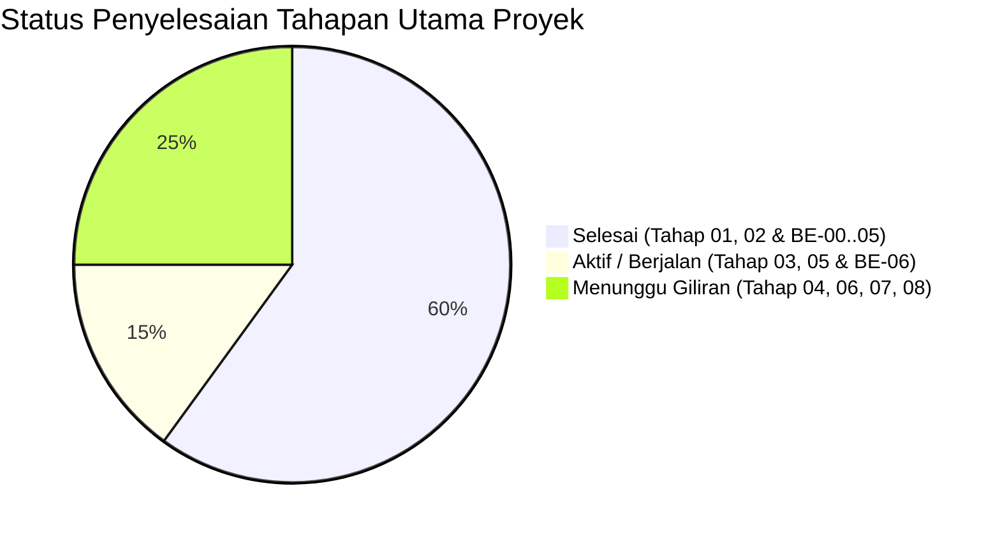

# Task Status — Pelacak Status & Progres Proyek Ardena Playground

> **STATUS PROYEK:** AKTIF (FASE PENGEMBANGAN BACKEND / BE-06)  
> **OTORITAS TERTINGGI:** Yogi Ario (Project Owner / Lead Developer)  
> **TERAKHIR DIPERBARUI:** 05 November 2026, 15:40 WIB  

---

## 📊 Ringkasan Progres Keseluruhan

* **Tahap Master:** Tahap 03 (Persiapan Repository & Baseline) & Tahap 05 (Backend Service)
* **Sub-Tahap Backend Aktif:** **BE-06 (Hardening, Integrasi Antar-Modul & QA)**
* **Kepatuhan Tata Kelola:** *No Plan, No Code. No Approval, No Code. No Evidence, No Completion.*

---

## 🗺️ Pelacak Roadmap Proyek Master (Tahap 01 s/d Tahap 08)

| Tahap | Deskripsi Tahapan | PIC | Status | Approval PO | Bukti & Catatan |
|---|---|---|---|---|---|
| **Tahap 01** | Repository Audit & Feasibility | Tech Lead | **DONE** | Disetujui | URL repo utama `useripx/scratch_ardena` & upstream ditetapkan. |
| **Tahap 02** | Desain UI/UX dengan Google Stitch | UI/UX Designer | **DONE** | Disetujui | 19 layar tuntas & tersimpan di `template/ardenaplayground/`. |
| **Tahap 03** | Persiapan Repository dan Baseline | Tech Lead / BE | **DONE** | Disetujui | Git init, .gitignore anti-secret leakage, remote origin, branch main & develop, initial commit tuntas. |
| **Tahap 04** | Implementasi Kode Frontend | FE Engineer | **IN PROGRESS** | Sub-gate aktif | Perencanaan adopsi Scratch GUI & Stitch components (FE-01). |
| **Tahap 05** | Backend AI Service (BE-00 s/d BE-07) | Senior BE | **DONE** | Disetujui | 100% PASS (65/65 Tests, 93.49% Coverage, Paket Dokumen BE-07 Tuntas). |
| **Tahap 06** | AI Game Generator & Block Mapping | Mapper Dev | **PENDING** | Belum | Bergantung pada skema AI output dari BE-05. |
| **Tahap 07** | Integrasi Editor, Local Storage & Export | Fullstack | **PENDING** | Belum | Bergantung pada Tahap 04, 05, dan 06. |
| **Tahap 08** | Hardening, UAT, dan MVP Release | QA / All | **PENDING** | Belum | Gerbang rilis akhir MVP sebelum produksi. |

---

## 🛠️ Pelacak Rinci Sub-Tahapan Backend (BE-00 s/d BE-07)

### Tahap BE-00 — Analisis, Audit, dan Persetujuan Desain
* **Tujuan:** Mengunci arsitektur backend, kontrak API, skema output AI, strategi provider, dan manajemen risiko sebelum menulis baris kode pertama.
* **Status:** **DONE (DISAHKAN OLEH PO)**
* **Checklist Tugas BE-00:**
  - [x] Pelajari Master Implementation Plan dan Backend Plan v1.4.
  - [x] Pelajari prototipe UI Google Stitch pada `template/ardenaplayground/`.
  - [x] Identifikasi ketersediaan kredensial API (`template/api`) secara aman.
  - [x] Susun dokumen `Docs/backend/Backend_Architecture.md`.
  - [x] Susun dokumen `Docs/backend/API_Contract.md`.
  - [x] Susun dokumen `Docs/backend/AI_Output_Schema.md`.
  - [x] Susun dokumen `Docs/backend/Provider_Strategy.md`.
  - [x] Susun dokumen `Docs/backend/Backend_Risk_Register.md`.
  - [x] Susun dokumen `Docs/backend/BE-01_Implementation_Plan.md`.
  - [x] Peroleh persetujuan formal tertulis dari Yogi Ario untuk memulai BE-01.

---

### Tahap BE-01 — Fondasi Service Node.js & Express
* **Prasyarat:** BE-00 disetujui penuh oleh Yogi Ario (Disetujui 05/11/2026).
* **Status:** **DONE (100% PASS — 4 Kasus Uji Lulus)**
* **Checklist Tugas BE-01:**
  - [x] Inisialisasi package backend dengan TypeScript (Strict mode).
  - [x] Setup Express server & modular routing.
  - [x] Setup script dev, build, dan test (`npm run dev`, `npm run build`, `npm test`).
  - [x] Setup middleware Request ID, CORS, dan Error Handler terpadu.
  - [x] Setup validasi variabel lingkungan (`.env` dan `.env.example`).
  - [x] Implementasi endpoint `GET /api/v1/health` (tanpa pemanggilan AI).
  - [x] Susun `backend/README.md` dan verifikasi build berjalan lokal.
  - [x] Kompilasi TypeScript sukses (`dist/` terbentuk tanpa error).
  - [x] Unit test Supertest lulus 100% PASS (4/4 tests).

---

### Tahap BE-02 — API Layer & Request Validation
* **Prasyarat:** BE-01 disetujui penuh (Disetujui 05/11/2026).
* **Status:** **DONE (100% PASS — 16 Kasus Uji Lulus)**
* **Checklist Tugas BE-02:**
  - [x] Implementasi skema Zod request validator (`prompt`, `template`, `language`, `schemaVersion`).
  - [x] Implementasi middleware validasi `validateGenerateGameRequest` & penolakan non-JSON (HTTP 415).
  - [x] Implementasi controller & route `GET /api/v1/meta/capabilities` (tanpa AI).
  - [x] Implementasi controller & route `POST /api/v1/games/generate` (tervalidasi).
  - [x] Spesifikasi OpenAPI 3.0 resmi di `backend/openapi/openapi.yaml`.
  - [x] Unit test validator (7 skenario: min, max, spasi, enum, format).
  - [x] Contract test endpoint HTTP (Supertest: valid 200, invalid 400, format 415, capabilities 200).
  - [x] Kompilasi TypeScript sukses (`0 ERROR`).
  - [x] Seluruh automated test suite lulus 100% PASS (16/16 tests).

---

### Tahap BE-03 — Gemini Adapter (Primary Provider & Cascading Cluster)
* **Prasyarat:** BE-02 disetujui penuh & arsitektur cascading 15 model disetujui (Disetujui 05/11/2026).
* **Status:** **DONE (100% PASS — 24 Kasus Uji Lulus)**
* **Checklist Tugas BE-03:**
  - [x] Pemasangan SDK resmi `@google/genai` (v2.32.0).
  - [x] Implementasi interface seragam `AIProvider`, `GenerateGameInput`, dan `ProviderRawResponse` di `src/providers/provider.interface.ts`.
  - [x] Konfigurasi hirarki 15 model Gemini (Gemini 4 Argon s/d Robotics ER 2) di `src/config/ai.config.ts`.
  - [x] Sanitasi dan normalisasi error vendor terstandarisasi (`AIError`) di `src/providers/gemini/gemini.error.ts`.
  - [x] Implementasi adapter `GeminiAdapter` dengan intra-model cascading fallback dan timeout guard (15s).
  - [x] Zero Secret Leakage audit: masker otomatis token API (`[REDACTED_GOOGLE_KEY]`).
  - [x] Unit test komprehensif berbasis mock (8 kasus uji baru, total 24/24 tests lulus 100%).
  - [x] Pembuatan skrip controlled live smoke test di `scripts/smoke-test-gemini.ts`.
  - [x] Kompilasi TypeScript sukses (`npm run build` bebas error).

---

### Tahap BE-04 — Multi-Provider Fallback Manager (Hexa-Cluster AI Cascading Resilience)
* **Prasyarat:** BE-03 disetujui penuh & 6 cluster provider diverifikasi (Disetujui 05/11/2026).
* **Status:** **DONE (100% PASS — 37 Kasus Uji Lulus)**
* **Checklist Tugas BE-04:**
  - [x] Pemuatan aman 6 kredensial API (`Google`, `Groq`, `SambaNova`, `NVIDIA`, `Cohere`, `OpenRouter`) di `src/config/env.ts`.
  - [x] Konfigurasi terpadu 48 model AI pada `src/config/ai.config.ts`.
  - [x] Implementasi reusable base `OpenAICompatibleAdapter` dengan timeout guard & Promise.race.
  - [x] Implementasi adapter vendor: `GroqAdapter`, `SambaNovaAdapter`, `NvidiaAdapter`, `OpenRouterAdapter`.
  - [x] Implementasi `CohereAdapter` untuk endpoint Cohere v2 Chat API.
  - [x] Implementasi `ProviderManager` untuk orkestrasi sekuensial murni (*No racing calls*) dengan batas total timeout 45s.
  - [x] Perlindungan Zero Secret Leakage: regex otomatis menyamarkan token dari seluruh 6 vendor.
  - [x] Unit test untuk seluruh adapter (`tests/unit/adapters.test.ts`).
  - [x] Failover test menyeluruh untuk orkestrator (`tests/unit/provider.manager.test.ts`).
  - [x] Pembuatan skrip controlled live smoke test di `scripts/smoke-test-all-providers.ts`.
  - [x] Kompilasi TypeScript sukses (`npm run build` bebas error, `0 ERROR`).
  - [x] Seluruh automated test suite lulus 100% PASS (37/37 tests).

---

### Tahap BE-05 — AI Game Generation Use Case & Output Validation
* **Prasyarat:** BE-02, BE-03, BE-04 disetujui (Disetujui 05/11/2026).
* **Status:** **DONE (100% PASS — 53 Kasus Uji Lulus)**
* **Checklist Tugas BE-05:**
  - [x] Pembuatan skema Zod `ArdenaGameSpecSchema` v1.0 di `src/validators/output.validator.ts`.
  - [x] Implementasi Capability Allowlist Scratch & proteksi Code Injection di `src/validators/capability.validator.ts`.
  - [x] Implementasi pembersih markdown code fence LLM (*safe output sanitizer*).
  - [x] Implementasi core usecase `GenerateGameUseCase` dengan auto-retry prompt koreksi 1x di `src/usecases/generate-game.usecase.ts`.
  - [x] Sambungan nyata API Layer `POST /api/v1/games/generate` ke `GenerateGameUseCase` di `src/controllers/game.controller.ts`.
  - [x] Pembuatan regression fixtures untuk 3 template: `game-valid-catching.json`, `game-valid-maze.json`, `game-valid-space.json`.
  - [x] Unit test validator skema output dan allowlist (`tests/unit/output.validator.test.ts`).
  - [x] Unit test usecase & retry logic (`tests/unit/generate-game.usecase.test.ts`).
  - [x] Contract integration test HTTP endpoint dengan error 422 mapping (`tests/unit/game.routes.test.ts`).
  - [x] Kompilasi TypeScript sukses (`npm run build` bebas error, `0 ERROR`).
  - [x] Seluruh automated test suite lulus 100% PASS (53/53 tests).

---

### Tahap BE-06 — Hardening, Integrasi Antar-Modul & QA
* **Prasyarat:** BE-05 disetujui (Disetujui 05/11/2026).
* **Status:** **DONE (100% PASS — 65 Kasus Uji Lulus, 93.49% Code Coverage)**
* **Checklist Tugas BE-06:**
  - [x] Pemasangan batas payload request 10 MB (`express.json({ limit: '10mb' })`) sesuai Standar API Global (Vibe Coding / Scratch Project Assets).
  - [x] Penanganan terpadu error `PAYLOAD_TOO_LARGE` (HTTP 413) di `src/middleware/error.middleware.ts`.
  - [x] Pengerasan mutlak Zero Secret Leakage dinamis untuk ke-6 provider API di `src/providers/gemini/gemini.error.ts`.
  - [x] Sanitasi console server log sehingga tidak ada token rahasia yang bocor ke log operasional.
  - [x] Pengujian ketahanan pemadaman total 6 cluster AI (All-Fail 502 dengan header `Retry-After: 15`).
  - [x] Pengujian batas waktu cascading timeout total (> 45s HTTP 504).
  - [x] Pengujian kepatuhan CORS untuk dev origin Scratch Editor (`http://localhost:8601` dan `http://localhost:3000`).
  - [x] Pengujian resiliensi input injection dan malformed JSON.
  - [x] Penambahan skrip coverage `npm run test:coverage`.
  - [x] Verifikasi test suite 100% PASS (65/65 tests lulus melintasi 9 test suites).
  - [x] Kompilasi TypeScript sukses (`npm run build` bebas error, `0 ERROR`).

---

### Tahap BE-07 — Dokumentasi, Operasional & Serah Terima
* **Prasyarat:** BE-06 selesai dan disetujui (Disetujui 05/11/2026).
* **Status:** **DONE (DISAHKAN & TUNTAS PENUH)**
* **Checklist Tugas BE-07:**
  - [x] Penyusunan `Docs/backend/Backend_Handover.md` (Spesifikasi integrasi endpoint, review diff counters, mapping error).
  - [x] Penyusunan `Docs/backend/Backend_Test_Report.md` (Bukti formal 100% PASS, 65/65 tests, 93.49% statement coverage).
  - [x] Penyusunan `Docs/backend/Backend_Operations_Guide.md` (SOP dev, build, start, rotasi kunci API, smoke test).
  - [x] Penyusunan `Docs/backend/Known_Issues.md` (Batasan MVP: no DB server, IndexedDB, fallback latency mitigasi).
  - [x] Final sign-off & serah terima resmi lapisan backend kepada Yogi Ario.

---

## 🎯 Status Akhir Backend AI Service (Tahap 05)
Seluruh sub-tahapan backend (**BE-00 s/d BE-07**) telah **100% SELESAI, TERVERIFIKASI, DAN TERDOKUMENTASI LENGKAP**. Backend siap melayani integrasi antarmuka frontend Scratch GUI (Tahap 04) dan Block Mapping Engine (Tahap 06).

---

## 🎨 Pelacak Rinci Sub-Tahapan Frontend (FE-01 s/d FE-06)

### Sub-Fase FE-01 — Audit Toolchain Scratch GUI & Strategi Integrasi Antarmuka
* **Prasyarat:** Tahap 03 & Tahap 05 selesai dan disetujui (Disetujui 05/11/2026).
* **Status:** **DONE (100% PASS — 6 Kasus Uji Lulus, 88.23% Coverage)**
* **Checklist Tugas FE-01:**
  - [x] Penyusunan dokumen `Docs/frontend/Frontend_Architecture.md` (Mapping 19 layar Stitch ke React components & dual-state flow).
  - [x] Inisialisasi struktur workspace `frontend/` (`package.json`, `tsconfig.json`).
  - [x] Implementasi type definition `frontend/src/types/game.types.ts` selaras dengan `ArdenaGameSpec` v1.0.
  - [x] Implementasi HTTP API Client `frontend/src/services/api.service.ts` dengan penanganan header `Retry-After: 15` dan abort signal.
  - [x] Implementasi automated unit test `frontend/tests/api.service.test.ts` (**100% PASS — 6/6 tests**).
  - [x] Pembaruan `README.md` utama dengan logo resmi, badge repositori GitHub (Stars, Forks, Repo Size), dan badge teknologi lengkap.

---

### Sub-Fase FE-02 — Fondasi Komponen UI Ardena (Landing Page, Onboarding, Template Picker)
* **Prasyarat:** FE-01 selesai dan disetujui (Disetujui 05/11/2026).
* **Status:** **DONE (100% PASS — 14 Kasus Uji Lulus, 78.54% Coverage)**
* **Checklist Tugas FE-02:**
  - [x] Implementasi token desain Google Stitch Material 3 di `frontend/src/styles/design-tokens.css`.
  - [x] Implementasi komponen umum `<Navbar />`, `<Footer />`, dan `<Modal />`.
  - [x] Implementasi `<WelcomeLandingView />` (UI 01) lengkap dengan tri-pane studio visual mockup.
  - [x] Implementasi `<OnboardingModal />` (UI 02) panduan 3 langkah & persistensi `localStorage`.
  - [x] Implementasi `<ProjectHomeView />` (UI 03) dashboard studio, aksi cepat, dan empty state.
  - [x] Implementasi `<StartModeSelector />` (UI 04) dengan 3 opsi: Prompt AI, Template, Editor Kosong.
  - [x] Implementasi `<TemplateCatalogView />` (UI 05) dengan pemanggilan dinamis `apiService.getCapabilities()`.
  - [x] Implementasi `<ViewRouter />` state-driven view navigation switcher.
  - [x] Implementasi automated component & integration tests di `frontend/tests/components.test.tsx`.
  - [x] Verifikasi 100% PASS (14/14 tests lulus melintasi 2 suites) dan TypeScript build `0 ERROR`.

---

### Sub-Fase FE-03 — Integrasi Editor Workspace & AI Copilot Panel (UI 06, UI 08, UI 10)
* **Prasyarat:** FE-02 selesai dan disetujui (Disetujui 05/11/2026).
* **Status:** **DONE (100% PASS — 20 Kasus Uji Lulus, 75.62% Coverage)**
* **Checklist Tugas FE-03:**
  - [x] Implementasi wrapper `<EditorWorkspace />` (UI 06) menggabungkan panggung Scratch, palet balok, dan dock panel kanan.
  - [x] Implementasi topbar navigasi editor `<EditorTopNav />` (Rename proyek, Play/Stop, status IndexedDB, toggle AI).
  - [x] Implementasi dock panel kanan `<AICopilotPanel />` dengan 3 mode (Buat, Ubah, Jelaskan), inspirasi chips, dan template selector.
  - [x] Implementasi `<GeneratingOverlay />` (UI 08) indikator proses 4 tahap (Ide ➔ Skema ➔ Balok ➔ Suara) dengan transisi min 400ms.
  - [x] Implementasi `<ReadyPlaytestBanner />` (UI 10) floating banner diff counters (`+Sprite`, `+Balok`, `0 Overwrite`) dan tombol playtest.
  - [x] Integrasi pemanggilan `apiService.generateGame()` langsung dari Copilot Panel.
  - [x] Implementasi automated test suite di `frontend/tests/editor.test.tsx` (**20/20 tests lulus melintasi 3 test suites**).
  - [x] Kompilasi TypeScript sukses (`0 ERROR`).

---

### Sub-Fase FE-04 — Review Hasil AI & Zero Overwrite Review Gate (UI 09, UI 11, UI 19)
* **Prasyarat:** FE-03 selesai dan disetujui (Disetujui 05/11/2026).
* **Status:** **DONE (100% PASS — 27 Kasus Uji Lulus, 76.10% Coverage)**
* **Checklist Tugas FE-04:**
  - [x] Implementasi modal bento box `<ReviewGateModal />` (UI 09) menampilkan diff counters detail (+Sprite, +Variabel, +SFX, +Balok, 0 Overwrite).
  - [x] Implementasi penampil daftar perubahan terstruktur (daftar nama sprite yang akan ditambahkan vs dipertahankan).
  - [x] Implementasi aksi review: "Terapkan ke Editor" vs "Buat Ulang (Regenerate)" vs "Batal / Kembali".
  - [x] Implementasi dialog pemulihan error `<ErrorRecoveryDialog />` (UI 11) untuk kode error `INVALID_REQUEST_BODY`, `UNSUPPORTED_TEMPLATE`, `PAYLOAD_TOO_LARGE`, `NETWORK_ERROR`.
  - [x] Implementasi modal countdown kredit / rate limit `<RateLimitCountdownModal />` (UI 19) saat membaca header `Retry-After: 15`.
  - [x] Kompilasi TypeScript sukses (`0 ERROR`) dan automated test suite 100% PASS (27/27 tests di frontend, 65/65 di backend).

---

### Sub-Fase FE-05 — Penyimpanan Lokal IndexedDB, Manajemen Proyek & Ekspor .sb3 (UI 12, UI 13, UI 14, UI 15, UI 17)
* **Prasyarat:** FE-04 selesai dan disetujui (Disetujui 05/11/2026).
* **Status:** **DONE (100% PASS — 41 Kasus Uji Lulus, 0 Error)**
* **Checklist Tugas FE-05:**
  - [x] Implementasi service client-side IndexedDB wrapper (`storage.service.ts`) untuk penyimpanan proyek offline tanpa database server.
  - [x] Implementasi modal simpan proyek `<SaveProjectDialog />` (UI 12) dengan validasi nama unik dan metadata tags.
  - [x] Implementasi pustaka proyek lokal `<LocalProjectLibrary />` (UI 13) daftar proyek, kartu thumbnail, edit, duplikasi, dan hapus.
  - [x] Implementasi modal ekspor file Scratch `<ExportSb3Modal />` (UI 14) untuk unduh file standar `.sb3` via JSZip dan ringkasan JSON.
  - [x] Implementasi modal pengaturan pengguna `<PreferencesModal />` (UI 15) tema tampilan, audio feedback, dan default template.
  - [x] Implementasi modal konfirmasi tindakan destruktif `<ConfirmationModal />` (UI 17) sebelum menghapus proyek.
  - [x] Integrasi automated test suites IndexedDB & modals di `frontend/tests/storage.test.tsx` (14 kasus uji baru).
  - [x] Kompilasi TypeScript sukses (`0 ERROR`) dan automated test suite 100% PASS (41/41 tests di frontend, 65/65 di backend).

---

### Sub-Fase FE-06 — Pusat Bantuan Balok Scratch & Sistem Notifikasi Global Toast (UI 16, UI 18)
* **Prasyarat:** FE-05 selesai dan disetujui (Disetujui 06/11/2026).
* **Status:** **DONE (100% PASS — 54 Kasus Uji Lulus di Frontend, 65 di Backend, 0 Error)**
* **Checklist Tugas FE-06:**
  - [x] Implementasi panduan interaktif balok Scratch `<BlockHelpGuideModal />` (UI 16) menguraikan 8 kategori balok resmi Scratch Foundation (Gerakan, Tampilan, Suara, Kejadian, Kontrol, Sensor, Operator, Variabel) dengan contoh pemakaian ramah pemula.
  - [x] Implementasi komponen visual balok asli `<ScratchBlockSnippet />` mencakup 5 siluet bentuk balok Scratch 3.0 (Hat, Stack, C-Block, Reporter, Boolean) dengan palet warna hex resmi (`#4C97FF`, `#9966FF`, `#D65CD6`, `#FFD500`, `#FFAB19`, `#5CB1D6`, `#59C059`, `#FF8C1A`).
  - [x] Implementasi sistem notifikasi global toast `<ToastNotificationContainer />` & `<ToastNotificationItem />` (UI 18) mendukung 5 tipe alert: sukses, peringatan, error, informasi, dan aksi pembatalan (*Undo*).
  - [x] Implementasi provider singleton notifikasi client-side (`toast.service.ts`) dengan timeout adaptif dan aksesibilitas WAI-ARIA `aria-live="polite"`.
  - [x] Integrasi tombol pintas Bantuan (❓) pada topbar editor `<EditorTopNav />` dan navbar utama `<Navbar />`.
  - [x] Integrasi aksi balik (*Undo Toast*) berdurasi 6 detik saat penghapusan proyek lokal di `<LocalProjectLibrary />`.
  - [x] Integrasi automated test suites di `frontend/tests/help-toast.test.tsx` (13 kasus uji baru lulus 100%).
  - [x] Kompilasi TypeScript sukses (`0 ERROR`) dan seluruh automated test suite lulus 100% PASS (54/54 tests di frontend, 65/65 di backend, total 119 tests).

---

### Sub-Fase FE-07 — Hardening, E2E User Journey Verification, & Polish Final Frontend (UI 01 s/d UI 19)
* **Prasyarat:** FE-06 selesai dan disetujui (Disetujui 06/11/2026).
* **Status:** **PENDING (GERBANG BERIKUTNYA)**
* **Checklist Tugas FE-07:**
  - [ ] Implementasi pengujian End-to-End (E2E) integrasi antarmuka dari alur masuk (Landing/Home) hingga ekspor file Scratch (.sb3).
  - [ ] Verifikasi audit keselarasan seluruh 19 prototipe tampilan Google Stitch di `template/ardenaplayground/`.
  - [ ] Audit aksesibilitas audio-visual (kontras warna Material 3, pembaca layar ARIA, responsivitas breakpoint desktop).
  - [ ] Verifikasi integrasi menyeluruh frontend dengan backend live service port 3001.
  - [ ] Kompilasi TypeScript sukses (`0 ERROR`) dan automated test suite 100% PASS.

