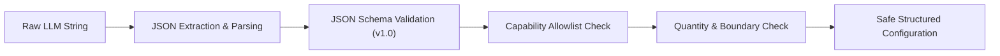

# AI Output Schema & Capability Allowlist — Ardena Playground

> **STATUS:** BASELINE SPECIFICATION (BE-00)  
> **SCHEMA VERSION:** `1.0`  
> **OTORITAS PENYETUJU:** Yogi Ario (Project Owner)  
> **PRINSIP:** *Untrusted Data, Strict Validation, Zero Arbitrary Code Execution*  

---

## 1. Filosofi & Alur Validasi

Output dari provider LLM (baik Gemini maupun Groq) diperlakukan sebagai **data tidak tepercaya**. Keberhasilan status HTTP 200 dari provider tidak menjamin data aman atau kompatibel dengan Scratch AST.



Jika ada tahapan validasi yang gagal, data **DITOLAK SECARA AMAN** dan sistem tidak akan meneruskan konfigurasi tersebut ke modul Block Mapper.

---

## 2. Struktur JSON Schema `v1.0`

Berikut adalah skema validasi resmi untuk konfigurasi game hasil AI:

```json
{
  "$schema": "http://json-schema.org/draft-07/schema#",
  "title": "ArdenaGameConfiguration",
  "type": "object",
  "required": ["schemaVersion", "game", "delta", "objects", "variables", "rules", "controls"],
  "properties": {
    "schemaVersion": {
      "type": "string",
      "enum": ["1.0"]
    },
    "game": {
      "type": "object",
      "required": ["title", "genre", "description"],
      "properties": {
        "title": { "type": "string", "maxLength": 60 },
        "genre": { "type": "string", "enum": ["catching-game", "maze-game", "space-shooter", "custom"] },
        "description": { "type": "string", "maxLength": 250 }
      }
    },
    "delta": {
      "type": "object",
      "required": ["newSpritesCount", "globalVariablesCount", "sfxCount", "logicBlocksCount", "overwrittenBlocksCount"],
      "properties": {
        "newSpritesCount": { "type": "integer", "minimum": 0, "maximum": 5 },
        "globalVariablesCount": { "type": "integer", "minimum": 0, "maximum": 5 },
        "sfxCount": { "type": "integer", "minimum": 0, "maximum": 5 },
        "logicBlocksCount": { "type": "integer", "minimum": 0, "maximum": 50 },
        "overwrittenBlocksCount": { "type": "integer", "enum": [0] }
      }
    },
    "objects": {
      "type": "array",
      "maxItems": 5,
      "items": {
        "type": "object",
        "required": ["id", "name", "role", "initialPosition"],
        "properties": {
          "id": { "type": "string", "pattern": "^[a-z0-9_]+$" },
          "name": { "type": "string", "maxLength": 30 },
          "role": { "type": "string", "enum": ["player", "obstacle", "collectible", "projectile", "goal"] },
          "initialPosition": {
            "type": "object",
            "required": ["x", "y"],
            "properties": {
              "x": { "type": "number", "minimum": -240, "maximum": 240 },
              "y": { "type": "number", "minimum": -180, "maximum": 180 }
            }
          },
          "costumes": { "type": "array", "items": { "type": "string" }, "maxItems": 3 }
        }
      }
    },
    "variables": {
      "type": "array",
      "maxItems": 5,
      "items": {
        "type": "object",
        "required": ["name", "type", "initialValue"],
        "properties": {
          "name": { "type": "string", "pattern": "^[a-z0-9_]+$", "maxLength": 20 },
          "type": { "type": "string", "enum": ["global", "local"] },
          "initialValue": { "type": "number" }
        }
      }
    },
    "rules": {
      "type": "array",
      "maxItems": 15,
      "items": {
        "type": "object",
        "required": ["event", "action"],
        "properties": {
          "event": { 
            "type": "string", 
            "enum": ["when_flag_clicked", "collision_detected", "timer_expired", "key_pressed"] 
          },
          "actor": { "type": "string" },
          "target": { "type": "string" },
          "action": { 
            "type": "string", 
            "enum": [
              "move_continuous", 
              "spawn_repeatedly", 
              "bounce_on_edge", 
              "play_sound_and_decrease_health", 
              "play_sound_and_increase_score", 
              "game_over", 
              "win_game"
            ] 
          },
          "sfx": { "type": "string", "enum": ["pop.wav", "chomp.wav", "explosion.wav", "laser.wav", "win.wav"] },
          "variableChange": {
            "type": "object",
            "properties": {
              "name": { "type": "string" },
              "amount": { "type": "number" }
            }
          }
        }
      }
    },
    "controls": {
      "type": "array",
      "maxItems": 6,
      "items": {
        "type": "object",
        "required": ["key", "action", "value"],
        "properties": {
          "key": { "type": "string", "enum": ["arrow_left", "arrow_right", "arrow_up", "arrow_down", "space", "mouse_x"] },
          "action": { "type": "string", "enum": ["move_x", "move_y", "shoot_laser"] },
          "value": { "type": "number" }
        }
      }
    }
  }
}
```

---

## 3. Capability Allowlist Berdasarkan 3 Template MVP

### A. Template 1: `catching-game`
* **Peran Karakter yang Diizinkan:** `player` (keranjang/penangkap), `collectible` (buah/koin jatuh), `obstacle` (bom/batu).
* **Kontrol yang Diizinkan:** `arrow_left`, `arrow_right`, `mouse_x`.
* **Opcode Scratch AST yang Didukung:**
  * `motion_setx`, `motion_changexby`
  * `motion_sety`, `motion_changeyby`
  * `sensing_touchingobject`
  * `data_changevariableby` (skor)
  * `sound_playuntildone` (`pop.wav`, `chomp.wav`)
  * `operator_random` (posisi spawn X: -200 s/d 200)

### B. Template 2: `maze-game`
* **Peran Karakter yang Diizinkan:** `player` (tikus/karakter labirin), `goal` (keju/garis finish).
* **Kontrol yang Diizinkan:** `arrow_up`, `arrow_down`, `arrow_left`, `arrow_right`.
* **Opcode Scratch AST yang Didukung:**
  * `motion_changexby`, `motion_changeyby`
  * `sensing_touchingcolor` (dinding labirin warna `#0000FF`)
  * `sensing_touchingobject` (goal)
  * `control_stop` (stop all / win game)
  * `looks_switchbackdropto` (layar menang)

### C. Template 3: `space-shooter`
* **Peran Karakter yang Diizinkan:** `player` (pesawat tempur), `projectile` (laser), `obstacle` (asteroid/musuh).
* **Kontrol yang Diizinkan:** `arrow_left`, `arrow_right`, `space` (tembak laser).
* **Opcode Scratch AST yang Didukung:**
  * `control_create_clone_of` (`projectile`, `obstacle`)
  * `control_start_as_clone`
  * `control_delete_this_clone`
  * `motion_changeyby` (laser bergerak ke atas, asteroid ke bawah)
  * `sensing_touchingobject` (laser menabrak asteroid / asteroid menabrak pesawat)
  * `data_changevariableby` (nyawa -1, skor +10)
  * `sound_play` (`laser.wav`, `explosion.wav`)

---

## 4. Batasan Keras & Penjaga Keamanan (Security Guardrails)

1. **Zero Overwrite Enforced:** Field `delta.overwrittenBlocksCount` wajib bernilai `0`. Generator Scratch hanya menginjeksi blok baru tanpa menimpa logika yang sudah dirancang pengguna.
2. **Kuantitas Terkendali:** Maksimal 5 sprite baru, 5 variabel, dan 15 aturan game dalam satu kali instruksi untuk mencegah beban memori berlebih pada Scratch VM.
3. **No Arbitrary Script Injection:** Seluruh nilai atribut adalah nilai skalar (string enum, angka, boolean). Backend secara tegas menolak blok kode JavaScript (`function()`, `eval()`, atau script tag).

