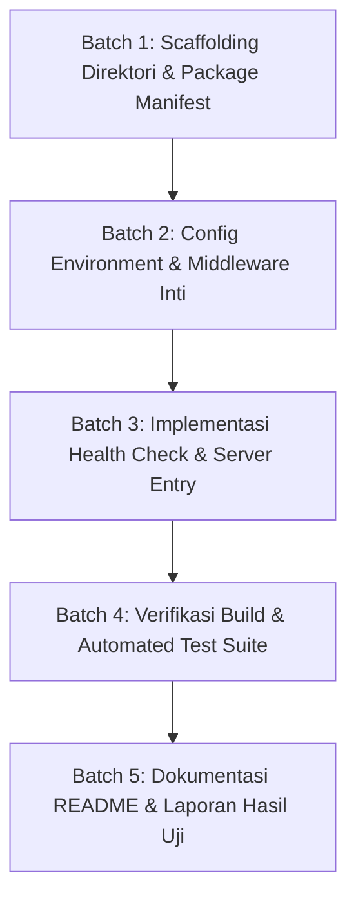

# Implementation Plan — Tahap BE-01: Fondasi Service Node.js & Express

> **TAHAP:** BE-01 (Fondasi Backend Node.js, Express, dan TypeScript)  
> **DOKUMEN INDUK:** `Docs/Implementation_Plan.md` & `Docs/backend/Backend_Architecture.md`  
> **STATUS:** MENUNGGU REVIEW & KOMENTAR DARI YOGI ARIO (APPROVAL GATE)  
> **OTORITAS PENYETUJU:** Yogi Ario (Project Owner / Lead Developer)  
> **PRINSIP:** *No Plan, No Code. No Approval, No Code. No Evidence, No Completion.*  

---

## 1. Tujuan & Ruang Lingkup

### 1.1 Tujuan Tahap BE-01
Membangun fondasi dasar (*skeleton service*) backend Ardena Playground berbasis **Node.js LTS, Express, dan TypeScript** dalam pola arsitektur **Modular Monolith** yang dapat dijalankan secara lokal (`npm run dev`), bersih dari ketergantungan Laragon, memiliki tata kelola environment yang aman, serta menyediakan endpoint pemeriksaan kesehatan (*health check*) yang berfungsi tanpa biaya AI.

### 1.2 Ruang Lingkup Pekerjaan (In-Scope):
1. Inisialisasi direktori mandiri `backend/` di root workspace proyek.
2. Konfigurasi `package.json` dan dependensi minimal yang aman dan stabil.
3. Konfigurasi `tsconfig.json` dengan mode ketat (*strict mode*).
4. Pembuatan template variabel lingkungan (`backend/.env.example`) dan `.gitignore` khusus backend.
5. Pembuatan sistem validasi konfigurasi startup (`src/config/env.ts`).
6. Pembuatan middleware inti:
   - `request-id.middleware.ts`: Menghasilkan atau meneruskan UUID `X-Request-ID`.
   - `cors.middleware.ts`: Mengatur whitelist origin frontend Scratch Editor.
   - `error.middleware.ts`: Penanganan error global aman tanpa kebocoran stack trace.
7. Implementasi endpoint `GET /api/v1/health` dan controller terkait.
8. Pembuatan script eksekusi development, build, dan test (`dev`, `build`, `start`, `test`).
9. Pembuatan unit test untuk health check dan verifikasi build 100% PASS.
10. Pembuatan panduan pengoperasian awal di `backend/README.md`.

### 1.3 Di Luar Ruang Lingkup (Out-of-Scope untuk BE-01):
- ❌ **TIDAK** ada pemanggilan atau koneksi langsung ke API Gemini atau Groq live (dikerjakan pada BE-03 & BE-04).
- ❌ **TIDAK** ada implementasi use case pembuatan game `/api/v1/games/generate` (dikerjakan pada BE-02 & BE-05).
- ❌ **TIDAK** ada penambahan database server (MySQL/PostgreSQL/MongoDB) sesuai ADR-005.

### 1.4 Penyelarasan dengan Ekosistem `https://github.com/scratchfoundation`
Backend dirancang dengan pemahaman penuh terhadap ekosistem resmi Scratch Foundation:
1. **Monorepo Acuan (`scratchfoundation/scratch-editor`):** Fondasi editor menggunakan monorepo resmi Scratch Foundation yang memuat paket `@scratch/scratch-gui`, `@scratch/scratch-vm`, `@scratch/scratch-blocks`, dan `@scratch/scratch-render`.
2. **Pola Dua Proses Terpisah (*Decoupled Two-Process Architecture*):**
   - *Proses 1:* Scratch Editor berjalan di server development bawaannya (Webpack pada port resmi Scratch, misal `http://localhost:8601`).
   - *Proses 2:* Backend Express berjalan di Node.js mandiri pada port `3001`.
3. **Konfigurasi CORS di BE-01:** Middleware CORS backend wajib mengizinkan origin development Scratch Editor (`http://localhost:8601` dan `http://localhost:3000`) agar panel AI Copilot di frontend dapat berkomunikasi tanpa kendala *browser security*.
4. **Isolasi Toolchain Total:** Backend dibuat di folder mandiri `backend/` dengan TypeScript dan toolchain terpisah agar **sama sekali tidak mengutak-atik, merusak, atau memaksa migrasi toolchain Webpack/React asli bawaan Scratch Foundation**.
5. **Kesesuaian Target Data untuk Scratch VM:** Kontrak dan struktur data yang disiapkan backend ditujukan untuk diterjemahkan oleh Block Mapper ke dalam representasi opcode balok asli Scratch 3.0 AST (bukan kode JS bebas).

---

## 2. Analisis Kondisi Saat Ini (*Current State*)

* **Root Workspace:** Berisi folder `aturan/`, `Docs/`, `changelog/`, dan `template/`.
* **Folder Backend:** Belum dibuat (`backend/` belum ada secara fisik).
* **Lingkungan Runtime:** Node.js LTS tersedia di lingkungan sistem pengguna.
* **Kredensial:** Kunci API Google & Groq tersimpan aman di `template/api` (berstatus offline/statis dan belum disentuh).

---

## 3. Daftar Berkas Target yang Akan Dibuat

Seluruh berkas baru akan dibuat di dalam direktori `backend/`:

| Path Berkas | Peran & Fungsi Berkas |
|---|---|
| `backend/package.json` | Manifest dependensi, scripts (`dev`, `build`, `start`, `test`), metadata proyek. |
| `backend/tsconfig.json` | Konfigurasi kompilator TypeScript (`target: es2022`, `module: commonjs/nodenext`, `strict: true`). |
| `backend/.env.example` | Template variabel lingkungan tanpa nilai rahasia (placeholder publik). |
| `backend/.gitignore` | Isolasi direktori backend (`node_modules/`, `dist/`, `.env`, coverage log). |
| `backend/src/server.ts` | Entry point proses HTTP listener dan penanganan *graceful shutdown* (`SIGTERM`/`SIGINT`). |
| `backend/src/app.ts` | Konfigurasi Express app, pemasangan middleware global, dan pendaftaran routes. |
| `backend/src/config/env.ts` | Validasi tipe variabel lingkungan saat startup server (fail-fast jika env rusak). |
| `backend/src/routes/health.routes.ts` | Definisi route `GET /api/v1/health`. |
| `backend/src/controllers/health.controller.ts` | Controller respons status server, uptime, dan timestamp. |
| `backend/src/middleware/request-id.middleware.ts` | Pembangkit `X-Request-ID` untuk penelusuran request per siklus. |
| `backend/src/middleware/cors.middleware.ts` | Pengendali CORS untuk domain frontend development. |
| `backend/src/middleware/error.middleware.ts` | Format penyeragaman respons error 500 aman. |
| `backend/tests/unit/health.test.ts` | Unit test otomatis endpoint health check (Supertest / Jest). |
| `backend/README.md` | Panduan langkah-demi-langkah menjalankan backend secara lokal. |

---

## 4. Daftar Dependensi yang Diusulkan (*Lean & Minimal*)

Sesuai **Pilar 7 (Lean Architecture)**, hanya pustaka yang benar-benar esensial yang akan dipasang:

### Dependensi Produksi (`dependencies`):
1. `express` (^4.19.x atau ^4.21.x): HTTP micro-framework minimalis.
2. `cors` (^2.8.x): Penanganan Cross-Origin Resource Sharing.
3. `dotenv` (^16.4.x): Pemuat variabel lingkungan dari `.env` ke `process.env`.
4. `uuid` (^9.x atau ^10.x): Pembangkit UUID v4 untuk `X-Request-ID`.

### Dependensi Pengembangan (`devDependencies`):
1. `typescript` (^5.x): Kompilator TypeScript.
2. `@types/node`, `@types/express`, `@types/cors`, `@types/uuid`: Definisi tipe data statis.
3. `ts-node-dev` (^2.0.x): Eksekusi live reload TypeScript saat development.
4. `jest` & `ts-jest` & `@types/jest`: Test runner pengujian otomatis.
5. `supertest` & `@types/supertest`: HTTP assertion testing tanpa membuka port jaringan sungguhan.

---

## 5. Rencana Langkah Kerja Bertahap (*Execution Batches*)

### Batch 1: Inisialisasi Direktori & Manifest Proyek
* Membuat struktur folder `backend/` beserta subfolder `src/`, `tests/`, `dist/`.
* Menulis `package.json`, `tsconfig.json`, `.gitignore`, dan `.env.example`.

### Batch 2: Environment Configuration & Middleware
* Mengimplementasikan `src/config/env.ts` untuk memverifikasi `PORT` dan `NODE_ENV`.
* Mengimplementasikan middleware `request-id`, `cors`, dan global safe `error.middleware`.

### Batch 3: Health Check Route & Server Setup
* Mengimplementasikan `src/controllers/health.controller.ts` dan `src/routes/health.routes.ts`.
* Menyatukan middleware dan routes ke dalam `src/app.ts`.
* Membuat `src/server.ts` yang mendengarkan port dari env (default `3001`).

### Batch 4: Verifikasi Otomatis (Build & Testing)
* Menulis unit test di `tests/unit/health.test.ts`.
* Menjalankan `npm run build` untuk memverifikasi tidak ada error tipe data TypeScript.
* Menjalankan `npm test` untuk memverifikasi endpoint mengembalikan `HTTP 200` dengan payload yang benar (Target: 100% PASS).

### Batch 5: Dokumentasi & Pelaporan
* Menulis `backend/README.md`.
* Memperbarui `Docs/Task_Status.md` dan `Docs/Decision_Log.md`.
* Mencatat ringkasan ke changelog bertimestamp flat.

---

## 6. Rencana Pengujian & Kriteria Keberhasilan (*Definition of Done*)

Sesuai **Pilar 6 (100% Automated Testing Gate)**:

| Uji yang Dilakukan | Kasus Uji | Ekspektasi Hasil |
|---|---|---|
| **TypeScript Compilation** | Menjalankan `npm run build` | Sukses kompilasi `0 ERROR`, berkas JavaScript terbentuk di `backend/dist/`. |
| **Health Check HTTP Status** | `GET /api/v1/health` via Supertest | Status `HTTP 200 OK`. |
| **Health Check Payload** | Memeriksa body response | Mengandung `{ status: "healthy", version: "1.0.0", uptimeSeconds: ..., timestamp: ... }`. |
| **Request ID Header** | Memeriksa response headers | Mengandung header `X-Request-ID` dengan format UUID yang valid. |
| **404 Not Found Handling** | `GET /api/v1/rute-acak-tidak-ada` | Mengembalikan status `HTTP 404` dengan format JSON aman tanpa stack trace. |

**Target Kelulusan:** `HASIL: 100% PASS (0 GAGAL / 0 ERROR)`.

---

## 7. Analisis Risiko & Mitigasi

1. **Risiko Konflik Port:** Port `3001` mungkin sedang digunakan oleh aplikasi lain di Windows.
   * *Mitigasi:* Konfigurasi port bersifat dinamis melalui variabel `PORT` di `.env`, dengan fallback aman.
2. **Risiko Kebocoran Secret:**
   * *Mitigasi:* Tidak ada variabel API key yang diwajibkan untuk BE-01. File `.env` lokal backend langsung di-ignore oleh Git.
3. **Risiko Modifikasi Toolchain Scratch:**
   * *Mitigasi:* Seluruh berkas dibuat strictly di dalam direktori mandiri `backend/` tanpa mengubah satu pun file di luar direktori tersebut.

---

## 8. Pertanyaan Review untuk Yogi Ario (Project Owner)

Silakan tinjau poin-poin di atas. Apakah ada catatan, komentar, atau koreksi terkait:
1. **Pilihan Test Runner:** Apakah Anda setuju menggunakan **Jest + Supertest** untuk suite unit testing backend?
2. **Pilihan Port Default:** Apakah port default **3001** sudah sesuai untuk environment pengembangan backend Anda?
3. **Struktur Folder:** Apakah struktur target `backend/src/` sudah sesuai dengan preferensi Anda?

