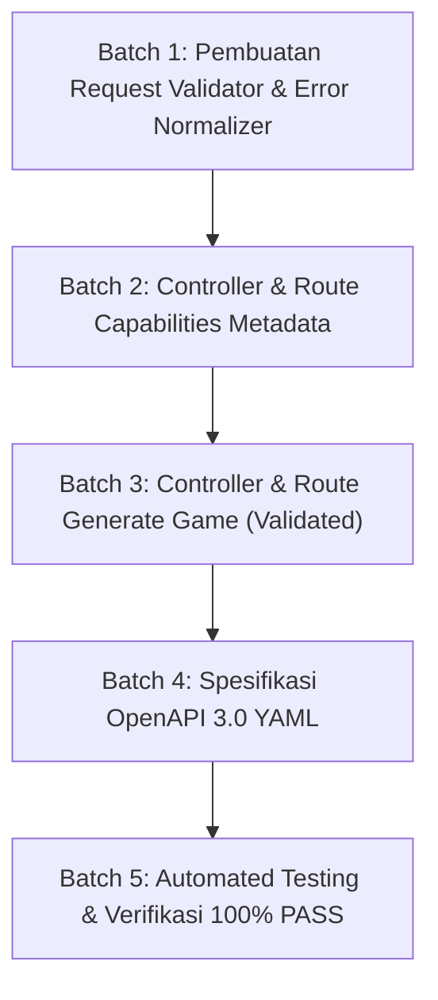

# Implementation Plan — Tahap BE-02: API Layer & Request Validation

> **TAHAP:** BE-02 (Lapisan HTTP, Validasi Request, dan Metadata Capabilities)  
> **DOKUMEN INDUK:** `Docs/Implementation_Plan.md`, `Docs/backend/API_Contract.md`, `Docs/backend/Backend_Architecture.md`  
> **STATUS:** MENUNGGU REVIEW & KOMENTAR DARI YOGI ARIO (APPROVAL GATE)  
> **OTORITAS PENYETUJU:** Yogi Ario (Project Owner / Lead Developer)  
> **PRINSIP:** *No Plan, No Code. No Approval, No Code. No Evidence, No Completion.*  

---

## 1. Tujuan & Ruang Lingkup

### 1.1 Tujuan Tahap BE-02
Membangun lapisan HTTP API yang kokoh dan tervalidasi (*robust API Layer*) pada backend Express TypeScript, mencakup validasi ketat terhadap input client sebelum diteruskan ke use case bisnis atau AI Provider, penolakan otomatis request yang tidak memenuhi syarat (*fail-fast validation*), penyediaan endpoint metadata kapabilitas Scratch, dan penerbitan spesifikasi resmi **OpenAPI 3.0**.

### 1.2 Ruang Lingkup Pekerjaan (In-Scope):
1. **Request Validation Layer (`src/validators/request.validator.ts`):**
   - Validasi body `POST /api/v1/games/generate`:
     - `prompt`: String, wajib, min 5 karakter, max 500 karakter (toleransi sistem 1.000 karakter), tidak boleh hanya spasi/whitespace.
     - `template`: Enum valid (`"catching-game"`, `"maze-game"`, `"space-shooter"`, `"custom"`).
     - `language`: Enum valid (`"id"`, `"en"`), default `"id"`.
     - `schemaVersion`: String, wajib, harus `"1.0"`.
2. **Payload Protection & Content-Type Middleware:**
   - Memastikan `Content-Type: application/json` pada request ber-body.
   - Penolakan payload yang melebihi batas ukuran 1 MB (HTTP 413 `PAYLOAD_TOO_LARGE`).
3. **Standarisasi Respons Error (Consistent Error Formatting):**
   - Format response error seragam: `{ success: false, error: { code, message, retryable, details }, meta: { requestId } }`.
   - Error code resmi: `INVALID_REQUEST_BODY` (400), `UNSUPPORTED_MEDIA_TYPE` (415), `PAYLOAD_TOO_LARGE` (413).
4. **Implementasi Endpoint Metadata Capabilities:**
   - Endpoint `GET /api/v1/meta/capabilities`.
   - Mengembalikan daftar template Scratch aktif, batas panjang prompt, dan versi skema yang didukung (tanpa biaya AI).
5. **Implementasi Routing & Controller Endpoint Generate (Stub/Validation Stage):**
   - Endpoint `POST /api/v1/games/generate`.
   - Menerima dan memvalidasi input client secara ketat. Jika valid, mengembalikan respons terstruktur tervalidasi (data stub yang sesuai kontrak sampai provider live dihubungkan di BE-03 s/d BE-05). Jika invalid, mengembalikan HTTP 400 dengan detail field yang salah.
6. **Dokumentasi Kontrak OpenAPI 3.0 (`backend/openapi/openapi.yaml`):**
   - Mendokumentasikan `/health`, `/meta/capabilities`, dan `/games/generate` dalam format OpenAPI 3.0 yang sinkron dengan `Docs/backend/API_Contract.md`.
7. **Pengujian Otomatis (Unit & Contract Test):**
   - Unit test request validator (input valid vs invalid).
   - Integration & contract test endpoint `/games/generate` dan `/meta/capabilities`.
   - Target: 100% PASS.

### 1.3 Di Luar Ruang Lingkup (Out-of-Scope untuk BE-02):
- ❌ **TIDAK** ada pemanggilan API langsung ke Gemini SDK atau Groq SDK (dikerjakan pada BE-03 dan BE-04).
- ❌ **TIDAK** ada parsing atau validasi respons output LLM (dikerjakan pada BE-05).
- ❌ **TIDAK** ada manipulasi frontend Scratch GUI (dikerjakan pada Tahap 04).

---

## 2. Analisis Kondisi Saat Ini (*Current State*)

* **Backend Baseline:** Tahap BE-01 telah selesai dengan status 100% PASS (`GET /api/v1/health` berfungsi, middleware request ID & CORS aktif).
* **Kontrak API:** Telah disepakati pada dokumen `Docs/backend/API_Contract.md`.
* **Penyelarasan UI:** Batas panjang prompt (500 karakter) dan 3 template MVP (*Catching*, *Maze*, *Space Shooter*) telah terverifikasi dari prototipe UI Google Stitch.

---

## 3. Daftar Berkas Target yang Akan Dibuat / Dimodifikasi

| Path Berkas | Status | Peran & Fungsi Berkas |
|---|---|---|
| `backend/src/validators/request.validator.ts` | **BARU** | Skema dan fungsi validasi input client (`prompt`, `template`, `language`, `schemaVersion`). |
| `backend/src/controllers/game.controller.ts` | **BARU** | Controller untuk menangani endpoint `POST /api/v1/games/generate`. |
| `backend/src/controllers/meta.controller.ts` | **BARU** | Controller untuk menangani endpoint `GET /api/v1/meta/capabilities`. |
| `backend/src/routes/game.routes.ts` | **BARU** | Definisi route `POST /games/generate` dengan middleware validasi. |
| `backend/src/routes/meta.routes.ts` | **BARU** | Definisi route `GET /meta/capabilities`. |
| `backend/openapi/openapi.yaml` | **BARU** | Spesifikasi resmi OpenAPI 3.0 untuk seluruh endpoint MVP. |
| `backend/src/app.ts` | **MODIFIKASI** | Mendaftarkan routes `game.routes.ts` dan `meta.routes.ts` ke dalam instance Express. |
| `backend/tests/unit/validator.test.ts` | **BARU** | Unit test pengujian berbagai skenario input valid dan invalid. |
| `backend/tests/unit/game.routes.test.ts` | **BARU** | Contract & integration test HTTP untuk endpoint `/games/generate` dan `/meta/capabilities`. |

---

## 4. Rencana Langkah Kerja Bertahap (*Execution Batches*)

### Batch 1: Request Validator & Error Normalizer
* Menyusun `src/validators/request.validator.ts` menggunakan skema pengecekan ketat tanpa dependensi berlebih (menggunakan Zod atau pengecekan tipe fungsional murni TypeScript).
* Menguji penolakan whitespace prompt, template asing, prompt < 5 atau > 1.000 karakter, dan format data non-JSON.

### Batch 2: Metadata Capabilities Endpoint
* Mengimplementasikan `src/controllers/meta.controller.ts` dan `src/routes/meta.routes.ts`.
* Mendaftarkan rute `GET /api/v1/meta/capabilities`.

### Batch 3: Generate Game Route & Controller
* Mengimplementasikan `src/controllers/game.controller.ts` dan `src/routes/game.routes.ts`.
* Memasang middleware `validateGenerateGameRequest` sebelum controller dieksekusi.
* Memastikan request invalid langsung ditolak dengan status HTTP 400 dan kode error `INVALID_REQUEST_BODY` tanpa membuang sumber daya komputasi.

### Batch 4: Spesifikasi OpenAPI 3.0
* Menulis berkas `backend/openapi/openapi.yaml` yang mendefinisikan skema request body, parameter query, respons sukses 200, dan skema error 400/413/415/500.

### Batch 5: Automated Test Suite & Pelaporan
* Menulis pengujian unit dan integrasi di `tests/unit/validator.test.ts` dan `tests/unit/game.routes.test.ts`.
* Menjalankan `npm test` dan memastikan seluruh suite (health test + game validator test + meta test) berstatus **100% PASS**.
* Menjalankan `npm run build` untuk memverifikasi kompilasi TypeScript bebas error.
* Memperbarui `Docs/Task_Status.md` dan changelog.

---

## 5. Rencana Pengujian & Kriteria Keberhasilan (*Definition of Done*)

Sesuai **Pilar 6 (100% Automated Testing Gate)**:

| Skenario Pengujian | Input Request | Ekspektasi Status HTTP | Ekspektasi Body / Header |
|---|---|---|---|
| **Input Valid Lengkap** | Prompt 50 karakter, template `"catching-game"` | `HTTP 200 OK` | `success: true`, payload game terstruktur, header `X-Request-ID`. |
| **Input Valid Minimal** | Prompt valid, tanpa field `language` | `HTTP 200 OK` | Default language `"id"`. |
| **Prompt Terlalu Pendek** | `"hai"` (< 5 karakter) | `HTTP 400 Bad Request` | `code: "INVALID_REQUEST_BODY"`, field error `prompt`. |
| **Prompt Hanya Spasi** | `"     "` (whitespace only) | `HTTP 400 Bad Request` | `code: "INVALID_REQUEST_BODY"`. |
| **Prompt Terlalu Panjang** | > 1.000 karakter | `HTTP 400 Bad Request` | `code: "INVALID_REQUEST_BODY"`. |
| **Template Tidak Dikenal** | `template: "game-balapan-liar"` | `HTTP 400 Bad Request` | `code: "INVALID_REQUEST_BODY"`, daftar template didukung. |
| **SchemaVersion Salah** | `schemaVersion: "9.9"` | `HTTP 400 Bad Request` | `code: "INVALID_REQUEST_BODY"`. |
| **Payload Bukan JSON** | `Content-Type: text/plain` | `HTTP 415 / 400` | Format error aman tanpa stack trace. |
| **Capabilities Metadata** | `GET /api/v1/meta/capabilities` | `HTTP 200 OK` | Memuat 3 template MVP, maxPromptLength, schemaVersion. |

**Target Kelulusan:** `HASIL: 100% PASS (0 GAGAL / 0 ERROR)`.

---

## 6. Pertanyaan Review untuk Yogi Ario (Project Owner)

Silakan periksa rencana di atas dan beri masukan pada poin-poin berikut:
1. **Pilihan Pustaka Validasi:** Apakah Anda menyukai validasi menggunakan pustaka **Zod** (populer, type-safe, dan ekosistem TypeScript standar) atau **validasi fungsional murni/kustom** tanpa dependensi luar tambahan?
2. **Batas Toleransi Prompt:** Apakah batas prompt **maksimal 500 karakter** (sesuai UI Google Stitch) dengan toleransi batas keras backend **1.000 karakter** sudah disetujui?
3. **Endpoint Metadata:** Apakah format metadata capabilities di `GET /api/v1/meta/capabilities` sudah sesuai dengan kebutuhan integrasi frontend?

