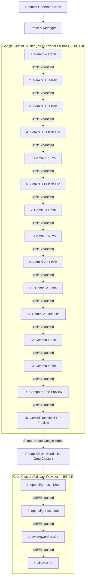
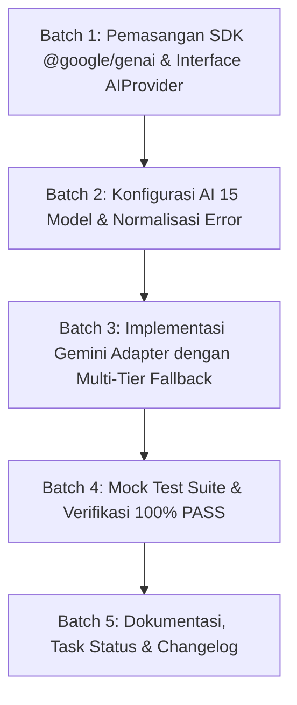

# Implementation Plan — Tahap BE-03: Gemini Adapter (Primary AI Provider)

> **TAHAP:** BE-03 (Integrasi Terisolasi Provider Utama: Google Gemini Cluster)  
> **DOKUMEN INDUK:** `Docs/Implementation_Plan.md`, `Docs/backend/Provider_Strategy.md`, `Docs/backend/Backend_Architecture.md`  
> **STATUS:** MENUNGGU PERSETUJUAN AKHIR DARI YOGI ARIO (APPROVAL GATE)  
> **OTORITAS PENYETUJU:** Yogi Ario (Project Owner / Lead Developer)  
> **PRINSIP:** *No Plan, No Code. No Approval, No Code. No Evidence, No Completion.*  

---

## 1. Tujuan & Ruang Lingkup

### 1.1 Tujuan Tahap BE-03
Membangun adapter terisolasi untuk **Google Gemini** sebagai provider AI utama pada backend Ardena Playground dengan arsitektur **Multi-Tier Cascading Fallback** sesuai urutan 15 model yang ditentukan oleh Yogi Ario. Adapter ini mengimplementasikan interface umum `AIProvider`, mengelola transisi otomatis antar model intra-Google saat kuota/rate-limit habis, menerapkan batas timeout lokal (15 detik), menormalisasi error vendor ke kode internal yang aman, serta menyediakan pengujian unit berbasis **Mock Test (Zero API Quota)** sehingga seluruh test suite dapat berjalan 100% tanpa mengonsumsi kuota API berbayar.

---

### 1.2 Skema AI Bertingkat (*Cascading Fallback Architecture*)

Sesuai arahan Yogi Ario:

---

### 1.3 Daftar Model Google Gemini (BE-03)
Adapter Gemini akan mengiterasi model-model berikut secara berurutan saat mendeteksi HTTP 429 (`RESOURCE_EXHAUSTED` / rate limit):

| Urutan | Label Model | API Model ID |
|---|---|---|
| 1 | Gemini 4 Argon | `gemini-4-argon` |
| 2 | Gemini 3.8 Flash | `gemini-3.8-flash` |
| 3 | Gemini 3.6 Flash | `gemini-3.6-flash` |
| 4 | Gemini 3.5 Flash Lite | `gemini-3.5-flash-lite` |
| 5 | Gemini 3.1 Pro | `gemini-3.1-pro-preview` |
| 6 | Gemini 3.1 Flash Lite | `gemini-3.1-flash-lite` |
| 7 | Gemini 3 Flash | `gemini-3-flash-preview` |
| 8 | Gemini 2.5 Pro | `gemini-2.5-pro` |
| 9 | Gemini 2.5 Flash | `gemini-2.5-flash` |
| 10 | Gemini 2 Flash | `gemini-flash-latest` |
| 11 | Gemini 2 Flash Lite | `gemini-2.5-flash-lite` |
| 12 | Gemma 4 31B | `gemma-4-31b-it` |
| 13 | Gemma 4 26B | `gemma-4-26b-a4b-it` |
| 14 | Computer Use Preview | `gemini-2.5-computer-use-preview-10-2025` |
| 15 | Gemini Robotics ER 2 Preview | `gemini-robotics-er-2-preview` |

---

### 1.4 Ruang Lingkup Pekerjaan (In-Scope untuk BE-03):
1. **Interface Bersama AI Provider (`src/providers/provider.interface.ts`):**
   - Mendefinisikan kontrak TypeScript seragam (`GenerateGameInput`, `ProviderRawResponse`, dan interface `AIProvider`).
2. **Konfigurasi Model Bertingkat (`src/config/ai.config.ts`):**
   - Mendefinisikan urutan 15 model Google Gemini dan parameter dasar (timeout 15.000 ms per pemanggilan, maxTokens 2.048, temperature 0.2).
   - Menyiapkan daftar urutan 4 model Groq untuk BE-04.
3. **Normalisasi Error Gemini (`src/providers/gemini/gemini.error.ts`):**
   - Memetakan error SDK Google menjadi kategori error standar:
     * HTTP 429 / `RESOURCE_EXHAUSTED` ➔ `AI_RATE_LIMIT_EXCEEDED` (`retryable: true`, memicu model berikutnya).
     * Timeout / `AbortError` ➔ `AI_TIMEOUT` (`retryable: true`).
     * Kunci tidak valid / `PERMISSION_DENIED` ➔ `AI_CONFIG_ERROR` (`retryable: false`).
     * Internal Server Error 5xx ➔ `AI_PROVIDER_ERROR` (`retryable: true`).
4. **Implementasi Gemini Adapter Bertingkat (`src/providers/gemini/gemini.adapter.ts`):**
   - Membungkus SDK resmi `@google/genai`.
   - Mengimplementasikan siklus fallback internal antar 15 model Google: jika model ke-N terkena kuota habis (429), otomatis melanjutkan ke model ke-(N+1).
   - Melampirkan informasi `modelUsed` pada respons sukses.
   - Menerapkan pembatalan request lokal via `AbortController` jika pemanggilan melampaui batas waktu 15 detik.
   - Menginjeksikan system instruction terstandarisasi untuk memastikan LLM menghasilkan JSON murni tanpa pembungkus percakapan (*no chit-chat*).
5. **Automated Mock Test Suite (`tests/unit/gemini.adapter.test.ts`):**
   - Menguji adapter menggunakan Jest Mocking tanpa koneksi internet (bebas kuota & offline-capable).
   - Menguji skenario:
     * Sukses pada model pertama (`gemini-4-argon`).
     * Sukses fallback ke model berikutnya saat model pertama terkena 429.
     * Seluruh model Google habis kuota ➔ melempar error terpadu yang siap ditangkap oleh Groq fallback manager di BE-04.
     * Timeout handling (>15 detik).
     * Invalid API Key (401/403).
6. **Skrip Uji Smoke Terkontrol (`scripts/smoke-test-gemini.ts`):**
   - Skrip mandiri terpisah untuk pengujian koneksi live menggunakan kredensial asli di `template/api` (HANYA dijalankan jika izin eksplisit diberikan oleh Yogi Ario).

---

### 1.5 Di Luar Ruang Lingkup (Out-of-Scope untuk BE-03):
- ❌ **TIDAK** ada adapter Groq atau orchestration multi-vendor manager (dikerjakan pada BE-04).
- ❌ **TIDAK** ada parsing kompleks atau capability allowlist Scratch (dikerjakan pada BE-05).
- ❌ **TIDAK** ada pengujian otomatis yang mengonsumsi kuota live secara berkala (semua CI/unit test wajib di-mock).

---

## 2. Analisis Kondisi Saat Ini (*Current State*)

* **Backend Baseline:** BE-01 (Fondasi Server) dan BE-02 (API Layer & Request Validation) telah selesai dengan kelulusan 16/16 tests (100% PASS).
* **Kredensial API:** File `template/api` telah memuat kunci API Google dan Groq resmi secara aman.
* **Model Terverifikasi:** Daftar 15 model Google dan 4 model Groq telah dicocokkan dengan ketersediaan API real-time.

---

## 3. Daftar Berkas Target yang Akan Dibuat / Dimodifikasi

| Path Berkas | Status | Peran & Fungsi Berkas |
|---|---|---|
| `backend/src/providers/provider.interface.ts` | **BARU** | Kontrak seragam untuk seluruh adapter AI (Gemini & Groq). |
| `backend/src/config/ai.config.ts` | **BARU** | Konfigurasi urutan 15 model Gemini & 4 model Groq, token, dan timeout. |
| `backend/src/providers/gemini/gemini.error.ts` | **BARU** | Normalisasi error vendor Gemini ke kategori internal. |
| `backend/src/providers/gemini/gemini.adapter.ts` | **BARU** | Implementasi adapter pemanggil Gemini dengan 15-model cascading fallback. |
| `backend/tests/fixtures/gemini-mock.json` | **BARU** | Fixture data tiruan untuk pengujian tanpa kuota. |
| `backend/tests/unit/gemini.adapter.test.ts` | **BARU** | Unit test komprehensif adapter berbasis Jest Mock (100% PASS). |
| `backend/scripts/smoke-test-gemini.ts` | **BARU** | Skrip opsional untuk pengujian live terkontrol jika disetujui PO. |
| `backend/package.json` | **MODIFIKASI** | Pemasangan dependensi SDK `@google/genai`. |

---

## 4. Rencana Langkah Kerja Bertahap (*Execution Batches*)

### Batch 1: Dependensi SDK & Interface Provider
* Memasang SDK `@google/genai` di direktori `backend/` (`npm install @google/genai`).
* Membuat `src/providers/provider.interface.ts` yang mendefinisikan interface `AIProvider`, `GenerateGameInput`, dan `ProviderRawResponse`.

### Batch 2: AI Config 15-Model & Normalisasi Error
* Membuat `src/config/ai.config.ts` memuat daftar 15 model Google Gemini dan 4 model Groq berurutan.
* Membuat `src/providers/gemini/gemini.error.ts` untuk memetakan error SDK ke status internal terpadu tanpa membocorkan kredensial.

### Batch 3: Implementasi Gemini Adapter Bertingkat
* Mengimplementasikan `src/providers/gemini/gemini.adapter.ts`.
* Menambahkan logika iterasi cascading antar 15 model Google saat menangkap HTTP 429 / kuota habis.
* Menambahkan pembatalan request menggunakan `AbortSignal` / `AbortController` setelah 15 detik per model.
* Merancang system instruction yang mewajibkan Gemini mengembalikan format JSON murni.

### Batch 4: Mock Testing (Zero Cost / Zero Quota)
* Menyiapkan fixture respons valid dan respons error pada `tests/fixtures/gemini-mock.json`.
* Menulis unit test di `tests/unit/gemini.adapter.test.ts` menggunakan `jest.mock`.
* Menjalankan `npm test` dan memastikan seluruh suite (health + validator + routes + gemini adapter) berstatus **100% PASS**.
* Menjalankan `npm run build` untuk memverifikasi kompilasi TypeScript bebas error.

### Batch 5: Dokumentasi & Pelaporan
* Membuat skrip smoke test terisolasi `scripts/smoke-test-gemini.ts`.
* Memperbarui `Docs/Task_Status.md` dan changelog bertimestamp.

---

## 5. Rencana Pengujian & Kriteria Keberhasilan (*Definition of Done*)

Sesuai **Pilar 6 (100% Automated Testing Gate)**:

| Skenario Pengujian | Kondisi Uji | Ekspektasi Hasil |
|---|---|---|
| **Ekstraksi Sukses (Tier 1)** | Model `gemini-4-argon` berhasil | Mengembalikan raw JSON, `providerName: 'gemini'`, `modelUsed: 'gemini-4-argon'`, `durationMs > 0`. |
| **Intra-Model Fallback (Tier 1 ➔ Tier 2)** | Model 1 melempar 429, Model 2 (`gemini-3.8-flash`) berhasil | Mengembalikan raw JSON, `modelUsed: 'gemini-3.8-flash'`. |
| **Multi-Step Fallback (Model 1..8 ➔ Model 9)** | Model 1..8 melempar 429, Model 9 (`gemini-2.5-flash`) berhasil | Mengembalikan raw JSON, `modelUsed: 'gemini-2.5-flash'`. |
| **Seluruh 15 Model Google 429** | Seluruh 15 model Google melempar 429 | Melempar `AI_RATE_LIMIT_EXCEEDED` (`retryable: true`, siap dialihkan ke Groq di BE-04). |
| **Timeout Handling** | Mock tertunda > 15 detik | `AbortController` memutus koneksi, adapter melempar error `AI_TIMEOUT` (`retryable: true`). |
| **API Key Invalid** | Mock melempar error 401/403 | Adapter melempar error `AI_CONFIG_ERROR` (`retryable: false`). |
| **Zero Secret Leakage** | Pemeriksaan log saat error | Tidak ada string API key yang muncul di console error. |

**Target Kelulusan:** `HASIL: 100% PASS (0 GAGAL / 0 ERROR)`.

---

## 6. Persetujuan Eksekusi

Rencana di atas telah disesuaikan secara utuh dengan daftar 15 model Google Gemini dan 4 model Groq yang Anda berikan.  
Jika Anda telah menyetujui rencana ini, silakan klik tombol **Proceed** pada rencana di atas atau balas **"Lanjut"** / **"Setuju"** untuk kita mulai eksekusi Batch 1.
