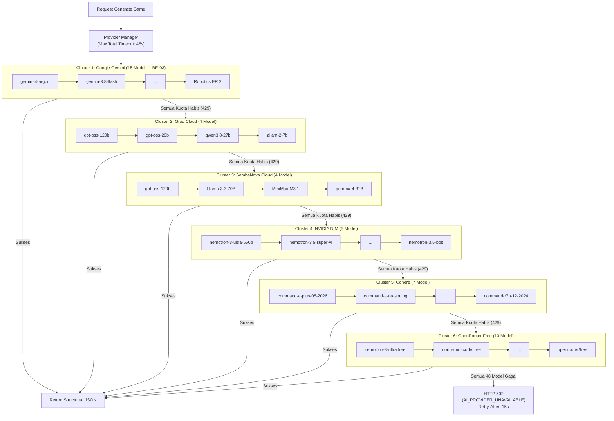
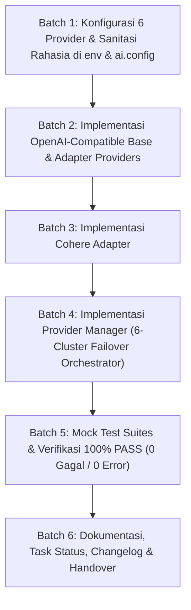

# Implementation Plan — Tahap BE-04: Multi-Provider Fallback Manager (Hexa-Cluster AI Cascading Resilience)

> **TAHAP:** BE-04 (Adapter Ekosistem Multi-Provider & Orkestrasi Provider Manager Berjenjang)
> **DOKUMEN INDUK:** `Docs/Implementation_Plan.md`, `Docs/backend/Provider_Strategy.md`, `Docs/backend/Backend_Architecture.md`
> **STATUS:** MENUNGGU REVIEW & PERSETUJUAN DARI YOGI ARIO (APPROVAL GATE)
> **OTORITAS PENYETUJU:** Yogi Ario (Project Owner / Lead Developer)
> **PRINSIP:** *No Plan, No Code. No Approval, No Code. No Evidence, No Completion.*

---

## 1. Tujuan & Ruang Lingkup

### 1.1 Tujuan Tahap BE-04

Membangun infrastruktur inferensi AI berketahanan ultra-tinggi (*ultra-high resilience*) dengan filosofi **"Kere Hore Tanpa Modal"** (maksimalisasi kuota gratis lintas provider) sesuai arahan Yogi Ario. Sistem ini mengintegrasikan **6 Cluster AI Provider** dengan total **48 Model AI Gratis** yang diurutkan secara berjenjang dari model reasoning paling pintar (*flagship*) hingga model hemat/ringan.

Semua provider diorkestrasikan secara sekuensial murni (*No racing calls*) oleh **Provider Manager** terpadu dengan perlindungan durasi total (*total timeout guard*) dan penyamaran token rahasia otomatis (*Zero Secret Leakage*).

---

### 1.2 Skema Alur Hexa-Cluster Cascading Fallback

---

### 1.3 Daftar Lengkap 48 Model AI (Urutan Pintar ➔ Ringan)

| Cluster       | Provider                       | Model ID API                                                                                                                                                                                                                                                                                                                                                                                                                                                                  | Karakteristik / Keunggulan                                                                      |
| --------------- | -------------------------------- | ------------------------------------------------------------------------------------------------------------------------------------------------------------------------------------------------------------------------------------------------------------------------------------------------------------------------------------------------------------------------------------------------------------------------------------------------------------------------------- | ------------------------------------------------------------------------------------------------- |
| **Cluster 1** | **Google Gemini** (15 Model)   | `gemini-4-argon` s/d `gemini-robotics-er-2-preview`                                                                                                                                                                                                                                                                                                                                                                                                                           | Telah diimplementasikan & lulus test di BE-03.                                                  |
| **Cluster 2** | **Groq Cloud** (4 Model)       | 1. `openai/gpt-oss-120b`2. `openai/gpt-oss-20b`3. `qwen/qwen3.8-27b`4. `allam-2-7b`                                                                                                                                                                                                                                                                                                                                                                                           | Inferensi ultra-cepat pada Groq LPU, ideal sebagai jaring pengaman awal.                        |
| **Cluster 3** | **SambaNova Cloud** (4 Model)  | 1. `gpt-oss-120b`2. `Meta-Llama-3.3-70B-Instruct`3. `MiniMax-M3.1-Flash`4. `gemma-4-31B-it`                                                                                                                                                                                                                                                                                                                                                                                   | Akselerator LDU hemat energi, handal saat Groq padat (terverifikasi 200 OK).                    |
| **Cluster 4** | **NVIDIA NIM** (5 Model)       | 1. `nvidia/nemotron-3-ultra-550b-a55b`2. `nvidia/nemotron-3.5-super-vl-120b-a12b`3. `nvidia/nemotron-3.5-lightning-30b-a3b`4. `nvidia/nemotron-3-nano-omni-30b-a3b-reasoning`5. `nvidia/nemotron-3.5-bolt-e4b`                                                                                                                                                                                                                                                                | Model reasoning titan 550B & 120B NVIDIA (terverifikasi 200 OK).                                |
| **Cluster 5** | **Cohere** (7 Model)           | 1. `command-a-plus-05-2026`2. `command-a-reasoning-08-2025`3. `command-a-03-2025`4. `command-r-plus-08-2024`5. `c4ai-aya-expanse-32b`6. `command-r-08-2024`7. `command-r7b-12-2024`                                                                                                                                                                                                                                                                                           | Spesialis penalaran instruksi & structured JSON enterprise (terverifikasi 200 OK).              |
| **Cluster 6** | **OpenRouter Free** (13 Model) | 1. `nvidia/nemotron-3-ultra-550b-a55b:free`2. `nvidia/nemotron-3.5-super-vl:free`3. `nvidia/nemotron-3.5-lightning:free`4. `nvidia/nemotron-3-nano-omni-30b-a3b-reasoning:free`5. `cohere/north-mini-code:free`6. `google/gemma-4-31b-it:free`7. `google/gemma-4-26b-a4b-it:free`8. `xingchen-agi/xing4.0-29b-a4b:free`9. `recursive/flint-v1.0:free`10. `stealth/crouton-alpha`11. `openrouter/free`12. `liquid/lfm-2.5-2.6b:free`13. `dots-studio/dots-3-note-preview:free` | 100% Free models (bebas biaya) dengan router otomatis fallback terakhir (terverifikasi 200 OK). |

---

### 1.4 Ruang Lingkup Pekerjaan (In-Scope untuk BE-04):

1. **Pembaruan Konfigurasi Kunci & Model (`src/config/env.ts` & `src/config/ai.config.ts`):**
   - Mendukung 6 provider API key (`Google`, `Groq`, `SambaNova`, `NVIDIA`, `Cohere`, `OpenRouter`).
   - Menyimpan hirarki 48 model pada `aiConfig`.
2. **Adapter Ekosistem Multi-Provider:**
   - **`GroqAdapter`:** Pemanggil Groq Cloud via SDK resmi / HTTP OpenAI compatible.
   - **`SambaNovaAdapter`:** Pemanggil SambaNova Cloud via OpenAI compatible client (`https://api.sambanova.ai/v1`).
   - **`NvidiaAdapter`:** Pemanggil NVIDIA NIM via OpenAI compatible client (`https://integrate.api.nvidia.com/v1`).
   - **`CohereAdapter`:** Pemanggil Cohere v2 API (`https://api.cohere.com/v2/chat`).
   - **`OpenRouterAdapter`:** Pemanggil OpenRouter Free via OpenAI compatible client (`https://openrouter.ai/api/v1`).
3. **Penyatuan Normalisasi Error & Zero Secret Leakage:**
   - Penyamaran otomatis regex untuk seluruh kunci: `AQ.*`, `gsk_*`, `nvapi-*`, `sk-or-*`, dan token SambaNova/Cohere (`[REDACTED_...]`).
4. **Implementasi Provider Manager (`src/providers/provider.manager.ts`):**
   - Mengorkestrasikan ke-6 cluster secara berurutan murni (*No racing calls*).
   - Menjaga total batas waktu request tidak melampaui 45 detik.
   - Mengembalikan metadata provider yang berhasil memproses permintaan.
5. **Automated Mock Test Suite (Zero API Quota):**
   - Unit test untuk masing-masing adapter provider.
   - Failover test komprehensif pada Provider Manager (Gemini gagal ➔ Groq gagal ➔ SambaNova sukses, dsb).
6. **Skrip Uji Smoke Terkontrol:**
   - Skrip smoke test live per provider di folder `backend/scripts/`.

---

### 1.5 Di Luar Ruang Lingkup (Out-of-Scope untuk BE-04):

- ❌ **TIDAK** ada parsing kompleks atau capability allowlist Scratch (dikerjakan pada BE-05).
- ❌ **TIDAK** ada pengujian otomatis CI yang mengonsumsi kuota live (semua CI test wajib di-mock).

---

## 2. Analisis Kondisi Saat Ini (*Current State*)

* **Backend Baseline:** BE-01, BE-02, dan BE-03 telah selesai 100% PASS (24/24 tests passed).
* **Kredensial Aktif:** Seluruh 6 provider di `template/api` telah diuji langsung dan terverifikasi aktif dengan respon valid.
* **Interface `AIProvider`:** Telah siap di `src/providers/provider.interface.ts`.

---

## 3. Daftar Berkas Target yang Akan Dibuat / Dimodifikasi

| Path Berkas                                                            | Status         | Peran & Fungsi Berkas                                                                             |
| ------------------------------------------------------------------------ | ---------------- | --------------------------------------------------------------------------------------------------- |
| `backend/src/config/env.ts`                                            | **MODIFIKASI** | Pemuatan 6 kredensial API dari env & `template/api`.                                              |
| `backend/src/config/ai.config.ts`                                      | **MODIFIKASI** | Definisi hirarki 48 model AI pada 6 cluster.                                                      |
| `backend/src/providers/openai-compatible/openai-compatible.adapter.ts` | **BARU**       | Base adapter reusable untuk Groq, SambaNova, NVIDIA NIM, dan OpenRouter.                          |
| `backend/src/providers/cohere/cohere.adapter.ts`                       | **BARU**       | Adapter inferensi untuk Cohere v2 Chat API.                                                       |
| `backend/src/providers/provider.manager.ts`                            | **BARU**       | Orkestrator sekuensial 6 cluster (Gemini -> Groq -> SambaNova -> NVIDIA -> Cohere -> OpenRouter). |
| `backend/tests/unit/provider.manager.test.ts`                          | **BARU**       | Contract & failover test orkestrator Provider Manager berbasis Mock.                              |
| `backend/tests/unit/adapters.test.ts`                                  | **BARU**       | Unit test untuk seluruh adapter multi-provider berbasis Mock.                                     |
| `backend/scripts/smoke-test-all-providers.ts`                          | **BARU**       | Skrip opsional untuk pengujian live terkontrol jika disetujui PO.                                 |
| `Docs/Task_Status.md`                                                  | **MODIFIKASI** | Pembaruan status milestone.                                                                       |

---

## 4. Rencana Langkah Kerja Bertahap (*Execution Batches*)

### Batch 1: Konfigurasi 6 Provider & Sanitasi Rahasia

* Memperbarui `src/config/env.ts` untuk memuat kunci Google, Groq, SambaNova, NVIDIA, Cohere, dan OpenRouter.
* Memperbarui `src/config/ai.config.ts` dengan daftar 48 model terverifikasi.
* Memperbarui regex sanitasi rahasia untuk semua jenis token.

### Batch 2: Implementasi OpenAI-Compatible Base & Adapters

* Membuat adapter terpadu `OpenAICompatibleAdapter` yang dapat digunakan oleh:
  - Groq (`https://api.groq.com/openai/v1`)
  - SambaNova (`https://api.sambanova.ai/v1`)
  - NVIDIA NIM (`https://integrate.api.nvidia.com/v1`)
  - OpenRouter (`https://openrouter.ai/api/v1`)
* Menyediakan sub-class spesifik untuk masing-masing vendor dengan error normalization terpadu.

### Batch 3: Implementasi Cohere Adapter

* Membuat `src/providers/cohere/cohere.adapter.ts` untuk endpoint `https://api.cohere.com/v2/chat`.

### Batch 4: Implementasi Provider Manager

* Membuat `src/providers/provider.manager.ts`.
* Menerapkan siklus pemanggilan sekuensial melintasi 6 provider.
* Mengatur batas timeout total 45 detik.

### Batch 5: Mock Testing & Verifikasi 100% PASS

* Menulis unit test mock untuk setiap adapter dan failover antar cluster di `tests/unit/provider.manager.test.ts`.
* Menjalankan `npm test` memastikan seluruh test lulus 100% PASS.
* Menjalankan `npm run build` memastikan kompilasi TypeScript `0 ERROR`.

### Batch 6: Dokumentasi & Pelaporan

* Membuat skrip smoke test `scripts/smoke-test-all-providers.ts`.
* Memperbarui `Docs/Task_Status.md`, `changelog/`, dan riwayat chat.

---

## 5. Rencana Pengujian & Kriteria Keberhasilan (*Definition of Done*)

Sesuai **Pilar 6 (100% Automated Testing Gate)**:

| Skenario Pengujian                            | Kondisi Uji                          | Ekspektasi Hasil                                                                 |
| ----------------------------------------------- | -------------------------------------- | ---------------------------------------------------------------------------------- |
| **Primary Berhasil**                          | Gemini berhasil                      | Mengembalikan output Gemini, provider lain tidak dipanggil.                      |
| **Failover Tingkat 1 (Gemini ➔ Groq)**       | Gemini semua 429                     | Provider Manager failover ke Groq, berhasil mengembalikan output Groq.           |
| **Failover Tingkat 2 (Groq ➔ SambaNova)**    | Gemini & Groq 429                    | Provider Manager failover ke SambaNova, berhasil mengembalikan output SambaNova. |
| **Failover Tingkat 3 (SambaNova ➔ NVIDIA)**  | Gemini, Groq, SambaNova 429          | Provider Manager failover ke NVIDIA NIM, berhasil.                               |
| **Failover Tingkat 4 (NVIDIA ➔ Cohere)**     | Provider 1-4 429                     | Provider Manager failover ke Cohere, berhasil.                                   |
| **Failover Tingkat 5 (Cohere ➔ OpenRouter)** | Provider 1-5 429                     | Provider Manager failover ke OpenRouter Free, berhasil.                          |
| **Seluruh 6 Provider Gagal**                  | Semua 48 model 429                   | Melempar HTTP 502 aman dengan header `Retry-After: 15`.                          |
| **Zero Secret Leakage**                       | Pemeriksaan log error semua provider | Tidak ada token dari ke-6 vendor yang bocor ke log/response.                     |

**Target Kelulusan:** `HASIL: 100% PASS (0 GAGAL / 0 ERROR)`.

---

## 6. Persetujuan Eksekusi

Rencana di atas telah disesuaikan secara utuh dengan filosofi *Kere Hore Tanpa Modal* dan seluruh kunci API yang Anda tambahkan.
Jika Anda telah menyetujui rencana ini, silakan klik tombol **Proceed** pada rencana di atas atau balas **"Lanjut"** / **"Setuju"** untuk kita mulai eksekusi Batch 1.
