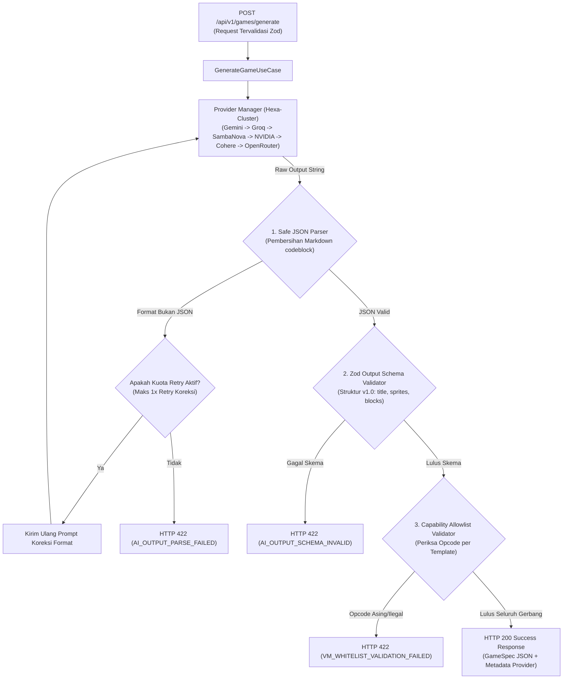
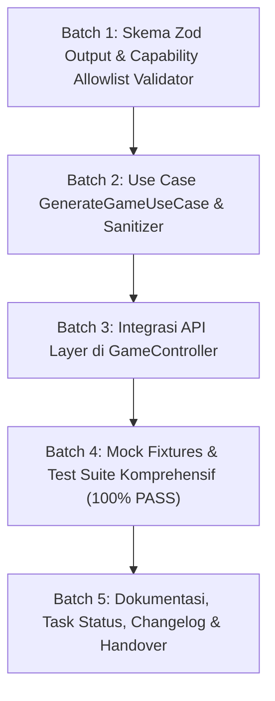

# Implementation Plan — Tahap BE-05: AI Game Generation Use Case & Output Validation

> **TAHAP:** BE-05 (Logika Use Case Inferensi Game & Validasi Ketat Skema Output Scratch)  
> **DOKUMEN INDUK:** `Docs/Implementation_Plan.md`, `Docs/backend/AI_Output_Schema.md`, `Docs/backend/API_Contract.md`, `Docs/backend/Backend_Architecture.md`  
> **STATUS:** MENUNGGU REVIEW & PERSETUJUAN DARI YOGI ARIO (APPROVAL GATE)  
> **OTORITAS PENYETUJU:** Yogi Ario (Project Owner / Lead Developer)  
> **PRINSIP:** *No Plan, No Code. No Approval, No Code. No Evidence, No Completion.*  

---

## 1. Tujuan & Ruang Lingkup

### 1.1 Tujuan Tahap BE-05
Membangun inti logika bisnis (*use case core*) **`GenerateGameUseCase`** yang menjembatani request pengguna yang telah tervalidasi pada API Layer (BE-02) dengan orkestrator inferensi Hexa-Cluster (BE-04), mem-parsing teks mentah LLM menjadi JSON terstruktur, memvalidasi kepatuhan skema terhadap **`Docs/backend/AI_Output_Schema.md` (v1.0)**, dan menegakkan **Capability Allowlist** untuk 3 template MVP (*Catching Game*, *Maze Adventure*, *Space Shooter*) guna menolak opcode Scratch yang tidak dikenal atau berbahaya.

---

### 1.2 Skema Pipa Pemrosesan Inferensi & Validasi Output



---

### 1.3 Ruang Lingkup Pekerjaan (In-Scope untuk BE-05):
1. **Skema Zod Output AI (`src/validators/output.validator.ts`):**
   - Memvalidasi struktur `GameSpec` v1.0:
     * `schemaVersion`: literal `"1.0"`.
     * `title`: string (1 - 100 karakter).
     * `description`: string (maks 500 karakter).
     * `template`: enum (`catching-game`, `maze-adventure`, `space-shooter`).
     * `language`: enum (`id`, `en`).
     * `stage`: konfigurasi backdrop panggung.
     * `variables`: array string nama variabel yang dideklarasikan.
     * `sprites`: array minimal 1 sprite, masing-masing memuat `name`, `role`, `costumes`, dan `scripts`.
     * `scripts`: array script berisi `event` trigger dan urutan `blocks` (tipe opcode & parameter).
2. **Capability Allowlist Validator (`src/validators/capability.validator.ts`):**
   - Menegakkan daftar putih blok Scratch sesuai `Docs/backend/AI_Output_Schema.md`:
     * **Template Catching Game:** Blok `motion_gotoxy`, `motion_changeyby`, `sensing_touchingobject`, `event_whenflagclicked`, `control_forever`, `control_if`, dsb.
     * **Template Maze Adventure:** Blok `motion_movesteps`, `motion_pointindirection`, `sensing_touchingcolor`, `control_if`, dsb.
     * **Template Space Shooter:** Blok `control_create_clone_of`, `control_start_as_clone`, `motion_changexby`, `operator_random`, dsb.
   - Menolak keras opcode yang tidak sah dengan kode error **`VM_WHITELIST_VALIDATION_FAILED`**.
3. **Pembersih Output LLM (*Safe Output Sanitizer*):**
   - Membersihkan bungkus markdown jika LLM secara tidak sengaja menambahkan `` ```json `` atau `` ``` `` di awal/akhir respons.
4. **Implementasi Use Case `GenerateGameUseCase` (`src/usecases/generate-game.usecase.ts`):**
   - Menerima `GenerateGameInput`.
   - Memanggil `ProviderManager`.
   - Menjalankan pipa: Sanitize ➔ JSON.parse ➔ Zod Schema Validation ➔ Capability Allowlist Check.
   - Menyediakan 1x retry prompt koreksi format otomatis jika model LLM menghasilkan format yang rusak.
5. **Sambungan ke API Controller (`src/controllers/game.controller.ts`):**
   - Menghubungkan endpoint `POST /api/v1/games/generate` langsung ke `GenerateGameUseCase`.
   - Mengembalikan HTTP 200 dengan struktur respons standar API Contract:
     ```json
     {
       "success": true,
       "data": { ...gameSpec... },
       "meta": {
         "provider": "gemini",
         "modelUsed": "gemini-4-argon",
         "durationMs": 1240,
         "requestId": "..."
       }
     }
     ```
6. **Regression Fixtures & Automated Test Suite:**
   - Fixture game valid untuk 3 template: `valid-catching.json`, `valid-maze.json`, `valid-space.json`.
   - Fixture error: `invalid-schema.json`, `invalid-illegal-opcode.json`, `corrupted-json.txt`.
   - Unit test untuk validator output dan capability checker.
   - Integration contract test untuk endpoint `POST /api/v1/games/generate` menggunakan mock provider.

---

### 1.4 Di Luar Ruang Lingkup (Out-of-Scope untuk BE-05):
- ❌ **TIDAK** ada pembuatan file biner Scratch `.sb3` atau zip file (dikerjakan pada Tahap 06/07).
- ❌ **TIDAK** ada integrasi GUI Scratch frontend (dikerjakan pada Tahap 04).

---

## 2. Analisis Kondisi Saat Ini (*Current State*)

* **Backend Baseline:** BE-01, BE-02, BE-03, dan BE-04 telah selesai 100% PASS (37/37 tests passed).
* **AI Provider Orchestrator:** `ProviderManager` (Hexa-Cluster 48 model) telah siap dan teruji failover sekuensialnya.
* **Spesifikasi Skema:** `Docs/backend/AI_Output_Schema.md` telah mendefinisikan skema v1.0 dan tabel Allowlist untuk 3 template.
* **Routing Endpoint:** Endpoint `POST /api/v1/games/generate` saat ini masih mengembalikan placeholder mock dari BE-02 dan siap dihubungkan ke use case nyata.

---

## 3. Daftar Berkas Target yang Akan Dibuat / Dimodifikasi

| Path Berkas | Status | Peran & Fungsi Berkas |
|---|---|---|
| `backend/src/validators/output.validator.ts` | **BARU** | Skema Zod untuk output game spec Scratch v1.0. |
| `backend/src/validators/capability.validator.ts` | **BARU** | Validator Capability Allowlist dan deteksi opcode ilegal. |
| `backend/src/usecases/generate-game.usecase.ts` | **BARU** | Core business logic usecase untuk pembuatan game ber-AI. |
| `backend/src/controllers/game.controller.ts` | **MODIFIKASI** | Menghubungkan endpoint HTTP ke `GenerateGameUseCase`. |
| `backend/tests/fixtures/game-valid-catching.json` | **BARU** | Fixture game Catching valid. |
| `backend/tests/fixtures/game-valid-maze.json` | **BARU** | Fixture game Maze valid. |
| `backend/tests/fixtures/game-valid-space.json` | **BARU** | Fixture game Space Shooter valid. |
| `backend/tests/unit/output.validator.test.ts` | **BARU** | Unit test validator skema output dan allowlist. |
| `backend/tests/unit/generate-game.usecase.test.ts` | **BARU** | Unit test use case dan retry prompt. |
| `backend/tests/unit/game.routes.test.ts` | **MODIFIKASI** | Pembaruan contract test endpoint generate game dengan integrasi penuh usecase. |
| `Docs/Task_Status.md` | **MODIFIKASI** | Pembaruan status milestone. |

---

## 4. Rencana Langkah Kerja Bertahap (*Execution Batches*)



### Batch 1: Skema Zod Output & Capability Allowlist
* Membuat `src/validators/output.validator.ts` yang memodelkan interface `GameSpec` v1.0 dengan Zod.
* Membuat `src/validators/capability.validator.ts` yang memeriksa opcode blok setiap sprite terhadap allowlist template terkait.

### Batch 2: Use Case GenerateGameUseCase
* Membuat `src/usecases/generate-game.usecase.ts`.
* Mengimplementasikan pembersihan string (regex pembuang markdown fence).
* Menghubungkan pemanggilan ke `ProviderManager`.
* Memvalidasi hasil parsing dengan Zod validator dan capability checker.
* Menangani kegagalan format dengan mekanisme retry koreksi 1x jika diperlukan.

### Batch 3: Integrasi API Layer
* Memperbarui `src/controllers/game.controller.ts` untuk menginstansiasi/menginjeksi `GenerateGameUseCase`.
* Memetakan error domain (`AI_OUTPUT_PARSE_FAILED`, `AI_OUTPUT_SCHEMA_INVALID`, `VM_WHITELIST_VALIDATION_FAILED`) ke HTTP status code 422 Unprocessable Entity yang aman dan informatif.

### Batch 4: Mock Fixtures & Automated Test Suite
* Membuat fixtures data uji JSON di `tests/fixtures/`.
* Menulis unit test di `tests/unit/output.validator.test.ts` dan `tests/unit/generate-game.usecase.test.ts`.
* Memperbarui `tests/unit/game.routes.test.ts` untuk memverifikasi respons HTTP 200 sukses dan 422 error.
* Menjalankan `npm test` memastikan seluruh test lulus **100% PASS**.
* Menjalankan `npm run build` memastikan kompilasi TypeScript **0 ERROR**.

### Batch 5: Dokumentasi & Pelaporan
* Memperbarui `Docs/Task_Status.md`, `changelog/`, dan riwayat chat.

---

## 5. Rencana Pengujian & Kriteria Keberhasilan (*Definition of Done*)

Sesuai **Pilar 6 (100% Automated Testing Gate)**:

| Skenario Pengujian | Kondisi Uji | Ekspektasi Hasil |
|---|---|---|
| **Ekstraksi Sukses Catching Game** | AI mengembalikan JSON valid catching game | HTTP 200, schemaVersion "1.0", sprite & block sesuai allowlist. |
| **Ekstraksi Sukses Maze Adventure** | AI mengembalikan JSON valid maze game | HTTP 200, blok navigasi arah dan deteksi warna valid. |
| **Ekstraksi Sukses Space Shooter** | AI mengembalikan JSON valid space shooter | HTTP 200, blok klon dan proyektil valid. |
| **Penanganan Bungkus Markdown** | AI mengembalikan respons dengan ` ```json ... ``` ` | Sanitizer otomatis membuang fence, JSON berhasil diurai tanpa error. |
| **Penolakan Format Bukan JSON** | AI mengembalikan teks percakapan biasa | Melempar error HTTP 422 `AI_OUTPUT_PARSE_FAILED`. |
| **Penolakan Skema Cacat** | JSON tidak memiliki field `sprites` atau `stage` | Melempar error HTTP 422 `AI_OUTPUT_SCHEMA_INVALID`. |
| **Penolakan Opcode Ilegal** | AI menyisipkan opcode berbahaya / tidak dikenal (misal: `sensing_loudness`) | Melempar error HTTP 422 `VM_WHITELIST_VALIDATION_FAILED`. |
| **Zero Secret Leakage** | Pemeriksaan log controller & usecase | Tidak ada kunci API atau informasi kredensial yang terekspos. |

**Target Kelulusan:** `HASIL: 100% PASS (0 GAGAL / 0 ERROR)`.

---

## 6. Pertanyaan Review untuk Yogi Ario (Project Owner)

Silakan periksa rancangan di atas dan beri masukan pada poin-poin berikut:
1. **Mekanisme Retry Koreksi:** Apakah Anda menyetujui mekanisme *automatic retry* maksimal 1x dengan prompt perbaikan format jika LLM menghasilkan JSON yang rusak sebelum melempar HTTP 422 ke pengguna?
2. **Persetujuan Rencana:** Apakah Anda menyetujui rencana kerja Tahap BE-05 ini untuk kita mulai eksekusi Batch 1?

