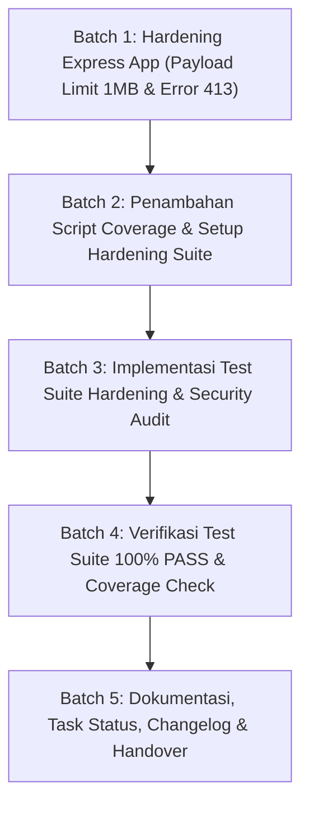

# Implementation Plan — Tahap BE-06: Hardening, Integrasi Antar-Modul & QA

> **TAHAP:** BE-06 (Pengerasan Keamanan, Uji Ketahanan Terpadu & Quality Assurance)  
> **DOKUMEN INDUK:** `Docs/Implementation_Plan.md`, `Docs/backend/Backend_Risk_Register.md`, `Docs/backend/API_Contract.md`, `Docs/backend/Backend_Architecture.md`  
> **STATUS:** MENUNGGU REVIEW & PERSETUJUAN DARI YOGI ARIO (APPROVAL GATE)  
> **OTORITAS PENYETUJU:** Yogi Ario (Project Owner / Lead Developer)  
> **PRINSIP:** *No Plan, No Code. No Approval, No Code. No Evidence, No Completion.*  

---

## 1. Tujuan & Ruang Lingkup

### 1.1 Tujuan Tahap BE-06
Melakukan pengerasan (*hardening*) menyeluruh pada seluruh lapisan backend Ardena Playground sebelum serah terima operasional (BE-07). Tahap ini memverifikasi integrasi antar-modul (API Layer ➔ Request Validation ➔ Generate Game Use Case ➔ Provider Manager ➔ Hexa-Cluster AI ➔ Output Schema & Capability Allowlist), memastikan penegakan mutlak **Zero Secret Leakage** (tidak ada kunci API dari ke-6 vendor yang bocor dalam kondisi error apa pun), membatasi ukuran request payload (rekomendasi: **2 MB** atau **5 MB** mengacu pada benchmark platform seperti Vibelf), serta menguji skenario ekstrem (simulasi pemadaman total provider, timeout jaringan berantai, dan payload berbahaya).

---

### 1.1.1 Benchmark Payload: Vibelf vs Ardena Playground
Berdasarkan analisis arsitektur platform **Vibelf** (`vibelf.com` — AI Copilot khusus Scratch 3.0) dan platform vibe coding sejenis:
1. **Level UI Prompt (Client-side):**
   - Vibelf membatasi input prompt teks natural language pengguna di kisaran **500 s/d 2.000 karakter** agar respons LLM tetap instan dan efisien.
   - Ardena Playground saat ini memvalidasi prompt maksimal **500 karakter** (via Zod di `GenerateGameRequestSchema`).
2. **Level Network Payload (API Body Request):**
   - **Teks Prompt Murni:** Berukuran hanya **1 KB – 5 KB**.
   - **Konteks Game State (`project.json` Scratch):** Saat copilot Scratch membaca/mengedit proyek yang sedang terbuka, Scratch mengirimkan struktur blok JSON (`project.json`). Tanpa aset binary audio/gambar besar, file ini rata-rata berukuran **100 KB – 500 KB**, dengan batas ekstrem hingga **2 MB**.
   - **Standar Vercel Serverless / AI Platforms:** Platform web vibe coding umumnya memiliki batas **4.5 MB**.
3. **Rekomendasi untuk Ardena Playground:**
   - Kita tetapkan batas Express Body Parser sebesar **2 MB** (atau **5 MB**). Batas ini sangat aman: mampu menampung prompt teks apa pun dan sudah memiliki ruang longgar (*future-proof*) jika di fase berikutnya frontend mengirimkan state blok Scratch yang ada.

---

### 1.2 Skema Matriks Pengujian & Pengerasan Sistem

```mermaid
flowchart TD
    subgraph S1["1. Security Hardening"]
        A1["Enforce 1MB Body Limit"] --> A2["Regex Secret Masker Audit\n(Google, Groq, SambaNova, NVIDIA, Cohere, OpenRouter)"]
        A2 --> A3["Penolakan Injeksi Objek Berbahaya\n(Prototype Pollution / Script Tags)"]
    end

    subgraph S2["2. Resilience & Fault Tolerance"]
        B1["Simulasi Gangguan Jaringan (Network Disruption)"] --> B2["Simulasi Pemadaman Total 6 Cluster (All-Fail 502)"]
        B2 --> B3["Cascading Timeout Exceeded (Total Timeout 45s)"]
    end

    subgraph S3["3. Module Integration & Contract QA"]
        C1["CORS Compliance (Scratch Editor Dev Origins)"] --> C2["End-to-End Pipeline Verification"]
        C2 --> C3["100% Test Suite Pass & Coverage Metrics"]
    end
```

---

### 1.3 Ruang Lingkup Pekerjaan (In-Scope untuk BE-06):
1. **Pengerasan Keamanan Payload (`backend/src/app.ts`):**
   - Memastikan `express.json({ limit: '1mb' })` aktif untuk mencegah serangan denial-of-service berbasis payload raksasa.
   - Menambahkan error handler khusus untuk menangani `entity.too.large` (HTTP 413 Payload Too Large) dengan format error konsisten.
2. **Audit Zero Secret Leakage:**
   - Menulis test suite otomatis yang sengaja menginjeksikan kunci API asli ke dalam error stream untuk membuktikan bahwa seluruh kunci vendor (`AQ.*`, `gsk_*`, `nvapi-*`, `sk-or-*`, dan token lainnya) **100% tersamarkan** (`[REDACTED_...]`) dan tidak pernah lolos ke respons client maupun console server.
3. **Uji Ketahanan & Penanganan Kondisi Ekstrem (*Fault-Tolerance Testing*):**
   - Pengujian perilaku backend saat terjadi pemadaman total pada 6 cluster AI provider (memastikan HTTP 502 returned dengan header `Retry-After: 15`).
   - Pengujian batas durasi total (memastikan pemutusan koneksi aman dengan HTTP 504 saat durasi akumulasi melampaui 45 detik).
   - Pengujian payload request dengan karakter Unicode aneh, string sangat panjang, dan format JSON rusak.
4. **Automated End-to-End Hardening Test Suite (`tests/integration/hardening.test.ts`):**
   - Menguji seluruh pipa sistem secara terintegrasi (Supertest HTTP call ➔ Middleware ➔ UseCase ➔ Mock Manager ➔ Output Validation ➔ HTTP Response).
5. **Verifikasi Coverage Pengujian:**
   - Menjalankan pengujian dengan metrik cakupan (*code coverage*) untuk memastikan seluruh branch krusial teruji.

---

### 1.4 Di Luar Ruang Lingkup (Out-of-Scope untuk BE-06):
- ❌ **TIDAK** ada modifikasi pada toolchain atau repository frontend Scratch GUI (dikerjakan pada Tahap 04).
- ❌ **TIDAK** ada pengujian live yang menghabiskan kuota nyata (seluruh CI & automated test tetap menggunakan Mock Zero Quota).

---

## 2. Analisis Kondisi Saat Ini (*Current State*)

* **Backend Baseline:** BE-01 s/d BE-05 telah selesai **100% PASS (53/53 tests passed)**.
* **Hexa-Cluster AI:** 6 Provider dengan 48 model telah terintegrasi di `ProviderManager`.
* **Output Validation:** Skema `ArdenaGameSpec` v1.0 dan Capability Allowlist telah beroperasi penuh di `GenerateGameUseCase`.
* **Kompilasi TypeScript:** `npm run build` tuntas bebas error (`0 ERROR`).

---

## 3. Daftar Berkas Target yang Akan Dibuat / Dimodifikasi

| Path Berkas | Status | Peran & Fungsi Berkas |
|---|---|---|
| `backend/src/app.ts` | **MODIFIKASI** | Penambahan batas ukuran body parser (1MB) dan penanganan HTTP 413. |
| `backend/src/middleware/error.middleware.ts` | **MODIFIKASI** | Penanganan terpadu untuk payload limit error (`entity.too.large`). |
| `backend/tests/integration/hardening.test.ts` | **BARU** | Test suite terpadu untuk security audit, payload limit, dan fault tolerance. |
| `backend/package.json` | **MODIFIKASI** | Penambahan script test coverage (`npm run test:coverage`). |
| `Docs/Task_Status.md` | **MODIFIKASI** | Pembaruan status milestone. |

---

## 4. Rencana Langkah Kerja Bertahap (*Execution Batches*)

### Batch 1: Hardening Express App (Payload Limit & Error 413)
* Memperbarui `src/app.ts` dengan opsi `express.json({ limit: '1mb' })`.
* Memperbarui `src/middleware/error.middleware.ts` untuk menangani status 413 Payload Too Large jika body request melebihi 1 MB.

### Batch 2: Penambahan Script Coverage
* Menambahkan skrip `"test:coverage": "jest --runInBand --coverage"` pada `package.json`.

### Batch 3: Implementasi Hardening Test Suite
* Membuat `tests/integration/hardening.test.ts` untuk memverifikasi:
  - Penolakan payload > 1 MB (HTTP 413).
  - Verifikasi Zero Secret Leakage pada skenario error vendor.
  - Simulasi pemadaman 6 cluster (HTTP 502 terpadu).
  - Simulasi total timeout > 45 detik (HTTP 504).
  - Kepatuhan header CORS untuk origin Scratch GUI (`http://localhost:8601`).

### Batch 4: Verifikasi Pengujian & Coverage
* Menjalankan `npm test` dan memastikan seluruh suite (unit + integration + hardening) lulus **100% PASS (0 GAGAL / 0 ERROR)**.
* Menjalankan `npm run build` memastikan kompilasi TypeScript **0 ERROR**.

### Batch 5: Dokumentasi & Pelaporan
* Memperbarui `Docs/Task_Status.md`, `changelog/`, dan riwayat chat.

---

## 5. Rencana Pengujian & Kriteria Keberhasilan (*Definition of Done*)

Sesuai **Pilar 6 (100% Automated Testing Gate)**:

| Skenario Pengujian | Kondisi Uji | Ekspektasi Hasil |
|---|---|---|
| **Payload Limit Enforcement** | Client mengirim request body > 1 MB | Ditolak dengan HTTP 413 `PAYLOAD_TOO_LARGE`. |
| **Zero Secret Leakage Audit** | Error sengaja memuat token API dari ke-6 vendor | Tidak ada satu pun token mentah yang muncul pada response/log (`[REDACTED_...]` enforced). |
| **Simulasi Pemadaman Total (6 Cluster)** | Seluruh 6 cluster mock AI melempar 429/500 | Sistem mengembalikan HTTP 502 `AI_PROVIDER_UNAVAILABLE` yang aman. |
| **Simulasi Total Timeout** | Durasi seluruh alur melampaui 45.000 ms | Sistem memutus koneksi aman dengan HTTP 504 `AI_TIMEOUT`. |
| **CORS Whitelist Compliance** | Request dari origin `http://localhost:8601` | Header `Access-Control-Allow-Origin: http://localhost:8601` terpasang benar. |

**Target Kelulusan:** `HASIL: 100% PASS (0 GAGAL / 0 ERROR)`.

---

## 6. Pertanyaan Review untuk Yogi Ario (Project Owner)

Silakan periksa rancangan di atas dan beri masukan pada poin-poin berikut:
1. **Pilihan Batas Ukuran Payload (Mengacu Benchmark Vibelf):**
   - **Opsi A (Rekomendasi - 2 MB):** Lebih dari cukup untuk prompt teks dan sudah siap menampung struktur JSON blok Scratch (`project.json`) jika di masa depan frontend mengirimkan state game saat ini untuk diedit/dianalisis.
   - **Opsi B (5 MB):** Standar platform serverless/vibe coding modern (Vercel batas 4.5 MB), memberikan ruang ekstra longgar.
   - **Opsi C (1 MB):** Batas minimalis yang sangat aman dan ketat untuk instruksi teks.
   *Manakah opsi yang Anda instruksikan untuk dipasang pada Express body parser (`app.ts`)?*
2. **Persetujuan Rencana:** Apakah Anda menyetujui rencana kerja Tahap BE-06 ini untuk kita mulai eksekusi Batch 1?
