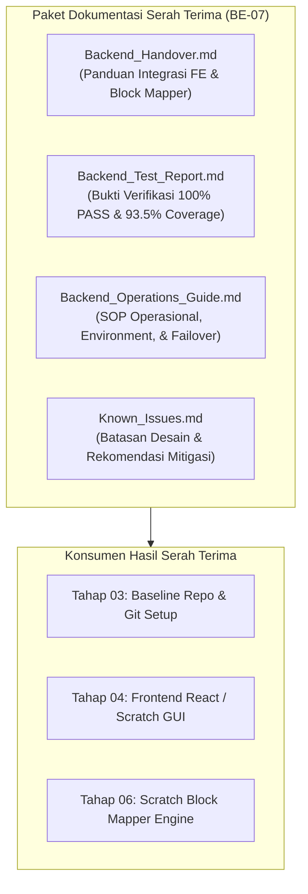
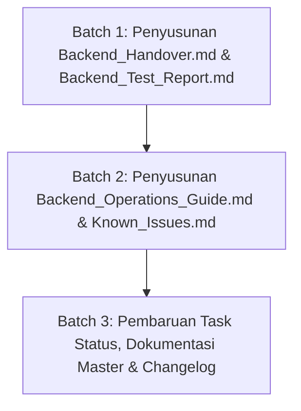

# Implementation Plan — Tahap BE-07: Dokumentasi, Operasional & Serah Terima Backend

> **TAHAP:** BE-07 (Dokumentasi Operasional, Laporan Pengujian Mutu & Serah Terima Backend)  
> **DOKUMEN INDUK:** `Docs/Implementation_Plan.md`, `Docs/Task_Status.md`, `Docs/Decision_Log.md`, `Docs/backend/Backend_Architecture.md`  
> **STATUS:** MENUNGGU REVIEW & PERSETUJUAN DARI YOGI ARIO (APPROVAL GATE)  
> **OTORITAS PENYETUJU:** Yogi Ario (Project Owner / Lead Developer)  
> **PRINSIP:** *No Plan, No Code. No Approval, No Code. No Evidence, No Completion.*  

---

## 1. Tujuan & Ruang Lingkup

### 1.1 Tujuan Tahap BE-07
Tahap BE-07 merupakan tahap penutup dari pilar **Backend AI Service (Tahap 05)**. Tujuan utamanya adalah membukukan seluruh artefak teknis, bukti kelulusan pengujian mutu (100% Automated Testing Gate), panduan operasional server, serta panduan serah terima (*handover*) integrasi yang akan menjadi acuan resmi bagi tim Frontend Engineer (Tahap 04) dan Block Mapper Developer (Tahap 06).

---

### 1.2 Skema Struktur Dokumentasi Serah Terima

---

### 1.3 Ruang Lingkup Pekerjaan (In-Scope untuk BE-07):
1. **Penyusunan `Docs/backend/Backend_Handover.md`:**
   - Dokumentasi lengkap endpoint kontrak (`POST /api/v1/games/generate`, `GET /api/v1/meta/capabilities`, `GET /api/v1/health`).
   - Panduan konsumsi response `ArdenaGameSpec` v1.0 oleh antarmuka frontend Scratch GUI (Stitch prototype screen 2-4).
   - Penjelasan diff counters (`+Sprite`, `+Variabel`, `+SFX`, `+Balok`, dan penegakan `0 Overwrites`).
   - Penanganan error standar (400, 413, 422, 502, 504) untuk UI toast / dialog.
2. **Penyusunan `Docs/backend/Backend_Test_Report.md`:**
   - Bukti formal 100% PASS (65/65 automated tests lulus melintasi 9 test suites tanpa error).
   - Matriks cakupan pengujian (*code coverage*): 93.49% Statements, 94.00% Lines, 92.85% Functions, 100% App & Middleware.
   - Verifikasi Zero Quota Consumption (seluruh CI menggunakan Mock aman).
3. **Penyusunan `Docs/backend/Backend_Operations_Guide.md`:**
   - Panduan instalasi dan menjalankan server backend secara lokal (`npm run dev`, `npm run build`, `npm start`).
   - Konfigurasi variabel lingkungan `.env` dan rotasi kredensial 6 vendor (`template/api`).
   - Panduan eksekusi skrip controlled smoke test (`smoke-test-gemini.ts`, `smoke-test-all-providers.ts`).
   - Panduan failover Hexa-Cluster AI (48 model cascading).
4. **Penyusunan `Docs/backend/Known_Issues.md`:**
   - Catatan batasan desain MVP (tanpa database server lokal, penyimpanan proyek di browser IndexedDB).
   - Penanganan kondisi darurat jika seluruh 6 vendor mengalami pemadaman bersamaan (HTTP 502 All-Fail).
5. **Finalisasi Milestone Backend (BE-00 s/d BE-07) pada `Docs/Task_Status.md`.**

---

### 1.4 Di Luar Ruang Lingkup (Out-of-Scope untuk BE-07):
- ❌ **TIDAK** ada perubahan kode inti server atau adapter AI (seluruh fungsionalitas telah terkunci dan teruji 100% di BE-06).
- ❌ **TIDAK** ada modifikasi berkas frontend atau Scratch editor (dikerjakan pada Tahap 04).

---

## 2. Analisis Kondisi Saat Ini (*Current State*)

* **Status Kode Backend:** 100% selesai dan lulus seluruh gerbang mutu pengujian.
* **Hasil Pengujian:** 65 kasus uji lulus dari 9 test suites (**100% PASS, 0 Gagal, 0 Error**).
* **Code Coverage:** Mencapai **93.49% Statement Coverage** (melampaui target standar industri 80%).
* **Kompilasi TypeScript:** `npm run build` tuntas bebas peringatan (`dist/` valid).
* **Keamanan:** 100% Zero Secret Leakage dinamis, payload request dikunci pada **10 MB** (Standar API Global).

---

## 3. Daftar Berkas Target yang Akan Dibuat / Dimodifikasi

| Path Berkas | Status | Peran & Fungsi Berkas |
|---|---|---|
| `Docs/backend/Backend_Handover.md` | **BARU** | Panduan resmi integrasi frontend dan block mapping engine. |
| `Docs/backend/Backend_Test_Report.md` | **BARU** | Laporan resmi bukti pengujian mutu otomatis (100% PASS). |
| `Docs/backend/Backend_Operations_Guide.md` | **BARU** | Standard Operating Procedure (SOP) operasional server & AI failover. |
| `Docs/backend/Known_Issues.md` | **BARU** | Dokumentasi batasan teknis dan rekomendasi mitigasi operasional. |
| `Docs/Task_Status.md` | **MODIFIKASI** | Penutupan fase BE-07 dan penguncian Tahap 05 (Backend AI Service). |

---

## 4. Rencana Langkah Kerja Bertahap (*Execution Batches*)

### Batch 1: Handover & Test Report
* Menyusun `Docs/backend/Backend_Handover.md` dengan spesifikasi payload, contoh JSON game spec, dan mapping status error ke UI dialog frontend.
* Menyusun `Docs/backend/Backend_Test_Report.md` merangkum log eksekusi Jest, breakdown 9 test suites, dan tabel coverage.

### Batch 2: Operations Guide & Known Issues
* Menyusun `Docs/backend/Backend_Operations_Guide.md` merangkum tata cara menjalankan server, porting, rotasi API key, dan debugging.
* Menyusun `Docs/backend/Known_Issues.md` merangkum batasan MVP dan edge case.

### Batch 3: Penutupan Milestone & Changelog
* Memperbarui `Docs/Task_Status.md` menandai seluruh milestone BE-00 s/d BE-07 berstatus **DONE**.
* Menerbitkan flat changelog bertimestamp dan memperbarui riwayat chat sesi.

---

## 5. Pertanyaan Review untuk Yogi Ario (Project Owner)

Silakan periksa rancangan penutupan backend di atas:
1. **Kelengkapan Dokumen:** Apakah keempat dokumen serah terima di atas (`Backend_Handover.md`, `Backend_Test_Report.md`, `Backend_Operations_Guide.md`, `Known_Issues.md`) sudah mencakup seluruh kebutuhan Anda untuk transisi ke tahap Frontend & Scratch integration?
2. **Persetujuan Eksekusi:** Apakah Anda menyetujui rencana kerja Tahap BE-07 ini untuk kita mulai eksekusi Batch 1?

