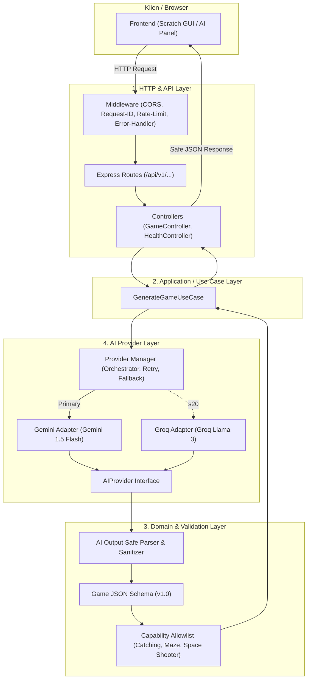

# Backend Architecture — Ardena Playground

> **STATUS:** DOKUMEN ARSITEKTUR TEKNIS BACKEND (BE-00)
> **OTORITAS PENYETUJU:** Yogi Ario (Project Owner / Lead Developer)
> **RUNTIME & BAHASA:** Node.js LTS, Express, TypeScript (Strict Mode)

---

## 1. Prinsip & Pola Arsitektur

Backend Ardena Playground mengadopsi pola **Modular Monolith** dengan pendekatan *Clean Layered Architecture*. Seluruh fungsionalitas berada dalam satu layanan mandiri (*single service*) yang memiliki batas tanggung jawab antar-lapisan yang tegas.



---

## 2. Rincian Lapisan Arsitektur

### 1. HTTP & Routing Layer

* **Tanggung Jawab:** Mengelola penerimaan HTTP request, ekstraksi parameter, penegakan CORS, pemetaan Request ID, pembatasan ukuran payload, dan formatting response HTTP.
* **Aturan:** Controller tidak boleh berisi logika bisnis atau pemanggilan langsung ke SDK AI Provider.

### 2. Application Layer (Use Cases)

* **Tanggung Jawab:** Mengorkestrasi alur proses pembuatan game:
  1. Menerima input prompt dan template yang telah divalidasi.
  2. Menyiapkan sistem instruksi yang membatasi kapabilitas AI.
  3. Memanggil Provider Manager untuk mendapatkan data rancangan game.
  4. Meneruskan respons mentah ke Validation Layer.
  5. Mengembalikan hasil yang valid dan aman ke Controller.

### 3. AI Provider Layer

* **Tanggung Jawab:** Mengabstraksi komunikasi dengan vendor eksternal melalui interface seragam:
  ```typescript
  export interface AIProvider {
    readonly name: string;
    generateGame(input: GenerateGameInput): Promise<ProviderRawResponse>;
  }
  ```
* **Provider Manager:** Mengatur kebijakan pemilihan provider:
  * Gemini 1.5 Flash sebagai prioritas utama.
  * Groq Llama 3 sebagai cadangan otomatis terkontrol.
  * Menjamin tidak ada pemanggilan paralel (*no racing calls*).
  * Menegakkan batas retry maksimal 1x dan batas timeout total (30 detik).

### 4. Domain & Validation Layer

* **Tanggung Jawab:** Menjamin seluruh data yang keluar dari backend berstatus aman dan kompatibel:
  * Mengekstrak JSON dari blok respons LLM.
  * Memvalidasi struktur terhadap `schemaVersion: "1.0"`.
  * Memverifikasi opcode dan entitas terhadap **Capability Allowlist** template aktif.
  * Menolak eksekusi fungsi atau kode dinamis.

---

## 3. Struktur Direktori Kode Sumber Target (`backend/src/`)

```text
backend/
├── src/
│   ├── app.ts                         # Konfigurasi Express app & middleware global
│   ├── server.ts                      # Entry point startup & graceful shutdown
│   │
│   ├── config/                        # Manajemen konfigurasi environment
│   │   ├── env.ts                     # Validasi tipe env (dotenv/zod)
│   │   └── ai.config.ts               # Parameter token, timeout, dan model ID
│   │
│   ├── routes/                        # Definisi endpoint API
│   │   ├── health.routes.ts           # /api/v1/health
│   │   ├── game.routes.ts             # /api/v1/games/generate
│   │   └── meta.routes.ts             # /api/v1/meta/capabilities
│   │
│   ├── controllers/                   # HTTP Controller
│   │   ├── health.controller.ts
│   │   └── game.controller.ts
│   │
│   ├── application/                   # Use Cases & Business Logic
│   │   └── use-cases/
│   │       └── generate-game.use-case.ts
│   │
│   ├── domain/                        # Entitas, Schema & Aturan Domain
│   │   ├── schemas/                   # JSON Schema definisi game
│   │   ├── allowlists/                # Daftar blok/opcode Scratch yang diizinkan
│   │   ├── types/                     # TypeScript Interfaces & Enums
│   │   └── errors/                    # Custom App Error Classes
│   │
│   ├── providers/                     # Integrasi AI Provider
│   │   ├── provider.interface.ts      # Kontrak umum AIProvider
│   │   ├── provider.manager.ts        # Logika fallback & timeout
│   │   ├── gemini/                    # Gemini Adapter & error mapper
│   │   └── groq/                      # Groq Adapter & error mapper
│   │
│   ├── validators/                    # Middleware & Schema Validators
│   │   ├── request.validator.ts       # Validasi body request client
│   │   └── output.validator.ts        # Validasi output LLM
│   │
│   ├── middleware/                    # Express Middleware
│   │   ├── request-id.middleware.ts   # Injeksi X-Request-ID
│   │   ├── error.middleware.ts        # Global Safe Error Handler
│   │   └── cors.middleware.ts         # Pengaturan origin dev
│   │
│   └── utils/                         # Logger terstruktur & helper
│
├── tests/
│   ├── unit/                          # Unit tests validator & adapter
│   ├── integration/                   # Integration tests routing & use cases
│   ├── contract/                      # Contract tests skema OpenAPI
│   └── fixtures/                      # Contoh JSON respons valid/invalid
│
├── openapi/
│   └── openapi.yaml                   # Spesifikasi resmi OpenAPI 3.0
├── package.json
├── tsconfig.json
└── README.md
```
