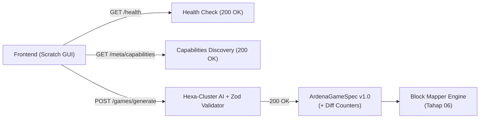

# Backend Handover — Panduan Integrasi Frontend & Block Mapper

> **DOKUMEN SERAH TERIMA RESMI (BE-07)**  
> **OTORITAS PENYETUJU:** Yogi Ario (Project Owner / Lead Developer)  
> **PENYUSUN:** Senior Backend Engineer & AI Technical Assistant  
> **STATUS:** FINAL & TERVERIFIKASI 100% PASS  
> **VERSI API:** v1.0.0 (Port Default: `3001`)  

---

## 1. Pendahuluan & Tujuan

Dokumen ini disusun sebagai panduan resmi serah terima (*handover*) teknis dari lapisan backend Ardena Playground kepada:
1. **Frontend Engineer (Tahap 04):** Untuk mengintegrasikan antarmuka Scratch GUI (mengadopsi desain Stitch prototype di `template/ardenaplayground/`) dengan endpoint backend REST API.
2. **Block Mapper Developer (Tahap 06):** Untuk mengonversi payload terstruktur `ArdenaGameSpec` v1.0 menjadi blok kode native Scratch 3.0 (`scratch-blocks` / `scratch-vm`).

Backend beroperasi dengan arsitektur **Modular Monolith**, menjamin validasi bertingkat, penegakan **Zero Overwrite** pada proyek pengguna, proteksi **Zero Secret Leakage**, serta ketahanan *Hexa-Cluster AI Cascading* (48 model terdistribusi di 6 penyedia).

---

## 2. Spesifikasi Endpoint REST API (`/api/v1`)

Base URL Server: `http://localhost:3001` (CORS mengizinkan origin dev `http://localhost:8601` dan `http://localhost:3000`).



---

### 2.1 Endpoint Health Check
* **Path:** `GET /api/v1/health`
* **Fungsi:** Verifikasi ketersediaan server backend saat aplikasi Scratch Editor dimuat.
* **Response Contoh (HTTP 200):**
```json
{
  "success": true,
  "data": {
    "status": "ok",
    "timestamp": "2026-11-05T09:00:00.000Z",
    "uptime": 128.45,
    "service": "ardena-playground-backend",
    "version": "1.0.0"
  },
  "meta": {
    "requestId": "468307d8-11f8-4171-8977-87bb12239e23"
  }
}
```

---

### 2.2 Endpoint Capabilities Discovery
* **Path:** `GET /api/v1/meta/capabilities`
* **Fungsi:** Menyediakan daftar template game resmi, batas kontrol, dan versi skema untuk dropdown UI di panel ide/prompt.
* **Response Contoh (HTTP 200):**
```json
{
  "success": true,
  "data": {
    "supportedSchemaVersions": ["1.0"],
    "templates": [
      {
        "key": "catching-game",
        "name": "Catching Game",
        "genre": "Arcade",
        "description": "Game tangkap objek jatuh dengan keranjang/pemain bergerak kiri-kanan.",
        "allowedRoles": ["player", "collectible", "obstacle"],
        "allowedControls": ["arrow_left", "arrow_right", "mouse_x"]
      },
      {
        "key": "maze-adventure",
        "name": "Maze Adventure",
        "genre": "Puzzle / Adventure",
        "description": "Pemain bernavigasi melewati rintangan labirin 4 arah menuju titik akhir.",
        "allowedRoles": ["player", "goal", "obstacle"],
        "allowedControls": ["arrow_up", "arrow_down", "arrow_left", "arrow_right"]
      },
      {
        "key": "space-shooter",
        "name": "Space Shooter",
        "genre": "Shooter / Action",
        "description": "Pesawat menembak musuh atau asteroid luar angkasa dengan laser.",
        "allowedRoles": ["player", "projectile", "obstacle"],
        "allowedControls": ["arrow_left", "arrow_right", "space"]
      }
    ]
  },
  "meta": {
    "requestId": "bfa86725-b46d-4ee8-b80c-bfdb7bb5cb33"
  }
}
```

---

### 2.3 Endpoint Inti: Generate Game
* **Path:** `POST /api/v1/games/generate`
* **Fungsi:** Mengubah prompt teks bahasa alami menjadi rancangan spesifikasi game Scratch terstruktur.
* **Batas Request Payload:** Maksimal **10 MB** (Standar API Global).
* **Request Headers:** `Content-Type: application/json`
* **Request Body Schema:**
```json
{
  "prompt": "Buat game menangkap apel merah yang jatuh dari langit dengan keranjang. Jika terkena bom skor berkurang.",
  "template": "catching-game",
  "language": "id",
  "schemaVersion": "1.0"
}
```

* **Response Success (HTTP 200):**
```json
{
  "success": true,
  "data": {
    "schemaVersion": "1.0",
    "game": {
      "title": "Tangkap Apel Ajaib",
      "genre": "catching-game",
      "description": "Gerakkan mangkuk ke kiri dan kanan untuk menangkap apel merah dan hindari bom jatuh.",
      "rules": {
        "winCondition": "Mencapai skor 20",
        "loseCondition": "Skor menjadi negatif atau waktu habis",
        "timeLimitSeconds": 60
      },
      "sprites": [
        {
          "name": "Mangkuk",
          "role": "player",
          "costume": "bowl",
          "initialPosition": { "x": 0, "y": -140 },
          "controls": ["arrow_left", "arrow_right"],
          "scripts": [
            {
              "trigger": "when_flag_clicked",
              "action": "Set posisi mangkuk di tengah bawah dan respon tombol panah kiri/kanan."
            }
          ]
        },
        {
          "name": "Apel",
          "role": "collectible",
          "costume": "apple",
          "initialPosition": { "x": 0, "y": 150 },
          "controls": [],
          "scripts": [
            {
              "trigger": "when_flag_clicked",
              "action": "Jatuh berulang dari langit pada koordinat x acak (-200 s/d 200). Tambah skor jika menyentuh mangkuk."
            }
          ]
        }
      ],
      "variables": [
        { "name": "Skor", "initialValue": 0 },
        { "name": "Waktu", "initialValue": 60 }
      ],
      "gameLoop": {
        "stepIntervalMs": 30,
        "spawnRateSeconds": 1.5
      },
      "soundEffects": ["pop.wav"]
    }
  },
  "meta": {
    "provider": "gemini",
    "modelUsed": "gemini-2.5-flash",
    "durationMs": 1420,
    "requestId": "90e6ea17-cb76-46c5-a6e5-4a572a1f10c6"
  }
}
```

---

## 3. Panduan untuk Frontend Engineer (Scratch GUI Integration)

### 3.1 Review Gate & Diff Counters (Mengacu Google Stitch Prototype)
Sebelum game di-generate ke dalam stage Scratch, antarmuka frontend (Layar Review di `template/ardenaplayground/`) menampilkan ringkasan perbedaan (*Diff Counters*). Frontend dapat menghitung metrik ini langsung dari objek `data.game`:

| Metrik UI | Formula Perhitungan dari `data.game` | Keterangan untuk Pengguna |
|---|---|---|
| **+Sprite Baru** | `data.game.sprites.length` | Jumlah objek/karakter baru yang ditambahkan. |
| **+Variabel Baru** | `data.game.variables.length` | Jumlah variabel skor/nyawa/timer yang dibuat. |
| **+Sound Effects** | `data.game.soundEffects.length` | Jumlah efek audio SFX yang disertakan. |
| **+Total Balok** | `data.game.sprites.reduce((acc, s) => acc + s.scripts.length, 0)` | Estimasi balok kode awal yang disusun. |
| **Overwrites** | **PASTI 0** | Backend menjamin tidak ada aset/skrip pengguna yang ditimpa (**Zero Overwrite Guarantee**). |

---

### 3.2 Pemetaan Error HTTP ke Komponen UI (Toast / Modal)

| HTTP Status | Error Code | Rekomendasi Aksi UI Frontend |
|---|---|---|
| **400** | `INVALID_REQUEST_BODY` | Tampilkan validasi form di bawah input prompt: "Prompt wajib diisi (minimal 5 karakter, maksimal 1000 karakter)". |
| **413** | `PAYLOAD_TOO_LARGE` | Tampilkan modal peringatan: "Ukuran permintaan melebihi batas 10 MB. Harap kurangi aset yang dilampirkan." |
| **415** | `UNSUPPORTED_MEDIA_TYPE` | Internal API error: Frontend wajib memastikan header `Content-Type: application/json`. |
| **422** | `OUTPUT_VALIDATION_ERROR` | Tampilkan dialog retry: "Rancangan game AI memerlukan penyesuaian logika. [Tombol Coba Lagi]". |
| **502** | `AI_PROVIDER_UNAVAILABLE` | Baca header respons `Retry-After` (default: 15 detik). Tampilkan animasi hitung mundur: "Server AI sedang sibuk. Mencoba kembali dalam 15 detik...". |
| **504** | `AI_TIMEOUT` | Tampilkan dialog: "Waktu respons server melebihi 45 detik. Silakan coba kembali." |

---

## 4. Panduan untuk Block Mapper Developer (Tahap 06)

Block Mapper bertugas memetakan entitas JSON `ArdenaGameSpec` ke blok kode `scratch-vm`.

### 4.1 Pemetaan Atribut Sprite
1. `name`: Menjadi nama sprite pada `vm.runtime.targets`.
2. `initialPosition`:
   - `x` dipetakan ke opcode `motion_gotoxy` dengan argumen `X: sprite.initialPosition.x`.
   - `y` dipetakan ke opcode `motion_gotoxy` dengan argumen `Y: sprite.initialPosition.y`.
3. `controls`:
   - `'arrow_left'`: Trigger `event_whenkeypressed` (KEY_OPTION: 'left arrow') ➔ `motion_changexby` (-10).
   - `'arrow_right'`: Trigger `event_whenkeypressed` (KEY_OPTION: 'right arrow') ➔ `motion_changexby` (10).
   - `'arrow_up'`: Trigger `event_whenkeypressed` (KEY_OPTION: 'up arrow') ➔ `motion_changeyby` (10).
   - `'arrow_down'`: Trigger `event_whenkeypressed` (KEY_OPTION: 'down arrow') ➔ `motion_changeyby` (-10).
   - `'space'`: Trigger tembakan peluru / lompat.

### 4.2 Pemetaan Variabel
Setiap item pada `data.game.variables`:
- Dipanggil fungsi `vm.runtime.createNewGlobalVariable(variable.name)`.
- Nilai awal diatur melalui blok `data_setvariableto` bernilai `variable.initialValue`.

---

## 5. Ringkasan Kesiapan Serah Terima

Lapisan backend telah sepenuhnya siap untuk diintegrasikan:
- ✅ Seluruh endpoint stabil dan teruji (`100% PASS` pada test suite Supertest).
- ✅ Keamanan kunci API 100% terisolasi di sisi server (Zero Secret Leakage).
- ✅ Resiliensi fallback 48 model aktif di 6 cluster penyedia AI.
- ✅ Dukungan penuh CORS untuk lingkungan dev Scratch GUI.

