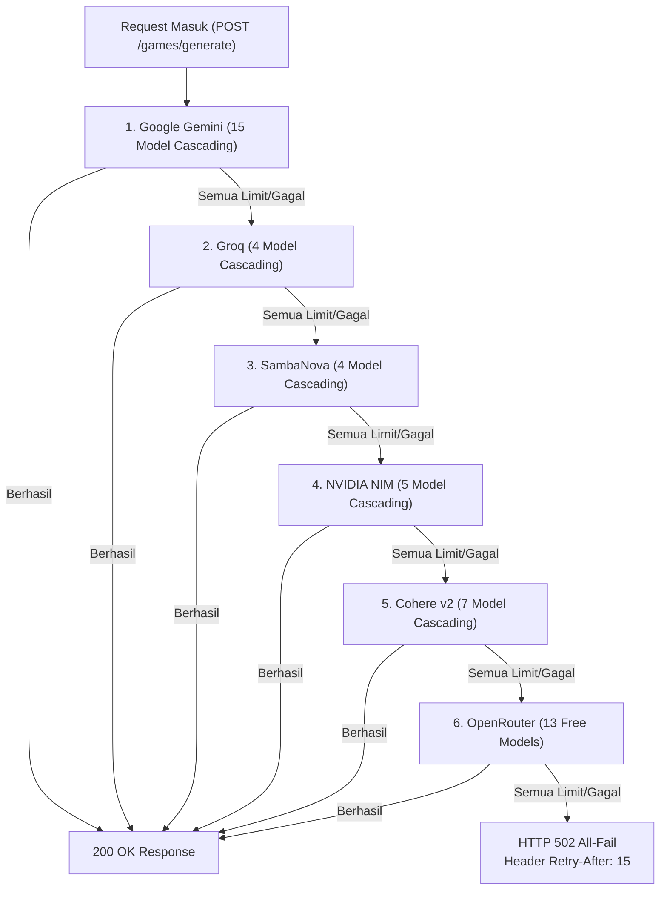

# Backend Operations Guide — Panduan Operasional & Pemeliharaan Server

> **STANDARD OPERATING PROCEDURE (SOP) OPERASIONAL BACKEND (BE-07)**  
> **PROYEK:** Ardena Playground Backend Service  
> **OTORITAS PENYETUJU:** Yogi Ario (Project Owner / Lead Developer)  
> **STATUS:** AKTIF & DIVERIFIKASI  
> **PORT DEFAULT:** `3001` (HTTP REST API)  

---

## 1. Prasyarat Sistem & Lingkungan Lokal

* **Node.js:** Versi LTS (v20.x atau lebih baru).
* **NPM:** Versi 10.x atau lebih baru.
* **Operating System:** Windows 10/11, macOS, atau Linux.
* **Lingkungan Server Web:** Dijalankan langsung melalui CLI Node.js.
  - ❌ **TIDAK MENGGUNAKAN LARAGON** (Sesuai ADR-003).
  - ❌ **TIDAK MEMBUTUHKAN APACHE / PHP / MYSQL**.

---

## 2. Struktur Perintah Manajemen Server

Seluruh perintah berikut dijalankan di dalam direktori `backend/`:

```powershell
# Berpindah ke direktori backend
Set-Location backend
```

| Perintah NPM | Fungsi & Tujuan | Catatan Operasional |
|---|---|---|
| `npm run dev` | Menjalankan server pada mode development (*hot reload*) | Menggunakan `ts-node-dev`, restart otomatis jika ada perubahan file di `src/`. |
| `npm run build` | Melakukan kompilasi TypeScript menjadi JavaScript | Menghasilkan direktori `dist/` bebas error. Wajib dijalankan sebelum deploy. |
| `npm start` | Menjalankan server production dari hasil build | Menggunakan `node dist/server.js`. Menjamin efisiensi memori maksimal. |
| `npm test` | Menjalankan seluruh test suite otomatis (9 suites) | Berjalan lokal dengan in-memory mock (**Zero Quota**). |
| `npm run test:coverage` | Menjalankan test suite beserta laporan metrik coverage | Memeriksa kepatuhan cakupan statement, branch, fungsi, dan baris kode. |

---

## 3. Konfigurasi Variabel Lingkungan & Kunci API

Backend memuat konfigurasi dari berkas `.env` (atau fallback otomatis ke `template/api`):

### 3.1 Berkas `.env` (Contoh Format)
```ini
# Server Port & Environment
PORT=3001
NODE_ENV=development

# CORS Whitelist Origins (Dipisahkan koma)
CORS_ORIGINS=http://localhost:8601,http://localhost:3000

# API Kredensial Hexa-Cluster AI
GEMINI_API_KEY=your_gemini_api_key_here
GROQ_API_KEY=your_groq_api_key_here
SAMBANOVA_API_KEY=your_sambanova_api_key_here
NVIDIA_API_KEY=your_nvidia_api_key_here
COHERE_API_KEY=your_cohere_api_key_here
OPENROUTER_API_KEY=your_openrouter_api_key_here
```

### 3.2 Rotasi Kredensial Aman (*Safe Secret Rotation*)
1. Jika salah satu kunci AI kedaluwarsa atau terkena limit bulanan, perbarui nilai kunci pada berkas `backend/.env` atau `template/api`.
2. Server yang berjalan dengan `npm run dev` akan memuat ulang konfigurasi secara otomatis.
3. Kunci API **100% aman dari kebocoran**: sistem regex masker dan dynamic redactor di `gemini.error.ts` menjamin kunci tidak akan pernah muncul di respons HTTP maupun terminal log.

---

## 4. Panduan Controlled Live Smoke Test

Tersedia skrip uji coba konektivitas live ke AI provider untuk memverifikasi keabsahan API key tanpa mengganggu test suite otomatis:

### 4.1 Uji Smoke Test Google Gemini Saja
```powershell
Set-Location backend
npx ts-node scripts/smoke-test-gemini.ts
```
* **Hasil Diharapkan:** Mengembalikan output JSON game spec valid dari Gemini 2.5 Flash / model aktif lainnya.

### 4.2 Uji Smoke Test Seluruh 6 Cluster Provider (Hexa-Cluster)
```powershell
Set-Location backend
npx ts-node scripts/smoke-test-all-providers.ts
```
* **Hasil Diharapkan:** Mengecek status koneksi ke Google, Groq, SambaNova, NVIDIA NIM, Cohere, dan OpenRouter secara berurutan.

---

## 5. SOP Penanganan Insiden & Failover



1. **Jika terjadi HTTP 502 All-Fail:**
   - Seluruh 48 model di 6 penyedia sedang mengalami lonjakan beban serentak (*peak load*).
   - Respons backend memuat header `Retry-After: 15`. Frontend akan menampilkan hitung mundur 15 detik sebelum meminta ulang.
2. **Jika terjadi HTTP 504 Timeout:**
   - Latensi jaringan upstream melampaui batas batas aman (45 detik).
   - Sarankan pengguna untuk menyederhanakan instruksi prompt.
3. **Pemeriksaan Log:**
   - Seluruh log error tercatat rapi dengan tag `[Ardena Error] [ReqID: ...] [Status: ...] [Code: ...]`. Gunakan `ReqID` untuk menelusuri tiket laporan pengguna.

