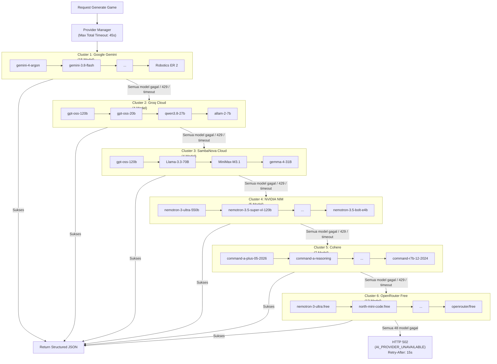

# AI Provider Strategy & Fallback Policy — Ardena Playground

> **STATUS:** UPDATED SPECIFICATION (Hexa-Cluster Architecture Approved by Yogi Ario)
> **OTORITAS PENYETUJU:** Yogi Ario (Project Owner)
> **STRATEGI:** *Kere Hore Multi-Tier Cascading Resilience (Maksimalisasi Free Tier Tanpa Biaya)*
> **TOTAL MODEL TERSEDIA:** 48 Model AI Terverifikasi Aktif pada 6 Provider

---

## 1. Arsitektur Hexa-Cluster Cascading Fallback

Backend Ardena Playground menerapkan pemisahan abstraksi yang sangat tangguh antara logika use case dengan integrasi vendor AI. Seluruh komunikasi vendor diatur secara otomatis oleh **Provider Manager** dengan kebijakan pemanggilan berurutan (*sequential*, tanpa pemanggilan paralel/*racing calls*) melintasi **6 Cluster Provider**:

---

## 2. Hirarki Lengkap 48 Model AI (Berdasarkan Tingkat Kepintaran & Efisiensi)

### 2.1 Cluster 1: Google Gemini (15 Model — Provider Utama)

1. `gemini-4-argon` (Flagship next-gen reasoning model)
2. `gemini-3.8-flash` (Ultra-fast high-throughput generation)
3. `gemini-3.6-flash` (High-speed structured output)
4. `gemini-3.5-flash-lite` (Lightweight low-latency model)
5. `gemini-3.1-pro-preview` (Advanced reasoning & complex logic)
6. `gemini-3.1-flash-lite` (Fast structured responder)
7. `gemini-3-flash-preview` (General high-performance flash model)
8. `gemini-2.5-pro` (Mature reasoning & code generator)
9. `gemini-2.5-flash` (Ultra-stable baseline flash model)
10. `gemini-flash-latest` (Gemini 2 Flash default)
11. `gemini-2.5-flash-lite` (Gemini 2 Flash Lite)
12. `gemma-4-31b-it` (Gemma 4 31B open instruct)
13. `gemma-4-26b-a4b-it` (Gemma 4 26B efficient instruct)
14. `gemini-2.5-computer-use-preview-10-2025` (Schema & tool-use follower)
15. `gemini-robotics-er-2-preview` (Spatial & algorithmic reasoning)

### 2.2 Cluster 2: Groq Cloud (4 Model — Fallback Tier 1)

1. `openai/gpt-oss-120b` (Flagship open-source reasoning model pada Groq LPU)
2. `openai/gpt-oss-20b` (Balanced efficiency model)
3. `qwen/qwen3.8-27b` (High-performance coding & logic specialist)
4. `allam-2-7b` (Compact low-latency tier)

### 2.3 Cluster 3: SambaNova Cloud (4 Model — Fallback Tier 2)

1. `gpt-oss-120b` (Flagship 120B pada SambaNova DataScale SN40L)
2. `Meta-Llama-3.3-70B-Instruct` (Llama 3.3 70B open weight instruct)
3. `MiniMax-M3.1-Flash` (High speed multi-turn generator)
4. `gemma-4-31B-it` (Google Gemma 4 31B pada SambaNova LDU)

### 2.4 Cluster 4: NVIDIA NIM (5 Model — Fallback Tier 3)

1. `nvidia/nemotron-3-ultra-550b-a55b` (550B parameter Ultra reasoning titan)
2. `nvidia/nemotron-3.5-super-vl-120b-a12b` (120B Super reasoning model)
3. `nvidia/nemotron-3.5-lightning-30b-a3b` (30B High-throughput instruct)
4. `nvidia/nemotron-3-nano-omni-30b-a3b-reasoning` (Nano Omni reasoning specialist)
5. `nvidia/nemotron-3.5-bolt-e4b` (Ultra-fast bolt generation tier)

### 2.5 Cluster 5: Cohere (7 Model — Fallback Tier 4)

1. `command-a-plus-05-2026` (Flagship 436k context reasoning model)
2. `command-a-reasoning-08-2025` (Complex logic & math reasoning)
3. `command-a-03-2025` (High-performance instruct model)
4. `command-r-plus-08-2024` (Command R+ enterprise generation)
5. `c4ai-aya-expanse-32b` (Multilingual 32B model)
6. `command-r-08-2024` (Command R balanced model)
7. `command-r7b-12-2024` (Command R 7B fast tier)

### 2.6 Cluster 6: OpenRouter Free (13 Model — Fallback Tier 5)

1. `nvidia/nemotron-3-ultra-550b-a55b:free` (Nemotron 550B free tier)
2. `nvidia/nemotron-3.5-super-vl:free` (1M context super model)
3. `nvidia/nemotron-3.5-lightning:free` (High-throughput reasoning)
4. `nvidia/nemotron-3-nano-omni-30b-a3b-reasoning:free` (Nano reasoning)
5. `cohere/north-mini-code:free` (Code specialist)
6. `google/gemma-4-31b-it:free` (Gemma 4 31B free tier)
7. `google/gemma-4-26b-a4b-it:free` (Gemma 4 26B free tier)
8. `xingchen-agi/xing4.0-29b-a4b:free` (XingChen 29B)
9. `recursive/flint-v1.0:free` (Flint 262k context)
10. `stealth/crouton-alpha` (1M context alpha)
11. `openrouter/free` (Auto-meta-router yang mengarahkan ke model free aktif)
12. `liquid/lfm-2.5-2.6b:free` (Liquid AI 2.6B lightweight)
13. `dots-studio/dots-3-note-preview:free` (Notes & structured output)

---

## 3. Disiplin Operasional & Tata Kelola Rahasia

1. **Urutan Sekuensial Murni (*No Racing Calls*):** Model dan provider dipanggil secara berurutan. Provider berikutnya HANYA dipanggil jika provider sebelumnya gagal karena HTTP 429 / kuota habis, timeout, atau 5xx.
2. **Zero Secret Leakage:** Kunci API (`Google`, `Groq`, `SambaNova`, `NVIDIA`, `Cohere`, `OpenRouter`) dimuat secara terisolasi. Seluruh string kunci otomatis disamarkan (`[REDACTED_...]`) pada terminal log dan output error.
3. **Total Request Timeout:** Maksimum `45.000 ms` untuk seluruh rangkaian failover lintas provider.
4. **Zero-Quota Mock Testing:** Seluruh automated unit test diuji tanpa mengonsumsi kuota asli.
