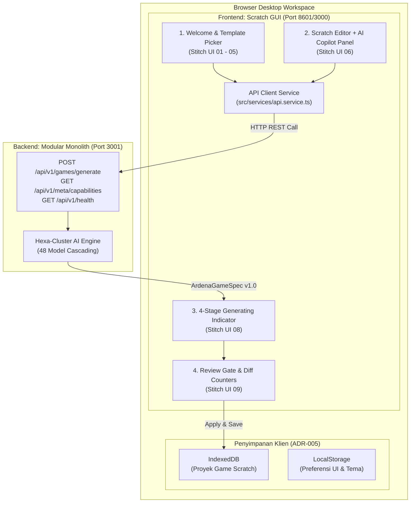
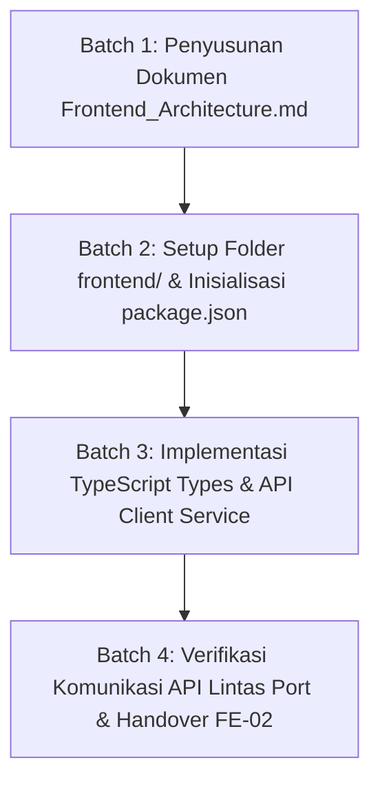

# Implementation Plan — Tahap 04 (FE-01): Audit Toolchain Scratch GUI & Strategi Integrasi Antarmuka

> **TAHAP:** Tahap 04 — Sub-Fase FE-01 (Audit Toolchain Scratch Editor & Strategi Integrasi Antarmuka Google Stitch)  
> **DOKUMEN INDUK:** `Docs/Implementation_Plan.md`, `Docs/backend/Backend_Handover.md`, `aturan/universal-rule.md`, `aturan/AGENTS.md`, `Docs/Decision_Log.md`  
> **STATUS:** MENUNGGU REVIEW & PERSETUJUAN DARI YOGI ARIO (APPROVAL GATE)  
> **OTORITAS PENYETUJU:** Yogi Ario (Project Owner / Lead Developer)  
> **PRINSIP:** *No Plan, No Code. No Approval, No Code. No Evidence, No Completion.*  

---

## 1. Tujuan & Ruang Lingkup

### 1.1 Tujuan Sub-Fase FE-01
Setelah **Tahap 03 (Git Baseline & Repository Setup)** dan **Tahap 05 (Backend AI Service BE-00 s/d BE-07)** tuntas 100% PASS, fokus proyek beralih ke **Tahap 04 (Implementasi Kode Frontend)**.

Sub-fase FE-01 bertujuan untuk:
1. Menetapkan struktur direktori frontend yang terisolasi dari backend (`frontend/`).
2. Menganalisis keselarasan toolchain resmi Scratch Editor (`scratch-gui`, `scratch-vm`, `scratch-blocks`) agar berjalan harmonis di port `8601` (atau `3000`) dan terhubung ke backend Express di port `3001`.
3. Menetapkan arsitektur adopsi komponen visual Google Stitch (`template/ardenaplayground/`) ke dalam React Scratch GUI tanpa memodifikasi atau merusak toolchain bawaan Scratch (*Zero Modification on Scratch Core Engine*).
4. Menyiapkan kontrak API Client di frontend yang mengonsumsi endpoint backend teruji (`/api/v1/health`, `/api/v1/meta/capabilities`, `/api/v1/games/generate`).

---

### 1.2 Skema Integrasi Frontend Scratch GUI & Backend Service

---

### 1.3 Pilihan Pendekatan Struktur Folder Frontend (`frontend/`):

* **Opsi A (Rekomendasi — Decoupled Workspace Folder `frontend/`):**
  - Membuat folder `frontend/` di root repositori.
  - Menginisialisasi komponen Scratch GUI dan lapisan wrapper Ardena di dalam `frontend/`.
  - Backend tetap independen di `backend/`.
  - *Kelebihan:* Struktur sangat rapi, dependency backend dan frontend tidak tercampur, build toolchain Scratch Webpack tidak mengganggu compiler TypeScript backend.
* **Opsi B (Clone Submodule Repositori `scratch_ardena`):**
  - Meng-clone repo upstream `https://github.com/useripx/scratch_ardena.git` langsung sebagai submodule di `frontend/`.
  - *Trade-off:* Memerlukan manajemen Git Submodule yang terkadang kompleks saat sinkronisasi branch lokal.

---

### 1.4 Ruang Lingkup Pekerjaan (In-Scope untuk FE-01):
1. **Penyusunan Arsitektur Frontend (`Docs/frontend/Frontend_Architecture.md`):**
   - Menetapkan arsitektur React component, state management (Redux bawaan Scratch GUI + Context API untuk panel AI Ardena).
   - Pemetaan rute tampilan (Landing Page ➔ Template Picker ➔ Scratch Editor Workspace ➔ Review Modal).
2. **Setup Folder & Dependency Baseline `frontend/`:**
   - Menyiapkan `package.json` frontend yang kompatibel dengan React Scratch GUI.
   - Mengonfigurasi proxy dev server atau environment `VITE_API_BASE_URL` / `REACT_APP_API_URL` mengarah ke `http://localhost:3001`.
3. **Pembuatan API Client Terpadu (`frontend/src/services/api.service.ts`):**
   - Fungsi `checkHealth()`: Memanggil `GET /api/v1/health`.
   - Fungsi `getCapabilities()`: Memanggil `GET /api/v1/meta/capabilities`.
   - Fungsi `generateGame(payload)`: Memanggil `POST /api/v1/games/generate` dengan penanganan timeout, abort controller, dan parsing error (HTTP 413, 422, 502 dengan `Retry-After`).
4. **Verifikasi Komunikasi Lintas Port (CORS Check):**
   - Memastikan request dari origin dev frontend (`http://localhost:8601` atau `http://localhost:3000`) diterima mulus oleh backend di port 3001.

---

### 1.5 Di Luar Ruang Lingkup (Out-of-Scope untuk FE-01):
- ❌ **TIDAK** mengubah engine inti `scratch-vm` atau compiler blok (dilakukan pada Tahap 06).
- ❌ **TIDAK** mengubah kode backend yang telah teruji 100% PASS di BE-07.

---

## 2. Analisis Kondisi Saat Ini (*Current State*)

* **Backend Baseline:** Aktif, teruji 100% PASS (65/65 tests), CORS telah mengizinkan `http://localhost:8601` dan `http://localhost:3000`.
* **Desain Visual:** 19 layar Stitch prototype siap di `template/ardenaplayground/` berstatus Read-Only.
* **Kontrak Handover:** Dokumen `Docs/backend/Backend_Handover.md` telah memetakan diff counters dan error codes.
* **Git Status:** Repositori aktif di branch `develop`, clean working tree.

---

## 3. Daftar Berkas Target yang Akan Dibuat / Dimodifikasi

| Path Berkas | Status | Peran & Fungsi Berkas |
|---|---|---|
| `Docs/frontend/Frontend_Architecture.md` | **BARU** | Arsitektur lengkap modul frontend, state flow, dan adopsi Scratch GUI. |
| `frontend/package.json` | **BARU** | Konfigurasi dependensi antarmuka frontend React. |
| `frontend/src/services/api.service.ts` | **BARU** | HTTP Client penghubung antarmuka ke backend port 3001. |
| `frontend/src/types/game.types.ts` | **BARU** | Type definition TypeScript selaras dengan `ArdenaGameSpec` v1.0. |
| `Docs/Task_Status.md` | **MODIFIKASI** | Pembaruan pelacak kemajuan frontend. |

---

## 4. Rencana Langkah Kerja Bertahap (*Execution Batches*)

### Batch 1: Desain Arsitektur Frontend
* Menyusun `Docs/frontend/Frontend_Architecture.md` memetakan alur komponen React dari prototipe Stitch 19 layar.

### Batch 2: Setup Workspace Frontend
* Menyiapkan folder `frontend/` dan inisialisasi package configuration dengan isolasi toolchain yang bersih.

### Batch 3: Implementasi API Client & Types
* Membuat `frontend/src/types/game.types.ts` mengimpor kontrak `ArdenaGameSpec` v1.0.
* Membuat `frontend/src/services/api.service.ts` dengan penanganan header `Retry-After: 15` dan safe error toast.

### Batch 4: Verifikasi & Pelaporan
* Menguji konektivitas API Client ke server backend lokal (port 3001) via automated unit test di frontend.
* Memperbarui `Docs/Task_Status.md` dan merilis changelog.

---

## 5. Pertanyaan Review untuk Yogi Ario (Project Owner)

Silakan periksa rancangan awal frontend di atas dan beri masukan pada poin-poin berikut:
1. **Pilihan Struktur Frontend:** Apakah Anda menyetujui **Opsi A (Folder `frontend/` terpisah / decoupled monorepo)** agar toolchain React Scratch Editor tidak bercampur dengan backend TypeScript?
2. **Persetujuan Rencana:** Apakah Anda menyetujui rencana kerja Sub-Fase FE-01 ini untuk kita mulai eksekusi Batch 1?

