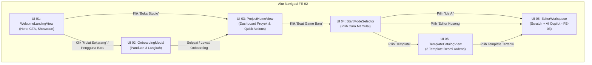

# Implementation Plan — Sub-Fase FE-02: Fondasi Komponen UI Ardena (Landing Page, Onboarding, Project Home, & Template Picker)

> **DOKUMEN RENCANA KERJA TEKNIS (FE-02)**  
> **PROYEK:** Ardena Playground  
> **OTORITAS PENYETUJU:** Yogi Ario (Project Owner / Lead Developer)  
> **STATUS:** MENUNGGU PERSETUJUAN (PENDING APPROVAL)  
> **PRASYARAT:** Sub-Fase FE-01 Selesai, 100% PASS, README Premium & Push Multi-Branch GitHub Selesai.

---

## 1. Ringkasan Eksekutif & Tujuan Sub-Fase FE-02

Melanjutkan keberhasilan **Sub-Fase FE-01** (arsitektur decoupled extension, kontrak data TypeScript, dan API client service), Sub-Fase **FE-02** berfokus pada pembangunan **Fondasi Komponen UI/UX Ardena Playground** yang mengadaptasi langsung desain interaktif dari **5 Prototipe Google Stitch** (`template/ardenaplayground/`):
1. **UI 01 — `<WelcomeLandingView />`:** Halaman penyambutan publik dengan *hero visual showcase*, trust badge penyimpanan lokal, pilar inovasi, dan tombol CTA utama (*"Mulai Sekarang — Gratis"* / *"Buka Studio"*).
2. **UI 02 — `<OnboardingModal />`:** Modal panduan interaktif 3 langkah bagi pengguna baru (1. Tulis Ide Bahasa Alami ➔ 2. Review Hasil AI Bergaransi ➔ 3. Mainkan & Edit di Scratch) lengkap dengan tombol *"Lewati"* dan *"Lanjut"*.
3. **UI 03 — `<ProjectHomeView />`:** Dashboard beranda proyek (*creative studio hub*) yang menampilkan aksi cepat, daftar proyek lokal pengguna (IndexedDB/mock), dan carousel template game rekomendasi.
4. **UI 04 — `<StartModeSelector />`:** Modal/view pemilih cara memulai dengan 3 kartu interaktif: *"Mulai dari Ide AI"*, *"Mulai dari Template Game"*, dan *"Mulai dari Scratch Editor Kosong"*.
5. **UI 05 — `<TemplateCatalogView />`:** Katalog 3 template game resmi (*Catching Game*, *Maze Adventure*, *Space Shooter*) dengan metadata tingkat kesulitan, tag mekanik, deskripsi edukatif, dan integrasi dinamis ke endpoint backend `GET /api/v1/meta/capabilities`.

---

## 2. Alur Navigasi Antar-Layar (State-Driven Router)



---

## 3. Spesifikasi Rinci Komponen Target

### 3.1 `<WelcomeLandingView />` (Mengacu `ui_01_welcome_landing_page/code.html`)
- **Header Navigasi:** Logo Ardena Playground (`Docs/assets/logo.png`), menu anchor (Beranda, Fitur AI, Template Game, Panduan, Tentang), tombol *"Pelajari Lebih Dulu"*, dan CTA *"Buka Studio"*.
- **Hero Section:**
  - Chip badge: *"Inovasi Pembuatan Game Edukatif • Berbasis Scratch & AI Copilot"*.
  - Headline utama: *"Wujudkan Ide Game Impianmu Jadi Nyata dalam Hitungan Detik"*.
  - Tombol aksi primer & sekunder dengan *hover transition* halus.
  - Microcopy trust: *"100% Penyimpanan Lokal di Browser • Tanpa Perlu Akun • Ramah Anak & Semua Usia"*.
- **Studio Showcase Mockup:** Tri-pane visual mockup yang memperlihatkan prompt bahasa alami, status analisa AI, blok Scratch kuning/biru yang dihasilkan, dan preview game stage.
- **Section Fitur & Alur Kerja:** 3 langkah visual (Tulis Ide ➔ AI Menyusun Blok ➔ Main & Modifikasi di Scratch).

### 3.2 `<OnboardingModal />` (Mengacu `ui_02_onboarding_panduan_awal/code.html`)
- **Struktur Dialog:** Modal melayang (*floating modal*) dengan backdrop blur semi-transparan (`bg-black/40 backdrop-blur-sm`).
- **Pagination 3 Langkah:**
  - **Langkah 1:** *"Tulis Ide Game dalam Bahasa Apapun"* (ilustrasi input prompt teks).
  - **Langkah 2:** *"Review Hasil AI Tanpa Rasa Takut"* (ilustrasi diff counters `+Sprite`, `+Variabel`, `0 Overwrite`).
  - **Langkah 3:** *"Eksplorasi & Modifikasi di Scratch Asli"* (ilustrasi panggung editor & ekspor `.sb3`).
- **Kontrol Aksi:** Tombol *"Lewati Panduan"*, tombol *"Kembali"*, dan tombol *"Lanjut"* / *"Mulai Berkreasi"*.
- **State Persistence:** Menyimpan flag `ardena_onboarding_completed: true` di `localStorage` agar tidak berulang kecuali diminta pengguna.

### 3.3 `<ProjectHomeView />` (Mengacu `ui_03_beranda_project_home/code.html`)
- **Header Sambutan:** Salam personal *"Selamat Datang di Studio Ardena!"* dengan indikator status AI Backend (*Online / Siap Melayani*).
- **Aksi Cepat (Quick Action Cards):**
  - Kartu 1: *"Buat dari Ide Baru"* (mengarahkan ke mode prompt AI).
  - Kartu 2: *"Jelajahi Template"* (mengarahkan ke katalog template).
  - Kartu 3: *"Buka Editor Kosong"* (mengarahkan langsung ke canvas Scratch murni).
- **Bagian Proyek Lokal Terbaru:**
  - Menampilkan grid kartu game lokal (thumbnail canvas, judul game, tanggal modifikasi, tombol *"Buka"* dan menu opsi).
  - Dilengkapi *Empty State* ramah anak jika pengguna belum memiliki proyek tersimpan.
- **Bagian Template Rekomendasi:** Preview 3 kartu template dengan tombol aksi cepat *"Gunakan"*.

### 3.4 `<StartModeSelector />` (Mengacu `ui_04_pilih_cara_memulai/code.html`)
- Modal/View elegan yang memberikan 3 jalur kreasi:
  1. **Mode A (Ide AI Copilot - Direkomendasikan):** *"Ketik ide ceritamu, biarkan AI merancang karakter, kontrol, dan aturan main."*
  2. **Mode B (Template Game Populer):** *"Mulai dari kerangka siap pakai yang sudah terbukti seru dan seimbang."*
  3. **Mode C (Editor Scratch Kosong):** *"Mulai dari kanvas bersih tanpa bantuan AI untuk kebebasan total."*

### 3.5 `<TemplateCatalogView />` (Mengacu `ui_05_pilih_template_game/code.html`)
- **Integrasi Backend Dinamis:** Memanggil `apiService.getCapabilities()` untuk mengambil daftar template resmi dan versi skema JSON.
- **3 Template Game Bawaan:**
  - **Catching Game:** Keranjang menangkap apel jatuh, skor bertambah, efek sfx tangkap (Tingkat: Pemula).
  - **Maze Adventure:** Menavigasi labirin dengan tombol panah, menghindari dinding & musuh patroli (Tingkat: Menengah).
  - **Space Shooter:** Pesawat menembak asteroid dan musuh luar angkasa, peluru laser, dan nyawa (Tingkat: Lanjutan).
- **Detail Kartu:** Thumbnail, label kesulitan, tag genre, deskripsi aturan main, dan tombol *"Gunakan Template Ini"*.

---

## 4. Rencana Implementasi & Struktur Berkas Baru

```
frontend/src/
├── components/
│   ├── common/
│   │   ├── Navbar.tsx             # Header navigasi utama dengan logo & status
│   │   ├── Footer.tsx             # Footer informasi dan hak cipta
│   │   └── Modal.tsx              # Reusable modal container dengan backdrop blur
│   ├── landing/
│   │   └── WelcomeLandingView.tsx # UI 01: Welcome landing page
│   ├── onboarding/
│   │   └── OnboardingModal.tsx    # UI 02: 3-step onboarding walkthrough
│   ├── home/
│   │   └── ProjectHomeView.tsx    # UI 03: Dashboard beranda proyek
│   ├── starter/
│   │   └── StartModeSelector.tsx  # UI 04: Pilihan 3 cara memulai
│   └── templates/
│       └── TemplateCatalogView.tsx # UI 05: Katalog 3 template game resmi
├── router/
│   └── ViewRouter.tsx             # State router ringan untuk transisi antar-tampilan
└── styles/
    └── design-tokens.css          # Palet warna Material 3 & tipografi Google Stitch
```

---

## 5. Strategi Verifikasi & Automated Testing (100% PASS Gate)

Mengacu pada **Pilar 6 (100% Automated Testing Gate)**, Sub-Fase FE-02 akan diverifikasi dengan skenario uji komprehensif:

| ID Pengujian | Target Komponen | Skenario Uji | Kriteria Sukses |
|---|---|---|---|
| `TEST-FE02-01` | `<WelcomeLandingView />` | Render hero section, teks headline, dan tombol CTA utama | Elemen HTML dan teks sesuai prototipe Stitch ter-render |
| `TEST-FE02-02` | `<OnboardingModal />` | Navigasi langkah 1 -> 2 -> 3 dan fungsi tombol "Lewati" | Pindah langkah dengan benar & menyimpan flag `localStorage` |
| `TEST-FE02-03` | `<ProjectHomeView />` | Render 3 kartu quick action dan empty state proyek lokal | Kartu aksi dan pesan empty state tampil sempurna |
| `TEST-FE02-04` | `<StartModeSelector />` | Pemilihan mode (AI Copilot vs Template vs Scratch Kosong) | Trigger event callback navigasi sesuai opsi terpilih |
| `TEST-FE02-05` | `<TemplateCatalogView />` | Pemuatan 3 template resmi dari `apiService.getCapabilities` | 3 template resmi ter-render dengan metadata akurat |
| `TEST-FE02-06` | `<ViewRouter />` | Navigasi antar-layar berbasis state internal | Pergantian view berjalan mulus tanpa page reload |
| `TEST-FE02-07` | TypeScript Compilation | `npm run build` pada folder `frontend/` | Kompilasi TypeScript sukses (`0 ERROR`) |

---

## 6. Pertanyaan Klarifikasi untuk Yogi Ario

Sebelum mengeksekusi implementasi FE-02, mohon konfirmasi untuk opsi preferensi tampilan berikut:
1. **Perilaku Tombol "Mulai Sekarang" di Landing Page (UI 01):**
   - **Opsi A (Rekomendasi):** Jika pengguna baru pertama kali berkunjung, buka `<OnboardingModal />` (UI 02) terlebih dahulu. Jika sudah pernah menyelesaikan onboarding, langsung masuk ke `<ProjectHomeView />` (UI 03).
   - **Opsi B:** Selalu buka `<StartModeSelector />` (UI 04) secara langsung untuk mempercepat alur kreasi.
2. **Ketersediaan Gambar/Aset Thumbnail:**
   - Untuk thumbnail template game (Catching, Maze, Space), apakah diperbolehkan merender komponen kartu dengan kombinasi ikon Material SVG dan palet warna tematik Stitch yang responsif sambil menunggu aset grafis permanen?
