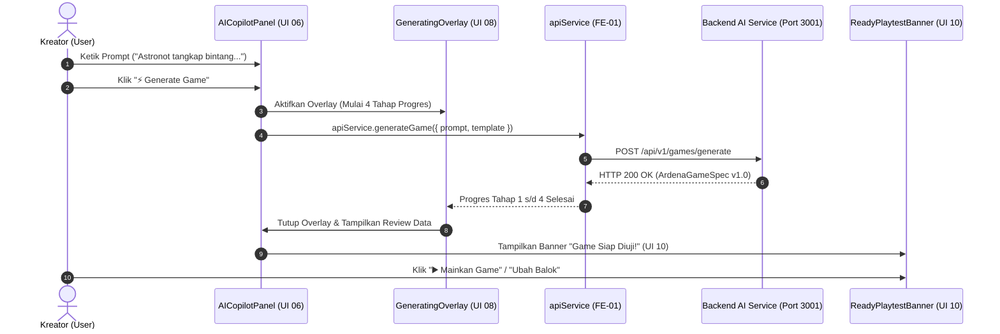

# Implementation Plan — Sub-Fase FE-03: Integrasi Editor Workspace & AI Copilot Panel (UI 06, UI 08, & UI 10)

> **DOKUMEN RENCANA KERJA TEKNIS (FE-03)**  
> **PROYEK:** Ardena Playground  
> **OTORITAS PENYETUJU:** Yogi Ario (Project Owner / Lead Developer)  
> **STATUS:** MENUNGGU PERSETUJUAN (PENDING APPROVAL)  
> **PRASYARAT:** Sub-Fase FE-02 Selesai, 100% PASS (14 Tests Lulus), Branch `main` Bersih, dan Push Multi-Branch GitHub Selesai.

---

## 1. Ringkasan Eksekutif & Tujuan Sub-Fase FE-03

Setelah fondasi antarmuka publik dan beranda studio (`<WelcomeLandingView />`, `<OnboardingModal />`, `<ProjectHomeView />`, `<StartModeSelector />`, dan `<TemplateCatalogView />`) diselesaikan secara sempurna pada **FE-02**, Sub-Fase **FE-03** melangkah ke **Jantung Pengalaman Pengguna (Core Workspace Experience)**:
1. **UI 06 — `<EditorWorkspace />` & `<AICopilotPanel />`:**
   - Menyusun layout tiga area (*tri-pane layout*) Scratch Editor modern: Topbar navigasi editor, Panggung (*Stage* 480x360 px), Palet kategori & area kerja balok (*Blockly Workspace*), dan Dock Panel AI Copilot di sisi kanan yang dapat di-*toggle/collapse*.
   - Panel AI Copilot dilengkapi 3 mode interaktif: **"Buat"** (*create new game/sprite*), **"Ubah"** (*tweak mechanics/rules*), dan **"Jelaskan"** (*explain block logic*), disertai contoh prompt kurasi cepat.
2. **UI 08 — `<GeneratingOverlay />`:**
   - Indikator progres visual 4 tahap saat AI sedang bekerja menyusun game, mencegah kebingungan pengguna (*spinner blindness*):
     - **Tahap 1:** 💡 *Menganalisis ide cerita & peran karakter...*
     - **Tahap 2:** 📐 *Memvalidasi skema JSON & batasan aman...*
     - **Tahap 3:** 🧱 *Menyusun struktur balok logika Scratch...*
     - **Tahap 4:** 🎵 *Menyiapkan efek suara SFX & variabel skor...*
3. **UI 10 — `<ReadyPlaytestBanner />`:**
   - Notifikasi sukses mengambang di atas panggung Scratch saat game berhasil dirakit oleh AI, memberi arahan ramah anak: *"Game Siap Dimainkan! Tekan Bendera Hijau untuk Menguji."*
4. **Integrasi Layanan API (`apiService.generateGame`):**
   - Menghubungkan textarea prompt pada AI Copilot Panel ke layanan backend Express (Port 3001) dengan timeout guard dan handling abort controller.

---

## 2. Diagram Alur Interaksi AI Copilot di Dalam Editor



---

## 3. Spesifikasi Rinci Komponen Target FE-03

### 3.1 `<EditorWorkspace />` (Mengacu `ui_06_editor_utama_scratch_ai_copilot/code.html`)
- **Top Navigation Bar:**
  - Logo kecil Ardena Playground.
  - Input judul proyek inline (dapat diubah nama).
  - Status penyimpanan lokal (ikon awan/hardisk: *"Tersimpan Lokal"*).
  - Kontrol Panggung: Tombol Bendera Hijau (Mulai) & Tombol Merah (Berhenti).
  - Tombol Toggle AI Copilot: Membuka/menutup dock panel kanan.
- **Main Editor Shell:**
  - **Area Kiri/Tengah:** Placeholder workspace Scratch Blocks & Stage canvas yang responsif.
  - **Area Kanan:** Docking panel `<AICopilotPanel />` selebar 380px–420px pada desktop.

### 3.2 `<AICopilotPanel />`
- **Tabs Mode:**
  - Tab 1: **"Buat"** (Aktif untuk generasi game/sprite baru).
  - Tab 2: **"Ubah"** (Untuk menambah skor, mengubah kecepatan musuh, mengganti sfx).
  - Tab 3: **"Jelaskan"** (Tutor AI menjelaskan fungsi balok yang dipilih).
- **Prompt Textarea:**
  - Batas karakter informatif (maks. 2.000 karakter).
  - Chip inspirasi prompt cepat: *"Tangkap Bintang Antariksa"*, *"Labirin Teka-Teki"*, *"Balapan Mobil"*.
- **Pilihan Template:** Dropdown opsional untuk membatasi genre (*Catching*, *Maze*, *Space Shooter*).
- **Status Cluster AI:** Badge dinamis menunjukkan ketersediaan cluster (*Gemini Cascading Active*).

### 3.3 `<GeneratingOverlay />` (Mengacu `ui_08_generating_state_indikator_proses_ai/code.html`)
- Animasi bertahap 4 langkah dengan progress bar visual (0% ➔ 25% ➔ 50% ➔ 75% ➔ 100%).
- Pesan motivasi ramah anak yang berganti otomatis setiap beberapa detik.
- Tombol *"Batalkan"* yang memanggil `AbortController.abort()`.

### 3.4 `<ReadyPlaytestBanner />` (Mengacu `ui_10_editor_terisi_hasil_generate_siap_diuji/code.html`)
- Banner mengambang dengan latar belakang gradien hijau/biru ceria.
- Menampilkan ringkasan singkat: `+2 Sprite`, `+1 Variabel`, `+Balok Logika`.
- Tombol aksi: *"Uji Mainkan"* dan *"Lanjut Edit Balok"*.

---

## 4. Rencana Struktur Berkas Baru

```
frontend/src/
├── components/
│   └── editor/
│       ├── EditorWorkspace.tsx     # UI 06: Shell utama editor Scratch
│       ├── EditorTopNav.tsx        # Topbar editor (Project Name, Run/Stop, Save Status)
│       ├── AICopilotPanel.tsx      # Dock panel kanan AI Copilot (Tabs Buat/Ubah/Jelaskan)
│       ├── GeneratingOverlay.tsx   # UI 08: Indikator proses AI 4 tahap
│       └── ReadyPlaytestBanner.tsx # UI 10: Notifikasi panggung siap playtest
```

---

## 5. Strategi Verifikasi & Automated Testing (100% PASS Gate)

Mengacu pada **Pilar 6 (100% Automated Testing Gate)**, Sub-Fase FE-03 akan diuji dengan kasus uji otomatis:

| ID Pengujian | Target Komponen | Skenario Uji | Kriteria Sukses |
|---|---|---|---|
| `TEST-FE03-01` | `<EditorWorkspace />` | Render topbar, status simpan, dan toggle panel Copilot | Topbar ter-render & Copilot panel dapat dibuka/tutup |
| `TEST-FE03-02` | `<AICopilotPanel />` | Penggantian mode (Buat vs Ubah vs Jelaskan) | Tab berganti & prompt state terisolasi dengan rapi |
| `TEST-FE03-03` | `<AICopilotPanel />` | Pengisian prompt dan klik contoh prompt cepat | Textarea terisi teks inspirasi saat chip diklik |
| `TEST-FE03-04` | `<GeneratingOverlay />` | Transisi 4 tahap proses dan tombol batalkan | Indikator langkah 1 s/d 4 aktif & abort trigger bekerja |
| `TEST-FE03-05` | `<ReadyPlaytestBanner />` | Menampilkan diff counters dan tombol CTA playtest | Banner muncul saat state 'ready' dengan data akurat |
| `TEST-FE03-06` | TypeScript Build | `npm run build` pada folder `frontend/` | Kompilasi TypeScript sukses (`0 ERROR`) |

---

## 6. Pertanyaan Klarifikasi untuk Yogi Ario

Sebelum mengeksekusi implementasi FE-03, mohon konfirmasi untuk preferensi interaksi berikut:
1. **Posisi Dock AI Copilot pada Layar Desktop:**
   - **Opsi A (Rekomendasi - Standar Google Stitch):** Berada di sisi kanan (*Right Dock Sidebar*), sehingga kanvas panggung dan palet blok Scratch di sebelah kiri tetap lega dan tidak terhalang.
   - **Opsi B:** Panel mengambang (*Floating Drawer*) yang dapat digeser-geser.
2. **Durasi Simulasi Indikator 4 Tahap Progres:**
   - Saat backend merespons cepat (< 2 detik), apakah disetujui memasang transisi visual minimal 400ms per tahap agar pengguna sempat membaca proses edukatifnya (Ide ➔ JSON ➔ Balok ➔ SFX)?
