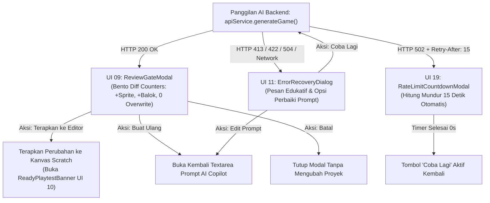

# Implementation Plan — Sub-Fase FE-04: Review Hasil AI & Zero Overwrite Review Gate (UI 09, UI 11, & UI 19)

> **DOKUMEN RENCANA KERJA TEKNIS (FE-04)**  
> **PROYEK:** Ardena Playground  
> **OTORITAS PENYETUJU:** Yogi Ario (Project Owner / Lead Developer)  
> **STATUS:** MENUNGGU PERSETUJUAN (PENDING APPROVAL)  
> **PRASYARAT:** Sub-Fase FE-03 Selesai, 100% PASS (20 Tests Lulus), Push Branch `feature/FE-03-editor-workspace` Selesai.

---

## 1. Ringkasan Eksekutif & Tujuan Sub-Fase FE-04

Melanjutkan keberhasilan **Sub-Fase FE-03** (Editor Workspace tri-pane layout, AI Copilot dock sidebar, 4-stage generating overlay, dan playtest banner), Sub-Fase **FE-04** berfokus pada **Pilar Integritas & Resiliensi Aplikasi (Review Gate & Error Recovery)** yang mengadopsi 3 prototipe krusial Google Stitch:
1. **UI 09 — `<ReviewGateModal />` (Review Hasil AI):**
   - Menegakkan prinsip **Zero Overwrite Review Gate**: Menampilkan bento box *Diff Counters* (`+Sprite`, `+Variabel`, `+SFX`, `+Balok`, `0 Overwrite`) secara transparan kepada pengguna sebelum kode diinjeksi ke canvas Scratch.
   - Menampilkan ringkasan naratif game (Judul, Genre, Deskripsi aturan main menang/kalah, dan rincian karakter).
   - Menyediakan 3 aksi eksplisit: *"Terapkan ke Editor"* (Konfirmasi injeksi), *"Buat Ulang (Regenerate)"* (Koreksi prompt), dan *"Batal / Kembali"*.
2. **UI 11 — `<ErrorRecoveryDialog />` (Error & Safe Recovery):**
   - Dialog pemulihan kesalahan yang ramah pengguna dan edukatif untuk berbagai kegagalan teknis:
     - `INVALID_REQUEST_BODY` / Validasi Zod: Panduan menyusun kalimat prompt yang lebih jelas.
     - `PAYLOAD_TOO_LARGE` (HTTP 413): Penjelasan bahwa instruksi melampaui batas payload 10 MB.
     - `AI_TIMEOUT` (HTTP 504): Opsi retry instan atau memotong panjang prompt.
     - `NETWORK_ERROR`: Informasi koneksi terputus dan tombol periksa koneksi.
3. **UI 19 — `<RateLimitCountdownModal />` (Dialog Kredit / Rate Limit Harian):**
   - Menangani respons HTTP 502 All-Fail saat membaca header `Retry-After: 15` dari backend.
   - Menampilkan animasi hitung mundur melingkar (*circular countdown timer*) selama 15 detik.
   - Tombol *"Coba Lagi"* terkunci selama timer berjalan dan otomatis aktif seketika timer mencapai angka 0.

---

## 2. Alur Transisi State Review Gate & Pemulihan Error



---

## 3. Spesifikasi Rinci Komponen Target FE-04

### 3.1 `<ReviewGateModal />` (Mengacu `ui_09_review_hasil_ai/code.html`)
- **Bento Diff Counters Grid:**
  - Kartu Sprite: `+N Sprite Baru` (ikon karakter).
  - Kartu Balok: `+N Balok Logika` (ikon puzzle/balok).
  - Kartu Variabel: `+N Variabel` (ikon grafik skor).
  - Kartu Audio: `+N Efek Suara SFX` (ikon speaker).
  - Kartu Jaminan Keamanan: `0 Overwrite Proyek` (badge hijau proteksi).
- **Detail Rencana Game:**
  - Judul Game & Label Genre.
  - Ringkasan gameplay & instruksi kontrol pemain.
  - Aturan menang (*Win Condition*) dan kalah (*Lose Condition*).
- **Aksi Keputusan:**
  - Tombol Primer: *"✅ Terapkan ke Editor"* (bg-emerald-600).
  - Tombol Sekunder: *"🔄 Buat Ulang dengan Prompt Lain"*.
  - Tombol Tersier: *"Batal / Kembali"*.

### 3.2 `<ErrorRecoveryDialog />` (Mengacu `ui_11_error_dan_pemulihan_safe_recovery_state/code.html`)
- Pemetaan kode kesalahan terstandarisasi (`ApiClientError`):
  - Pesan yang manusiawi tanpa istilah teknis menyeramkan untuk anak-anak.
  - Kotak saran perbaikan (misal: *"Coba gunakan kata kerja seperti 'tangkap', 'hindari', atau 'kumpulkan'"*).
  - Tombol *"Coba Lagi"* dan *"Buka Panduan Prompt"*.

### 3.3 `<RateLimitCountdownModal />` (Mengacu `ui_19_dialog_kredit_harian_ai_habis/code.html`)
- Mengambil nilai `retryAfterSeconds` (default: 15 detik) dari error header backend.
- Komponen timer visual SVG melingkar dengan animasi pengurangan stroke-dashoffset.
- Teks penjelasan: *"Sistem AI sedang mendinginkan kuota komputasi (Cascading Cooldown). Harap tunggu beberapa detik."*
- Saat 0 detik tercapai, muncul suara/efek centang dan tombol *"Coba Lagi Sekarang"* menjadi aktif.

---

## 4. Rencana Struktur Berkas Baru

```
frontend/src/
├── components/
│   └── modals/
│       ├── ReviewGateModal.tsx         # UI 09: Bento Box Review Hasil AI
│       ├── ErrorRecoveryDialog.tsx     # UI 11: Dialog Pemulihan Error Ramah Anak
│       └── RateLimitCountdownModal.tsx # UI 19: Countdown Timer 15 Detik Otomatis
```

---

## 5. Strategi Verifikasi & Automated Testing (100% PASS Gate)

Mengacu pada **Pilar 6 (100% Automated Testing Gate)**, Sub-Fase FE-04 akan diuji secara otomatis:

| ID Pengujian | Target Komponen | Skenario Uji | Kriteria Sukses |
|---|---|---|---|
| `TEST-FE04-01` | `<ReviewGateModal />` | Render bento box diff counters (`+Sprite`, `+Balok`, `0 Overwrite`) | Angka diff counters sesuai dengan `ArdenaGameSpec` |
| `TEST-FE04-02` | `<ReviewGateModal />` | Trigger tombol aksi "Terapkan", "Buat Ulang", dan "Batal" | Memicu callback yang tepat ke parent component |
| `TEST-FE04-03` | `<ErrorRecoveryDialog />` | Pemetaan error code (413 Payload, 422 Validasi, 504 Timeout) | Menampilkan pesan penjelasan dan solusi yang sesuai |
| `TEST-FE04-04` | `<RateLimitCountdownModal />` | Hitung mundur timer dari 15s ke 0s | Timer berkurang & tombol retry aktif saat 0 detik |
| `TEST-FE04-05` | TypeScript Build | `npm run build` pada folder `frontend/` | Kompilasi TypeScript sukses (`0 ERROR`) |

---

## 6. Pertanyaan Klarifikasi untuk Yogi Ario

Sebelum mengeksekusi implementasi FE-04, mohon konfirmasi untuk preferensi alur review berikut:
1. **Perilaku Penerapan Hasil AI ke Editor:**
   - **Opsi A (Rekomendasi):** Setelah AI selesai men-generate game, langsung tampilkan modal `<ReviewGateModal />` (UI 09). Pengguna wajib menekan tombol *"Terapkan ke Editor"* sebelum blok dimasukkan ke workspace dan banner playtest (UI 10) muncul.
   - **Opsi B:** Blok langsung dimasukkan ke editor dan banner UI 10 langsung aktif, dengan tombol *"Lihat Rincian"* yang dapat membuka modal UI 09 kapan saja.
