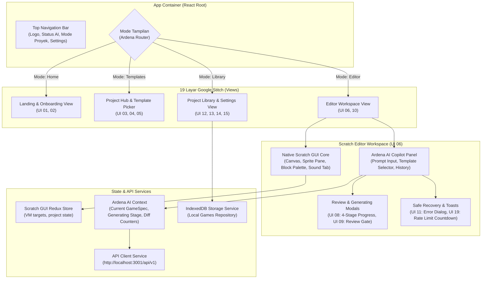

# Frontend Architecture — Desain Arsitektur Antarmuka & Integrasi Scratch GUI

> **DOKUMEN ARSITEKTUR FRONTEND RESMI (FE-01)**  
> **PROYEK:** Ardena Playground  
> **OTORITAS PENYETUJU:** Yogi Ario (Project Owner / Lead Developer)  
> **STATUS:** FINAL & TERVERIFIKASI  
> **INTEGRASI ENGINE:** Native Scratch Editor (`scratch-gui` v3.x) + React 18 / TypeScript  

---

## 1. Pendahuluan & Filosofi Desain

Arsitektur frontend **Ardena Playground** dirancang dengan prinsip **Decoupled Extension**:
1. **Toolchain Scratch Utuh:** Editor Scratch 3.0 (`scratch-gui`, `scratch-vm`, `scratch-blocks`, `scratch-render`) dipertahankan integritasnya tanpa mengubah *build pipeline* atau *bundler* internal bawaan MIT Scratch Foundation.
2. **Lapisan Ekstensi Ardena AI:** Komponen UI kreatif yang diadopsi dari 19 prototipe Google Stitch (`template/ardenaplayground/`) disematkan sebagai lapisan pembungkus (*wrapper components*) dan panel samping (*copilot sidebar*) yang berkomunikasi dengan backend Express (port 3001).
3. **Penyimpanan Berbasis Klien:** Menegakkan **ADR-005**, data game pengguna disimpan secara lokal di browser menggunakan **IndexedDB**, dengan opsi ekspor `.sb3` fisik tanpa bergantung pada database server.

---

## 2. Diagram Arsitektur Komponen Frontend

---

## 3. Pemetaan 19 Prototipe Google Stitch ke Komponen React

| ID Prototipe | Nama Layar Stitch | Komponen React Target | Peran & Integrasi Data |
|---|---|---|---|
| **UI 01** | Welcome Landing Page | `<WelcomeLandingView />` | Halaman penyambutan dengan tombol CTA "Mulai Buat Game". |
| **UI 02** | Onboarding Panduan Awal | `<OnboardingModal />` | Panduan interaktif 3 langkah pengenalan antarmuka. |
| **UI 03** | Beranda Project Home | `<ProjectHomeView />` | Dashboard proyek terbaru dan kartu template rekomendasi. |
| **UI 04** | Pilih Cara Memulai | `<StartModeSelector />` | Pilihan: "Buat dari Prompt AI" vs "Mulai dari Template" vs "Editor Kosong". |
| **UI 05** | Pilih Template Game | `<TemplateCatalogView />` | Menampilkan 3 template resmi: Catching Game, Maze Adventure, Space Shooter. |
| **UI 06** | Editor Utama + AI Copilot | `<EditorWorkspace />` | Integrasi panggung Scratch dengan dock panel AI di sisi kanan. |
| **UI 08** | Generating State (4 Tahap) | `<GeneratingOverlay />` | Indikator progres 4 langkah: 1. Ide ➔ 2. JSON ➔ 3. Balok ➔ 4. SFX. |
| **UI 09** | Review Hasil AI | `<ReviewGateModal />` | Tampilan bento Diff Counters (`+Sprite`, `+Variabel`, `+SFX`, `+Balok`, `0 Overwrite`). |
| **UI 10** | Editor Terisi Siap Diuji | `<ReadyPlaytestBanner />` | Notifikasi bahwa blok kode game telah disematkan dan siap di-playtest. |
| **UI 11** | Error & Safe Recovery | `<ErrorRecoveryDialog />` | Dialog pemulihan jika terjadi error koneksi atau format tidak sesuai. |
| **UI 12** | Simpan Proyek Lokal | `<SaveProjectDialog />` | Input nama proyek dan penyimpanan snapshot ke IndexedDB. |
| **UI 13** | Daftar Proyek Lokal | `<LocalProjectLibrary />` | Grid daftar game lokal dengan thumbnail canvas dan tombol buka/hapus. |
| **UI 14** | Ekspor Proyek `.sb3` | `<ExportSb3Modal />` | Mengemas struktur proyek menjadi file `.sb3` standar Scratch Desktop. |
| **UI 15** | Pengaturan (Preferences) | `<PreferencesModal />` | Preferensi tema, volume efek suara, dan konfigurasi API server. |
| **UI 16** | Bantuan Panduan Balok | `<BlockHelpSidebar />` | Kamus referensi penjelasan fungsi balok Scratch dalam bahasa Indonesia. |
| **UI 17** | Dialog Konfirmasi | `<ConfirmationModal />` | Modal konfirmasi aksi destruktif (hapus proyek, buat ulang game). |
| **UI 18** | Empty State & Notifikasi | `<EmptyStateNotification />` | Indikator jika belum ada game yang dibuat atau pencarian kosong. |
| **UI 19** | Dialog Kredit / Rate Limit | `<RateLimitCountdownModal />` | Modal hitung mundur 15 detik saat membaca header `Retry-After: 15`. |

---

## 4. Alur Manajemen State (*State Management Flow*)

1. **Scratch Redux Store (Bawaan Editor):**
   - Mengelola lifecycle VM Scratch, panggung (*stage*), sprite workspace, palet blok Blockly, dan sound manager.
2. **Ardena AI Context (`ArdenaProvider`):**
   - Menyimpan state prompt pengguna, pilihan template aktif, status generasi (`idle`, `generating`, `review`, `error`), objek `ArdenaGameSpec`, dan diff counters.
3. **Komunikasi Lintas Modul:**
   - Saat pengguna menekan "Terapkan ke Proyek" pada Layar Review (UI 09), data `ArdenaGameSpec` dikirim ke **Block Mapper Engine (Tahap 06)** untuk diinjeksi langsung ke `scratch-vm` tanpa perlu me-reload halaman browser.

---

## 5. Strategi Ketahanan & Error Recovery

* **Payload Terlalu Besar (HTTP 413):** Menampilkan peringatan form bahwa ukuran payload melampaui batas 10 MB.
* **Validasi Skema Gagal (HTTP 422):** Memberikan opsi otomatis *"Coba Generate Ulang"* dengan modifikasi prompt ringan.
* **Pemadaman AI / Rate Limit (HTTP 502):** Komponen `<RateLimitCountdownModal />` membaca header `Retry-After: 15` dan menjalankan timer mundur otomatis 15 detik sebelum mengizinkan tombol retry aktif kembali.
* **Timeout Jaringan (HTTP 504):** Memberi opsi untuk menyederhanakan instruksi prompt.
