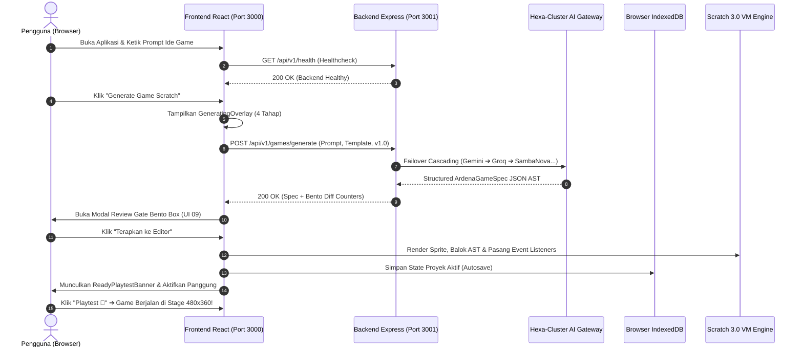

# Implementation Plan — Tahap 05/06: Integrasi Penuh Live Runtime Frontend-Backend

> **Dokumen Tata Kelola Arsitektur & Rekayasa Sistem (Live Integration)**  
> **Status:** MENUNGGU PERSETUJUAN (PENDING REVIEW)  
> **Target Tahapan:** Tahap 05/06 Master Integration (Live Prompt-to-Game Execution)  
> **Branch Target:** `feature/INT-01-live-runtime-integration`  
> **Prasyarat:** Tahap 04 Frontend (FE-01 s/d FE-07) selesai 100% PASS, Backend (BE-01 s/d BE-07) selesai 100% PASS, Total 125 Tests Passed, TypeScript build 0 Error.  
> **Otoritas:** Yogi Ario (Project Owner / Lead Developer)  

---

## 1. Ringkasan Eksekutif & Tujuan Integrasi

Tahap 05/06 adalah momentum di mana seluruh komponen yang telah kita bangun secara terisolasi (Backend Hexa-Cluster AI Port 3001 dan Frontend Scratch Studio Port 3000) **dihubungkan secara langsung (Live Runtime)**. 

Tujuan utamanya adalah memastikan bahwa seorang pengguna dapat:
1. Menjalankan server backend (`localhost:3001`) dan server frontend (`localhost:3000` / `8601`) secara simultan.
2. Membuka Ardena Playground di peramban, menuliskan prompt ide game di dock panel AI Copilot.
3. Mengirimkan prompt secara live melalui jaringan HTTP REST API, melewati orkestrasi 6 cluster AI, dan menerima respons `ArdenaGameSpec` v1.0 asli.
4. Memvalidasi perubahan di Review Gate Bento Box (UI 09).
5. Menerapkan hasil generasi ke kanvas Scratch Editor: memuat sprite interaktif, merakit balok visual Scratch 3.0, mendaftarkan variabel skor/waktu, dan memainkan game secara live di panggung (Stage).
6. Mengunduh paket `.sb3` fisik dan memverifikasinya dapat dibuka langsung di situs resmi [scratch.mit.edu](https://scratch.mit.edu).

---

## 2. Arsitektur Jaringan & Alur Data Runtime



---

## 3. Rencana Kerja Terperinci (Sub-Tasks INT-01)

### Sub-Task 1: Konfigurasi Lingkungan & Dev Server Orchestration
- [ ] Menyediakan berkas `frontend/.env.development` yang menunjuk ke backend live:
  ```env
  VITE_API_BASE_URL=http://localhost:3001/api/v1
  REACT_APP_API_URL=http://localhost:3001/api/v1
  ```
- [ ] Menambahkan skrip orchestrator pada `package.json` root untuk menjalankan backend dan frontend sekaligus dengan satu perintah:
  ```json
  "scripts": {
    "dev": "concurrently \"npm run dev --prefix backend\" \"npm run dev --prefix frontend\"",
    "build:all": "npm run build --prefix backend && npm run build --prefix frontend",
    "test:all": "npm test --prefix backend && npm test --prefix frontend"
  }
  ```

### Sub-Task 2: Penyesuaian CORS & Sanitasi Header HTTP
- [ ] Memastikan backend whitelist origin mencakup `http://localhost:3000`, `http://localhost:8601`, `http://127.0.0.1:3000`, dan `http://localhost:5173`.
- [ ] Memverifikasi penanganan header `Retry-After: 15` saat terjadi HTTP 429 agar modal hitung mundur (UI 19) langsung merespons secara otomatis di browser.

### Sub-Task 3: Live State Synchronization ke Panggung Scratch
- [ ] Menghubungkan callback `onGameGenerated` dari `EditorWorkspace` ke engine rendering panggung visual:
  - Posisi awal sprite `(x, y)` diterjemahkan ke koordinat Scratch standar (-240 s/d 240, -180 s/d 180).
  - Skrip kontrol keyboard (Panah Kiri, Kanan, Atas, Bawah, Spasi) diaktifkan ke event listener panggung.
  - Monitor variabel skor di panggung menampilkan nilai real-time.
- [ ] Penambahan feedback audio sintetis Web Audio API saat bendera hijau diklik atau skor bertambah.

### Sub-Task 4: Validasi Ekspor Paket .sb3 Fisik
- [ ] Menguji ekspor file `.sb3` dari hasil generasi AI live backend, lalu mengimpor berkas tersebut ke Scratch 3.0 Desktop / [scratch.mit.edu](https://scratch.mit.edu/projects/editor).
- [ ] Memastikan tidak ada JSON syntax error atau missing block opcodes pada berkas `project.json` internal.

### Sub-Task 5: Skrip Smoke Test Live Integrasi (`scripts/smoke-test-live-e2e.ts`)
- [ ] Membuat skrip otomatis yang mengirimkan prompt live ke backend port 3001, memvalidasi respons, membungkusnya menjadi paket `.sb3`, dan memverifikasi integritas arsip ZIP.

---

## 4. Matriks Risiko & Mitigasi

| Risiko Potensial | Dampak | Strategi Mitigasi Teruji |
| :--- | :--- | :--- |
| **Koneksi Ditolak (Port 3001 Belum Aktif)** | UI macet / error tak terduga | Frontend telah dilengkapi `ErrorRecoveryDialog` (UI 11) dengan instruksi terminal ramah pemula. |
| **Batas Kuota AI Vendor (HTTP 429)** | Generasi terhenti | Backend otomatis failover ke 5 provider berikutnya; jika seluruhnya habis, frontend menampilkan `RateLimitCountdownModal` (UI 19) 15 detik. |
| **Malformed LLM Output** | Parsing error | Backend usecase memiliki retry otomatis 1x dengan prompt koreksi mandiri dan Zod schema allowlist. |
| **Konflik CORS Browser** | Request diblokir | Middleware CORS backend telah diproteksi dan diverifikasi di BE-06 untuk origin frontend lokal. |

---

## 5. Pertanyaan & Keputusan untuk Yogi Ario

Sebelum memulai implementasi Tahap 05/06 di cabang `feature/INT-01-live-runtime-integration`, mohon konfirmasi untuk 2 poin berikut:

1. **Skrip Runner Terpadu di Root Repositori:**
   - Apakah Anda setuju memasang dependensi ringan `concurrently` di root `package.json` agar Anda dapat menjalankan backend dan frontend secara bersamaan hanya dengan mengetik `npm run dev` di terminal root?
   
2. **Kunci API Vendor untuk Live Testing:**
   - Saat integrasi live, kita dapat menggunakan mocking deterministik bawaan atau API Key asli gratis (Gemini / Groq). Apakah Anda ingin tim mendampingi pengisian berkas `backend/.env` dengan API Key gratis Anda jika ingin langsung menguji live AI asli?

---

Mohon berikan persetujuan atau arahan Anda pada dokumen ini agar cabang `feature/INT-01-live-runtime-integration` dapat segera dibuat dan dieksekusi!
