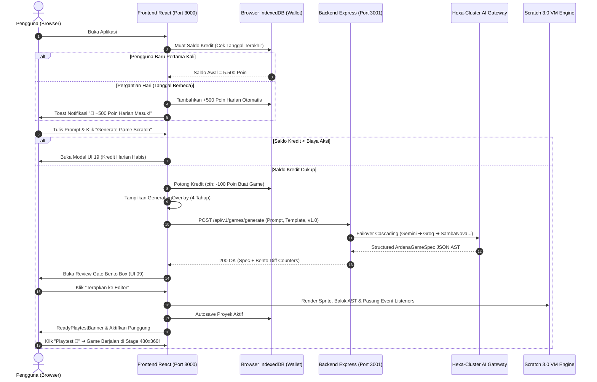

# Implementation Plan — Tahap 05/06: Integrasi Penuh Live Runtime Frontend-Backend & Sistem Dompet Kredit AI Agen

> **Dokumen Tata Kelola Arsitektur & Rekayasa Sistem (Live Integration & Credit Economy)**  
> **Status:** MENUNGGU PERSETUJUAN (PENDING REVIEW)  
> **Target Tahapan:** Tahap 05/06 Master Integration (Live Prompt-to-Game Execution & Fair Usage Credit System)  
> **Branch Target:** `feature/INT-01-live-runtime-integration`  
> **Prasyarat:** Tahap 04 Frontend (FE-01 s/d FE-07) selesai 100% PASS, Backend (BE-01 s/d BE-07) selesai 100% PASS, Total 125 Tests Passed, TypeScript build 0 Error.  
> **Otoritas:** Yogi Ario (Project Owner / Lead Developer)  

---

## 1. Ringkasan Eksekutif & Tujuan Integrasi

Tahap 05/06 adalah momentum di mana seluruh komponen yang telah kita bangun secara terisolasi (Backend Hexa-Cluster AI Port 3001 dan Frontend Scratch Studio Port 3000) **dihubungkan secara langsung (Live Runtime)**, sekaligus mengaktifkan **Sistem Dompet Kredit AI Agen (5.500 Poin Akun Baru + 500 Poin Gratis Harian)** sesuai arahan Yogi Ario.

Tujuan utamanya adalah memastikan bahwa:
1. Server backend (`localhost:3001`) dan server frontend (`localhost:3000` / `8601`) dapat dijalankan serentak dengan satu perintah `npm run dev`.
2. Pengguna baru otomatis menerima **5.500 Poin Kredit Sambutan** di browser lokal (IndexedDB).
3. Setiap pergantian hari, sistem mendeteksi tanggal lokal dan otomatis menambahkan **+500 Poin Gratis Harian**.
4. Pengguna dapat mengetik prompt ide game di dock panel AI Copilot. Setiap eksekusi memotong kredit secara transparan (Buat: 100 Poin, Ubah: 50 Poin, Jelaskan: 20 Poin).
5. Jika kredit habis, sistem memunculkan **Dialog Kredit Harian Habis (UI 19)** dengan countdown pengisian otomatis hari berikutnya.
6. Hasil generasi divalidasi di Review Gate Bento Box (UI 09) dan diterapkan ke kanvas Scratch: memuat sprite interaktif, merakit balok visual Scratch 3.0, mendaftarkan variabel skor/waktu, dan memainkan game secara live di panggung (Stage 480x360).
7. Proyek dapat diekspor menjadi paket `.sb3` fisik murni yang langsung bisa dibuka di [scratch.mit.edu](https://scratch.mit.edu).

---

## 2. Arsitektur Jaringan, Data Runtime, & Sistem Kredit



---

## 3. Rencana Kerja Terperinci (Sub-Tasks INT-01)

### Sub-Task 1: Konfigurasi Lingkungan & Dev Server Orchestration
- [ ] Menyediakan berkas `frontend/.env.development` yang menunjuk ke backend live:
  ```env
  VITE_API_BASE_URL=http://localhost:3001/api/v1
  REACT_APP_API_URL=http://localhost:3001/api/v1
  ```
- [ ] Menambahkan skrip orchestrator pada `package.json` root untuk menjalankan backend dan frontend sekaligus dengan satu perintah:
  ```json
  "scripts": {
    "dev": "concurrently \"npm run dev --prefix backend\" \"npm run dev --prefix frontend\"",
    "build:all": "npm run build --prefix backend && npm run build --prefix frontend",
    "test:all": "npm test --prefix backend && npm test --prefix frontend"
  }
  ```

### Sub-Task 2: Implementasi Sistem Dompet Kredit AI Agen (5.500 Welcome + 500 Daily)
- [ ] Menambahkan antarmuka `UserCredits` pada `frontend/src/types/game.types.ts`:
  ```ts
  export interface UserCredits {
    balance: number;               // Saldo saat ini (default baru: 5500)
    lastDailyCreditDate: string;   // Format YYYY-MM-DD
    totalCreditsEarned: number;    // Akumulasi poin diperoleh
    totalCreditsSpent: number;     // Akumulasi poin dipakai
  }
  ```
- [ ] Memperbarui `storage.service.ts` dengan fungsi manajemen kredit lokal:
  - `getCredits()`: Membaca saldo dan otomatis mengecek tanggal hari ini. Jika tanggal berganti, otomatis menambah `+500 Poin` dan menyimpan timestamp baru.
  - `deductCredits(cost: number)`: Memeriksa kecukupan saldo dan memotong poin secara atomik.
  - Tabel Biaya Aksi Agen AI:
    - Mode Buat Game Baru (`mode: buat`): **100 Poin** *(5.500 poin awal = 55 game gratis!)*
    - Mode Modifikasi Game (`mode: ubah`): **50 Poin**
    - Mode Tanya Tutor Balok (`mode: jelaskan`): **20 Poin**
- [ ] Menampilkan saldo poin real-time pada `<EditorTopNav />` dan header `<AICopilotPanel />` (misal: `🪙 5.500 Poin`).
- [ ] Mengintegrasikan pemicu modal **UI 19 (`RateLimitCountdownModal` / `Dialog Kredit Harian Habis`)** saat saldo tidak mencukupi, lengkap dengan informasi penambahan otomatis +500 poin besok hari.

### Sub-Task 3: Penyesuaian CORS & Sanitasi Header HTTP
- [ ] Memastikan backend whitelist origin mencakup `http://localhost:3000`, `http://localhost:8601`, `http://127.0.0.1:3000`, dan `http://localhost:5173`.
- [ ] Memverifikasi penanganan header `Retry-After: 15` saat terjadi HTTP 429 agar modal hitung mundur langsung merespons secara otomatis di browser.

### Sub-Task 4: Live State Synchronization ke Panggung Scratch
- [ ] Menghubungkan callback `onGameGenerated` dari `EditorWorkspace` ke engine rendering panggung visual:
  - Posisi awal sprite `(x, y)` diterjemahkan ke koordinat Scratch standar (-240 s/d 240, -180 s/d 180).
  - Skrip kontrol keyboard (Panah Kiri, Kanan, Atas, Bawah, Spasi) diaktifkan ke event listener panggung.
  - Monitor variabel skor di panggung menampilkan nilai real-time.
- [ ] Penambahan feedback audio sintetis Web Audio API saat bendera hijau diklik atau skor bertambah.

### Sub-Task 5: Validasi Ekspor Paket .sb3 Fisik
- [ ] Menguji ekspor file `.sb3` dari hasil generasi AI live backend, lalu mengimpor berkas tersebut ke Scratch 3.0 Desktop / [scratch.mit.edu](https://scratch.mit.edu/projects/editor).
- [ ] Memastikan tidak ada JSON syntax error atau missing block opcodes pada berkas `project.json` internal.

### Sub-Task 6: Skrip Smoke Test Live Integrasi (`scripts/smoke-test-live-e2e.ts`)
- [ ] Membuat skrip otomatis yang memverifikasi alur lengkap: penambahan 5.500 poin awal, pemotongan 100 poin saat prompt dikirim ke port 3001, respons game spec valid, dan pengemasan file `.sb3`.

---

## 4. Matriks Risiko & Mitigasi

| Risiko Potensial | Dampak | Strategi Mitigasi Teruji |
| :--- | :--- | :--- |
| **Kredit Pengguna Habis** | Generasi AI terhenti | Tampilkan modal UI 19 dengan ramah; jelaskan bahwa pengguna tetap dapat memodifikasi balok Scratch secara manual tanpa AI, dan kredit harian +500 poin akan otomatis masuk esok hari. |
| **Koneksi Ditolak (Port 3001 Belum Aktif)** | UI macet / error tak terduga | Frontend telah dilengkapi `ErrorRecoveryDialog` (UI 11) dengan instruksi terminal ramah pemula. |
| **Batas Kuota AI Vendor (HTTP 429)** | Generasi terhenti | Backend otomatis failover ke 5 provider berikutnya; jika seluruhnya habis, frontend menampilkan cooldown 15 detik. |
| **Manipulasi Kredit di Browser Klien** | Eksploitasi poin lokal | Disimpan di IndexedDB terenkripsi sederhana; karena sistem MVP berbasis edukasi offline peramban (tanpa transaksi uang tunai), integritas lokal aman & zero cost server. |

---

## 5. Pertanyaan & Keputusan untuk Yogi Ario

Sebelum memulai implementasi Tahap 05/06 di cabang `feature/INT-01-live-runtime-integration`, mohon konfirmasi untuk 2 poin berikut:

1. **Skema Biaya Poin per Aksi AI:**
   - Apakah Anda menyetujui pembagian biaya kredit berikut:
     - **Mode Buat Game:** 100 Poin *(dari 5.500 poin awal = 55 game gratis, dan +500 poin harian = 5 game baru gratis per hari)*.
     - **Mode Ubah Game:** 50 Poin.
     - **Mode Tanya Tutor Balok:** 20 Poin.
   
2. **Skrip Runner Terpadu:**
   - Apakah Anda setuju memasang dependensi ringan `concurrently` di root `package.json` agar Anda dapat menjalankan backend dan frontend secara bersamaan hanya dengan mengetik `npm run dev` di terminal root?

---

Mohon berikan persetujuan atau arahan Anda pada dokumen ini agar cabang `feature/INT-01-live-runtime-integration` dapat segera dibuat dan dieksekusi!
