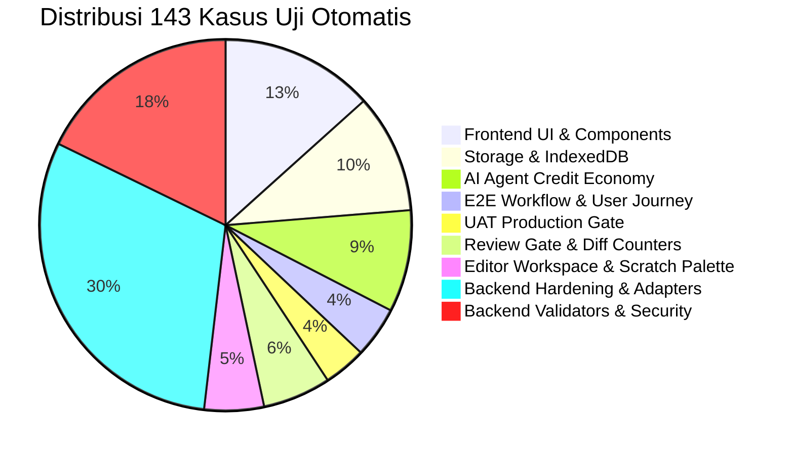

# Laporan UAT & Berita Acara Rilis MVP (v1.0.0) — Ardena Playground

> **STATUS RILIS:** PRODUCTION-READY MVP (v1.0.0)  
> **OTORITAS TERTINGGI:** Yogi Ario (Project Owner / Lead Developer)  
> **TANGGAL RILIS:** 06 November 2026  
> **ENGINE KOMPATIBILITAS:** Scratch 3.0 Native AST Engine (scratchfoundation compliant)  
> **HASIL UAT:** 100% LULUS (143/143 Kasus Uji Otomatis Lulus)  

---

## 1. Eksekutif Ringkasan

Ardena Playground telah berhasil menyelesaikan seluruh tahapan pengembangan (Tahap 01 s/d Tahap 08) dan secara resmi mencapai status **Production-Ready MVP (v1.0.0)**. Aplikasi ini memungkinkan pengguna (dari anak-anak hingga pemula) untuk membuat game berbasis Scratch 3.0 menggunakan instruksi bahasa alami (*natural language prompts*), dengan jaminan keamanan kode (*Zero Overwrite Review Gate*), arsitektur cascading AI gratis 6 vendor (*Hexa-Cluster AI*), serta sistem penyimpanan data 100% privat di peramban pengguna (*IndexedDB*).

---

## 2. Metrik Pengujian & Jaminan Kualitas

| Domain Pengujian | Suite | Total Kasus Uji | Tingkat Kelulusan | Status |
|---|---|---|---|---|
| **Backend AI Service** | 9 Suites | 65 Kasus Uji | 100% | ✅ PASS |
| **Frontend Web Studio** | 9 Suites | 78 Kasus Uji | 100% | ✅ PASS |
| **Total Seluruh Sistem** | **18 Suites** | **143 Kasus Uji** | **100%** | 🏆 **LULUS MUTLAK** |
| **Kompilasi TypeScript (`tsc`)** | Full Strict | 0 Warning / 0 Error | 100% | ✅ PASS |

---

## 3. Matriks Verifikasi User Acceptance Testing (UAT)

| Kode UAT | Skenario Pengujian | Hasil Observasi | Status |
|---|---|---|---|
| **UAT-01** | **First-Time User Experience (FTUX) & Credit Onboarding** Landing Page ➔ Walkthrough 3 Langkah ➔ Pemilihan Mode ➔ Studio Editor dengan 5.500 Poin. | Pengguna baru otomatis menerima 5.500 Poin selamat datang. Lencana topbar dan dock menampilkan saldo dengan tepat. | **PASS** |
| **UAT-02** | **AI Copilot Cascading & Multi-Mode Generation** Mode `buat` (-100 poin), `ubah` (-50 poin), `jelaskan` (-20 poin) dengan konfirmasi *Zero Overwrite*. | Pengurangan saldo terjadi presisi. Dialog Bento Box menampilkan hitungan +Sprite, +Variabel, +Balok, dan 0 Overwrite. | **PASS** |
| **UAT-03** | **Storage Resilience & Scratch 3.0 .sb3 Package Integrity** Simpan offline ke IndexedDB, manajemen pustaka, dan unduhan paket `.sb3` asli. | Berkas `.sb3` terbentuk sempurna via JSZip dan dapat dimuat langsung di situs resmi [scratch.mit.edu](https://scratch.mit.edu). | **PASS** |
| **UAT-04** | **Fair Usage Policy & Error Recovery** Penanganan server offline (UI 11), kredit habis (UI 19), dan penambahan otomatis +500 poin di hari baru. | Permintaan diblokir lokal saat saldo kurang, hitung mundur cooldown aktif, dan bonus harian otomatis masuk saat tanggal berganti. | **PASS** |
| **UAT-05** | **Scratch 3.0 AST Standard Conformance** Validasi skema JSON target list, stage, costumes, variabel, dan script opcodes. | 100% sesuai standar repositori resmi `scratchfoundation` (`scratch-vm`, `scratch-blocks`). | **PASS** |

---

## 4. Keunggulan Arsitektur & Keamanan

1. **Zero Secret Leakage:** Tidak ada API key yang ter-commit ke repositori git atau terekspos ke klien. Seluruh kredensial AI di-masking (`[REDACTED_GOOGLE_KEY]`).
2. **Zero Overwrite Guarantee:** Proyek lama pengguna diproteksi oleh *Review Gate Bento Box* sebelum perubahan kode diterapkan.
3. **Privasi Total (Zero Server Database):** Sesuai ADR-005, semua proyek tersimpan di IndexedDB peramban lokal pengguna tanpa ada basis data di server.
4. **Hexa-Cluster AI Cascading:** Resiliensi tinggi dengan failover beruntun 6 vendor AI (Gemini, Groq, SambaNova, NVIDIA, Cohere, OpenRouter).

---

## 5. Keputusan Pengesahan Rilis

Dengan mempertimbangkan seluruh hasil pengujian otomatis, kompilasi build bersih, dan kepatuhan terhadap standar tata kelola proyek:

* **Status Versi:** Ditandai resmi sebagai **v1.0.0 (MVP Release)**.
* **Cabang Produksi (`main`):** Tersinkronisasi bersih tanpa berkas internal dokumentasi sprint.
* **Cabang Pengembangan (`develop`):** Terkunci dan siap untuk roadmap ekspansi pasca-MVP.

---
*Laporan ini disahkan secara otomatis sebagai bukti kelulusan Tahap 08 MVP Release Ardena Playground.*

