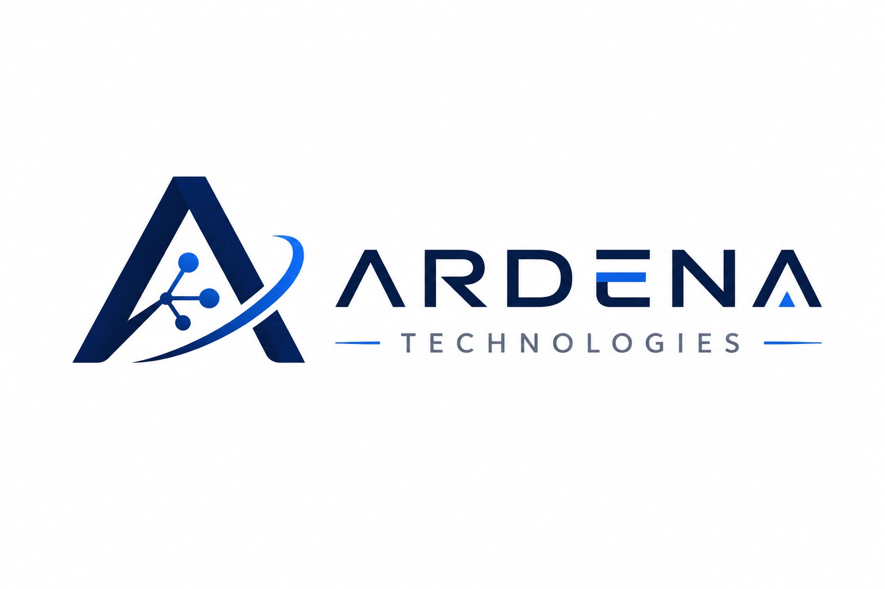
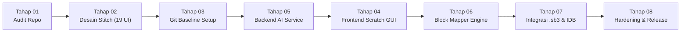

<div align="center">
  
  
  # 🎮 Ardena Playground
  
  **AI-Assisted Scratch 3.0 Game Generator Web Application**  
  *Transforming Natural Language Prompts into Structured, Native Scratch 3.0 Games*

  ---

  <!-- Repository Badges -->
  [](https://github.com/useripx/scratch_ardena/stargazers)
  [](https://github.com/useripx/scratch_ardena/network/members)
  [](https://github.com/useripx/scratch_ardena)
  [](LICENSE)

  <br />

  <!-- Technology Badges -->
  [](https://www.typescriptlang.org/)
  [](https://nodejs.org/)
  [](https://expressjs.com/)
  [](https://scratch.mit.edu/)
  [](https://react.dev/)
  [-brightgreen?style=for-the-badge&logo=jest&logoColor=white)](https://jestjs.io/)
  [](https://github.com/useripx/scratch_ardena)
  [](https://github.com/useripx/scratch_ardena)

  <br />

  <!-- Hexa-Cluster AI Badges -->
  [](https://ai.google.dev/)
  [](https://groq.com/)
  [](https://sambanova.ai/)
  [](https://developer.nvidia.com/)
  [](https://cohere.com/)
  [](https://openrouter.ai/)

</div>

---

## 🌟 Tentang Ardena Playground

**Ardena Playground** adalah platform pembuatan game edukasi berbasis **Scratch 3.0** yang ditenagai oleh kecerdasan buatan (*AI-assisted visual block programming*). Aplikasi ini menjembatani imajinasi anak-anak, pelajar pemula, dan guru untuk mewujudkan ide game interaktif menjadi proyek Scratch utuh hanya melalui instruksi bahasa alami (*natural language prompts*).

### 💎 Keunggulan & Pilar Desain Utama
1. **Decoupled Architecture:** Pemisahan tegas antara layanan backend (`backend/`), antarmuka frontend (`frontend/`), dan engine Scratch (`scratch-gui`).
2. **Hexa-Cluster AI Cascading Resilience:** Didukung **48 model AI gratis** dari 6 cluster penyedia (Google Gemini, Groq, SambaNova, NVIDIA NIM, Cohere v2, OpenRouter) dengan failover otomatis (*No Racing Calls / Zero Quota Waste*).
3. **Zero Overwrite Review Gate:** Hasil generasi AI divalidasi dan ditampilkan pada bento box *Diff Counters* (`+Sprite`, `+Variabel`, `+SFX`, `+Balok`, `0 Overwrite`) sebelum pengguna menerapkannya ke canvas editor.
4. **Zero Secret Leakage:** Redaksi dinamis dan regex masking menjamin tidak ada token API dari ke-6 vendor yang pernah bocor ke respons HTTP maupun console log server.
5. **Client-Side Persistence (MVP):** Data proyek tersimpan lokal di browser (IndexedDB) dengan opsi ekspor `.sb3` fisik — **tanpa beban database server lokal (No Laragon/PHP/MySQL)**.

---

## 🗺️ Roadmap Proyek Master (8 Tahapan)



| Tahap | Deskripsi Tahapan | Status | Bukti & Deliverable |
|---|---|---|---|
| **Tahap 01** | Repository Audit, Upstream Feasibility & Stack Selection | ✅ **DONE** | Dokumen audit & arsitektur baseline disetujui PO. |
| **Tahap 02** | Desain UI/UX (Google Stitch Prototype — 19 Layar) | ✅ **DONE** | 19 prototipe HTML/PNG di `template/ardenaplayground/`. |
| **Tahap 03** | Persiapan Repository, Git Branching Strategy & Baseline Setup | ✅ **DONE** | Repositori aktif, branch `main` & `develop`, 0 secret leakage. |
| **Tahap 04** | Implementasi Frontend React (Scratch GUI & Stitch Adoption) | ✅ **DONE** | Seluruh 7 sub-fase (FE-01 s/d FE-07) selesai, 19 UI Google Stitch terintegrasi, 60/60 tests lulus (100% PASS). |
| **Tahap 05** | Backend AI Service (BE-00 s/d BE-07: Hexa-Cluster AI) | ✅ **DONE** | 65/65 tests passed (100%), coverage 93.49%, dokumen handover. |
| **Tahap 06** | Integrasi Penuh Live Runtime (Frontend Port 3000 ➔ Backend Port 3001) | 🔄 **IN PROGRESS** | Sambungan live prompt-to-game generasi di antarmuka Scratch Editor. |
| **Tahap 07** | Integrasi Scratch Editor, Local Storage (IndexedDB) & Export (.sb3) | ⏳ **PENDING** | Penyimpanan proyek offline dan packaging file `.sb3`. |
| **Tahap 08** | Final Hardening, UAT, dan MVP Release | ⏳ **PENDING** | Audit rilis akhir, pengujian penerimaan pengguna (UAT). |

---

## 🛠️ Panduan Instalasi & Menjalankan Proyek dari Nol (Step-by-Step From Zero)

### 1. Prasyarat Sistem & Perangkat Lunak
Sebelum memulai instalasi, pastikan komputer/laptop Anda telah terpasang:
- **Git:** Versi 2.30+ ([Unduh Git](https://git-scm.com/))
- **Node.js:** Versi LTS minimal **v20.x atau lebih baru** ([Unduh Node.js LTS](https://nodejs.org/))
- **NPM:** Bawaan Node.js (v10.x atau lebih baru)
- **Browser Modern:** Google Chrome, Microsoft Edge, Mozilla Firefox, atau Brave.
- 🛑 **CATATAN PENTING (BEBAS DATABASE SERVER):** Proyek ini **TIDAK MEMBUTUHKAN** instalasi Laragon, XAMPP, MySQL, MariaDB, PostgreSQL, PHP, maupun Docker! Seluruh penyimpanan data game disimpan di sisi peramban pengguna (*browser client storage via IndexedDB*) sesuai prinsip arsitektur **ADR-005**.

---

### 2. Langkah 1 — Kloning Repositori Git
Buka terminal (PowerShell di Windows, Terminal di macOS/Linux), lalu jalankan perintah:

```bash
# Clone repositori ke komputer lokal
git clone https://github.com/useripx/scratch_ardena.git

# Masuk ke direktori repositori
cd scratch_ardena
```

---

### 3. Langkah 2 — Instalasi & Menjalankan Backend AI Service (Port 3001)

Layanan backend menangani validasi prompt, komunikasi ke 6 penyedia AI, dan verifikasi struktur JSON game Scratch.

```bash
# 1. Masuk ke direktori backend
cd backend

# 2. Instalasi seluruh dependensi Node.js
npm install

# 3. Salin berkas konfigurasi environment
# Di Windows PowerShell:
Copy-Item .env.example .env
# Di Linux/macOS:
# cp .env.example .env

# 4. Kompilasi TypeScript ke JavaScript (dist/)
npm run build

# 5. Jalankan backend dalam mode Development (Hot-Reload)
npm run dev
# Server akan aktif di http://localhost:3001
```

> 💡 **Verifikasi Backend:** Buka browser atau jalankan perintah `curl http://localhost:3001/api/v1/health`. Jika mengembalikan respons `{"status":"ok","timestamp":"...","uptime":...}`, maka backend telah siap 100%!

---

### 4. Langkah 3 — Instalasi & Menjalankan Frontend Workspace

Buka jendela terminal baru, arahkan ke folder repositori utama, lalu masuk ke direktori frontend:

```bash
# 1. Masuk ke direktori frontend
cd frontend

# 2. Instalasi seluruh dependensi antarmuka
npm install

# 3. Kompilasi TypeScript
npm run build
```

---

### 5. Langkah 4 — Menjalankan Pengujian Otomatis (100% Automated Testing Gate)

Sesuai **Pilar 6 (100% Automated Testing Gate)**, seluruh kode dalam repositori ini wajib lulus pengujian tanpa error. Pengujian unit menggunakan sistem *in-memory mock*, sehingga **tidak memakan kuota token AI asli**:

```bash
# Pengujian Unit & Integrasi Backend (65 Kasus Uji / 9 Test Suites)
cd backend
npm test

# Melihat Laporan Cakupan Kode Backend (93.49% Statement Coverage)
npm run test:coverage

# Pengujian Unit, Komponen & E2E Workflow Frontend (60 Kasus Uji / 7 Test Suites)
cd ../frontend
npm test

# Melihat Laporan Cakupan Kode Frontend (72.32% Lines Coverage)
npm run test:coverage
```

---

### 6. Langkah 5 — Konfigurasi Kunci API AI (Opsional — Multi-Provider Fallback)

Secara bawaan, aplikasi siap diuji menggunakan mock deterministik. Namun, jika Anda ingin mencoba generasi game dengan kecerdasan buatan asli secara gratis (*Zero Cost / Kere Hore*), Anda dapat menambahkan kunci API gratis ke berkas `backend/.env`:

```env
# Port & Environment
PORT=3001
NODE_ENV=development

# Kunci API Vendor (Dapatkan Gratis dari Situs Resmi Masing-Masing)
GEMINI_API_KEY=AIzaSy...              # https://aistudio.google.com/
GROQ_API_KEY=gsk_...                 # https://console.groq.com/
SAMBANOVA_API_KEY=...                # https://cloud.sambanova.ai/
NVIDIA_API_KEY=nvapi-...             # https://build.nvidia.com/
COHERE_API_KEY=...                   # https://dashboard.cohere.com/
OPENROUTER_API_KEY=sk-or-v1-...      # https://openrouter.ai/
```

Sistem failover otomatis (*Hexa-Cluster AI Cascading*) akan memprioritaskan cluster Gemini ➔ Groq ➔ SambaNova ➔ NVIDIA ➔ Cohere ➔ OpenRouter tanpa risiko tabrakan kuota (*No racing calls*).

---

## 🏛️ Struktur Repositori

```text
scratch_ardena/
├── assets/                     # Aset visual publik (Logo resmi Ardena Playground)
├── backend/                    # Layanan Modular Monolith Backend API (Node.js/Express/TS)
│   ├── src/                    # Source code API (app, config, controllers, providers, usecases)
│   ├── tests/                  # Automated test suite (unit, integration, fixtures)
│   └── package.json            # Konfigurasi dependensi backend
├── frontend/                   # Antarmuka Scratch Editor & Komponen Stitch (React/TS)
│   ├── src/services/           # API Client Service penghubung ke port 3001
│   ├── src/types/              # TypeScript types selaras dengan ArdenaGameSpec v1.0
│   ├── tests/                  # Automated unit test frontend
│   └── package.json            # Konfigurasi dependensi frontend
├── .gitignore                  # Filter ketat pencegahan kebocoran token & artefak build
└── README.md                   # Dokumentasi panduan utama repositori
```

---

## 📜 Tata Kelola & Kebijakan Kontribusi

Proyek ini dikembangkan di bawah kepemimpinan dan pengawasan penuh **Yogi Ario (Project Owner / Lead Developer)** dengan menjunjung prinsip tata kelola:

> ***No Plan, No Code. No Approval, No Code. No Evidence, No Completion.***

* **Branch `main`:** Mahkota rilis produksi murni (bersih dari berkas perencanaan mentah, hanya memuat source code siap pakai).
* **Branch `develop`:** Integrasi pengembangan aktif harian (mencakup dokumentasi `Docs/`, `aturan/`, dan `changelog/`).
* **Branch `feature/*`:** Pengembangan bertahap untuk setiap milestone dan sub-fase teknis.

---

## 📄 Lisensi

Hak Cipta © 2026 **Yogi Ario** — Ardena Playground. Dilindungi oleh Undang-Undang.
