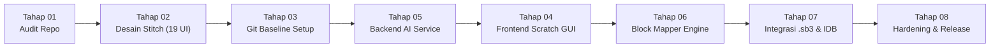

<div align="center">
  
  
  # 🎮 Ardena Playground
  
  **AI-Assisted Scratch 3.0 Game Generator Web Application**  
  *Transforming Natural Language Prompts into Structured, Native Scratch 3.0 Games*

  ---

  <!-- Repository Badges -->
  [](https://github.com/useripx/scratch_ardena/stargazers)
  [](https://github.com/useripx/scratch_ardena/network/members)
  [](https://github.com/useripx/scratch_ardena)
  [](LICENSE)

  <br />

  <!-- Technology Badges -->
  [](https://www.typescriptlang.org/)
  [](https://nodejs.org/)
  [](https://expressjs.com/)
  [](https://scratch.mit.edu/)
  [](https://react.dev/)
  [](https://jestjs.io/)
  [](https://github.com/useripx/scratch_ardena)

  <br />

  <!-- Hexa-Cluster AI Badges -->
  [](https://ai.google.dev/)
  [](https://groq.com/)
  [](https://sambanova.ai/)
  [](https://developer.nvidia.com/)
  [](https://cohere.com/)
  [](https://openrouter.ai/)

</div>

---

## 🌟 Tentang Ardena Playground

**Ardena Playground** adalah platform pembuatan game edukasi berbasis **Scratch 3.0** yang ditenagai oleh kecerdasan buatan (*AI-assisted visual block programming*). Aplikasi ini menjembatani imajinasi anak-anak, pelajar pemula, dan guru untuk mewujudkan ide game interaktif menjadi proyek Scratch utuh hanya melalui instruksi bahasa alami (*natural language prompts*).

### 💎 Keunggulan & Pilar Desain Utama
1. **Decoupled Architecture:** Pemisahan tegas antara layanan backend (`backend/`), antarmuka frontend (`frontend/`), dan engine Scratch (`scratch-gui`).
2. **Hexa-Cluster AI Cascading Resilience:** Didukung **48 model AI gratis** dari 6 cluster penyedia (Google Gemini, Groq, SambaNova, NVIDIA NIM, Cohere v2, OpenRouter) dengan failover otomatis (*No Racing Calls / Zero Quota Waste*).
3. **Zero Overwrite Review Gate:** Hasil generasi AI divalidasi dan ditampilkan pada bento box *Diff Counters* (`+Sprite`, `+Variabel`, `+SFX`, `+Balok`, `0 Overwrite`) sebelum pengguna menerapkannya ke canvas editor.
4. **Zero Secret Leakage:** Redaksi dinamis dan regex masking menjamin tidak ada token API dari ke-6 vendor yang pernah bocor ke respons HTTP maupun console log server.
5. **Client-Side Persistence (MVP):** Data proyek tersimpan lokal di browser (IndexedDB) dengan opsi ekspor `.sb3` fisik — **tanpa beban database server lokal (No Laragon/PHP/MySQL)**.

---

## 🗺️ Roadmap Proyek Master (8 Tahapan)



| Tahap | Deskripsi Tahapan | Status | Bukti & Deliverable |
|---|---|---|---|
| **Tahap 01** | Repository Audit, Upstream Feasibility & Stack Selection | ✅ **DONE** | Dokumen audit & arsitektur baseline disetujui PO. |
| **Tahap 02** | Desain UI/UX (Google Stitch Prototype — 19 Layar) | ✅ **DONE** | 19 prototipe HTML/PNG di `template/ardenaplayground/`. |
| **Tahap 03** | Persiapan Repository, Git Branching Strategy & Baseline Setup | ✅ **DONE** | Repositori aktif, branch `main` & `develop`, 0 secret leakage. |
| **Tahap 04** | Implementasi Frontend React (Scratch GUI & Stitch Adoption) | 🔄 **IN PROGRESS** | Arsitektur frontend `Docs/frontend/` & API client service. |
| **Tahap 05** | Backend AI Service (BE-00 s/d BE-07: Hexa-Cluster AI) | ✅ **DONE** | 65/65 tests passed (100%), coverage 93.49%, dokumen handover. |
| **Tahap 06** | AI Game Generator & Scratch Block Mapping Engine | ⏳ **PENDING** | Penerjemahan JSON spec ke AST / XML balok Scratch. |
| **Tahap 07** | Integrasi Scratch Editor, Local Storage (IndexedDB) & Export (.sb3) | ⏳ **PENDING** | Penyimpanan proyek offline dan packaging file `.sb3`. |
| **Tahap 08** | Final Hardening, UAT, dan MVP Release | ⏳ **PENDING** | Audit rilis akhir, pengujian penerimaan pengguna (UAT). |

---

## 🛠️ Panduan Menjalankan Layanan (Quickstart)

### 1. Prasyarat Sistem
* **Node.js:** Versi LTS (v20.x atau lebih baru).
* **NPM:** Versi 10.x atau lebih baru.
* **Laragon / PHP / MySQL:** ❌ **Tidak Dibutuhkan**.

---

### 2. Menjalankan Backend API Service (Port 3001)
```powershell
# Masuk ke direktori backend
cd backend

# Instalasi paket
npm install

# Kompilasi TypeScript
npm run build

# Menjalankan server development (Hot Reload)
npm run dev
# Atau mode produksi:
npm start
```

---

### 3. Menjalankan Frontend Workspace
```powershell
# Masuk ke direktori frontend
cd frontend

# Instalasi paket
npm install

# Kompilasi TypeScript
npm run build
```

---

### 4. Eksekusi Pengujian Otomatis (100% Automated Testing Gate)
Seluruh pengujian otomatis dijalankan dengan **Zero API Quota Consumption** menggunakan mock deterministik in-memory:

```powershell
# Menguji Backend Service (65 Tests / 9 Suites)
cd backend
npm test

# Menjalankan Backend Code Coverage (93.49% Statement Coverage)
npm run test:coverage

# Menguji Frontend API Client Service (6 Tests)
cd ../frontend
npm test
```

---

## 🏛️ Struktur Repositori

```text
ardenaplayground/
├── aturan/                     # Master Framework Tata Kelola & Aturan AI Agent
│   ├── universal-rule.md       # Master Governance Framework (8 Pilar Standar Kerja)
│   ├── AGENTS.md               # Aturan kerja spesifik AI Agent Ardena Playground
│   └── GEMINI.md               # Indeks ringkas AI Coding Assistant
├── backend/                    # Layanan Modular Monolith Backend API (Node.js/Express/TS)
│   ├── src/                    # Source code API (app, config, controllers, providers, usecases)
│   ├── tests/                  # Automated test suite (unit, integration, fixtures)
│   └── package.json            # Konfigurasi dependensi backend
├── frontend/                   # Antarmuka Scratch Editor & Komponen Stitch (React/TS)
│   ├── src/services/           # API Client Service penghubung ke port 3001
│   ├── src/types/              # TypeScript types selaras dengan ArdenaGameSpec v1.0
│   ├── tests/                  # Automated unit test frontend
│   └── package.json            # Konfigurasi dependensi frontend
├── changelog/                  # Catatan perubahan flat bertimestamp (changelog*.md)
├── Docs/                       # Dokumentasi arsitektur, API contract, SOP, dan ADR
│   ├── assets/                 # Aset logo dan diagram visual
│   ├── backend/                # Handover guide, Test Report (100% PASS), Operations Guide
│   ├── frontend/               # Arsitektur antarmuka & rencana implementasi frontend
│   ├── chat/                   # Arsip riwayat dialog sesi pengembangan
│   ├── Decision_Log.md         # Architecture Decision Records (ADR-001 s/d ADR-010)
│   └── Task_Status.md          # Pelacak progres tahapan proyek
├── template/                   # Mockup UI/UX Stitch 19 Layar (READ-ONLY)
└── README.md                   # Dokumentasi utama repositori
```

---

## 📜 Tata Kelola & Kebijakan Kontribusi

Proyek ini dikembangkan di bawah kepemimpinan dan pengawasan penuh **Yogi Ario (Project Owner / Lead Developer)** dengan menjunjung prinsip tata kelola:

> ***No Plan, No Code. No Approval, No Code. No Evidence, No Completion.***

* **Branch `main`:** Mahkota rilis produksi (Hanya dikontrol dan di-merge oleh Yogi Ario).
* **Branch `develop`:** Integrasi pengembangan aktif harian.
* **Branch `feature/*`:** Pengembangan bertahap untuk setiap milestone dan sub-fase teknis.

---

## 📄 Lisensi

Hak Cipta © 2026 **Yogi Ario** — Ardena Playground. Dilindungi oleh Undang-Undang.
