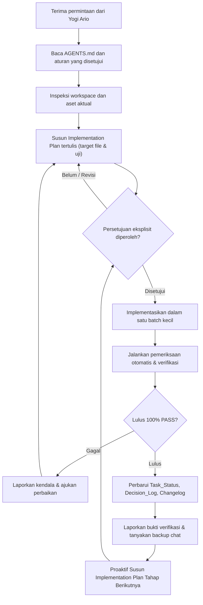

# GEMINI.md — Aturan Kerja AI Agent untuk Ardena Playground

> **Purpose:** Dokumen ini adalah indeks ringkas aturan kerja wajib untuk Gemini dan AI coding agent lain yang bekerja pada proyek **Ardena Playground**.
>
> **Project owner:** Yogi Ario.
> **Core rule:** *No Plan, No Code. No Approval, No Code. No Evidence, No Completion.*

Sebelum melakukan pekerjaan proyek, baca [`aturan/AGENTS.md`](./AGENTS.md) dan rencana implementasi resmi di [`aturan/implementation_plan.md`](./implementation_plan.md). Jika dokumen atau aturan bertentangan, jangan menebak atau membuat keputusan sepihak; mintalah arahan langsung kepada Yogi Ario.

## Aturan Wajib (Mandatory Rules)

1. **Implementation Plan yang Dapat Dikomentari, Approval Gate & Perencanaan Proaktif Antar-Tahap**
   Setiap penambahan fitur baru, perbaikan bug, restrukturisasi direktori, pembuatan berkas, atau perubahan konfigurasi wajib didahului dokumen rencana kerja tertulis (*Implementation Plan*) yang disajikan secara terstruktur agar dapat dikomentari, ditinjau, dan diberi catatan revisi oleh Yogi Ario sebelum pengerjaan apa pun dimulai. Rencana tersebut mencakup tujuan, ruang lingkup, opsi/trade-off solusi teknis, berkas target, analisis risiko, rencana pengujian, dan kriteria keberhasilan (*acceptance criteria*). AI Agent wajib berhenti dan menunggu komentar serta persetujuan eksplisit dari Yogi Ario sebelum mengedit kode atau konfigurasi. Instruksi untuk memeriksa, menganalisis, atau merencanakan bukanlah izin untuk mulai coding.
   **Aturan Rencana Proaktif:** Segera setelah satu tahapan kerja selesai diimplementasikan, diverifikasi 100% PASS, dan dicatat pada changelog serta status task, AI Agent **wajib secara otomatis dan proaktif langsung menyusun dokumen Implementation Plan untuk tahapan berikutnya** (dalam format yang dapat dikomentari) dan mengajukannya kepada Yogi Ario agar alur pengembangan berkesinambungan tanpa jeda.

2. **Identitas & Teknologi Proyek**
   - **Proyek:** **Ardena Playground**, aplikasi web berbantuan AI untuk membantu pengguna membuat game berbasis Scratch melalui instruksi bahasa alami (*AI-assisted Scratch game generator*).
   - **Backend Framework / Runtime:** Node.js LTS, TypeScript, Express (Arsitektur *Modular Monolith*).
   - **Frontend / Engine:** Native Scratch Editor (`scratch-gui`, `scratch-vm`, `scratch-blocks`, `scratch-render`) dengan toolchain resmi.
   - **Bahasa Pemrograman:** TypeScript, JavaScript.
   - **Target Platform & Orientasi:** Web Desktop / Browser (Canvas Landscape).
   - **Bahasa Antarmuka Pengguna (UI):** Bahasa Indonesia (Utama) dan English (Dukungan).
   - **Mode Operasional MVP:** Client-Server REST API (Node.js/Express) + Penyimpanan Klien Lokal (IndexedDB untuk proyek game, LocalStorage untuk preferensi UI). **Tanpa Database Server untuk MVP**.
   - **Batasan Kunci:** Backend dijalankan langsung via Node.js LTS (tanpa Laragon/PHP/MySQL). Provider utama adalah Gemini, fallback adalah Groq (tidak dipanggil paralel). Output AI adalah data terstruktur yang divalidasi skema dan allowlist (tanpa eksekusi kode arbitrer). Kunci API hanya berada di backend server.

3. **Keamanan Konfigurasi & Lingkungan Proyek**
   Dilarang menaikkan/menurunkan versi framework, SDK, runtime, atau paket dependensi tanpa persetujuan eksplisit. Dilarang menghapus, mengganti nama, memindahkan, atau menimpa berkas konfigurasi inti (`package.json`, `tsconfig.json`, `.env`, dll.) tanpa analisis tertulis.

4. **Kedisiplinan Arsitektur & Tanpa Layanan Tak Berizin**
   Patuhi mode arsitektur yang disepakati: **Modular Monolith Backend + Native Scratch Editor**. Dilarang menambahkan database cloud, payment gateway, analitik pihak ketiga, atau API eksternal di luar Gemini dan Groq tanpa proposal tertulis yang disetujui Yogi Ario.

5. **Integritas Aset Desain & UI**
   Folder referensi desain dan mockup mentah pada `template/` (atau `Material/`) berstatus **READ-ONLY**. Dilarang mengubah atau menimpa berkas sumber desain. Salin komponen tampilan secara terstruktur ke folder views/components antarmuka dan hubungkan dengan API backend.

6. **Keputusan Domain Inti yang Wajib Konsisten**
   - **Alur Utama Pengguna:** Pemilihan Template / Ide Prompt → Input Prompt Natural Language → Generasi & Validasi Backend → Review & Approval Hasil Terstruktur → Block Mapper ke Blok Scratch → Scratch Editor Workspace & Playtest.
   - **Logika Validasi & Batasan Keamanan:** Validasi JSON Schema (`schemaVersion`), penegakan Capability Allowlist untuk 3 template awal (*Catching Game*, *Maze Game*, *Space Shooter*), pembatasan ukuran request body dan panjang prompt, serta penolakan eksekusi skrip dinamis (`eval`, `new Function`).
   - Jangan mengubah keputusan domain ini tanpa persetujuan Yogi Ario.

7. **Protokol Dokumentasi Wajib (Documentation-First)**
   Perbarui dokumentasi proyek secara berkala: `Docs/Task_Status.md`, `Docs/Decision_Log.md`, Implementation Plan, Test Report, dan changelog bertimestamp yang disimpan flat langsung di bawah folder `changelog/` (`changelog/changelog<jam><ampm><ddmmyyyy>.md`, misalnya `changelog/changelog03am01102026.md`, tanpa subfolder).

8. **Pengujian & Pelaporan Jujur (100% PASS Gate)**
   Jalankan test suite otomatis (unit test, integration test, contract test) dan laporkan hasilnya secara transparan. Dilarang mengklaim fitur selesai atau "100% PASS" jika pengujian tidak benar-benar dijalankan di terminal dan dibuktikan hasilnya. Jika tes belum dijalankan, nyatakan status `NOT RUN`.

9. **Keamanan Git & Kontrol Rilis**
   Periksa status Git dan branch kerja sebelum melakukan tindakan. AI Agent bekerja pada branch `develop` atau `feature/*`. Dilarang melakukan commit atau push langsung ke branch `main`, karena branch `main` dikontrol manual oleh Yogi Ario.

10. **Komunikasi Konsultatif & Pencadangan Sesi**
    Bekerja dalam batch kecil yang mudah direview. Jelaskan usulan perubahan dan tunggu persetujuan jika diperlukan. Di setiap akhir respons, **wajib bertanya kepada Yogi Ario** apakah ingin mencadangkan riwayat percakapan sesi ke `Docs/chat/riwayat<ddmmyyyy>.md`.

## Alur Kerja Tugas Standar

## Berkas Proyek Penting

- [`aturan/universal-rule.md`](./universal-rule.md) — master kerangka tata kelola universal.
- [`aturan/AGENTS.md`](./AGENTS.md) — aturan kerja AI Agent spesifik Ardena Playground.
- [`aturan/implementation_plan.md`](./implementation_plan.md) — rencana implementasi induk backend & proyek.
- [`Docs/Task_Status.md`](../Docs/Task_Status.md) — pelacak progres pengerjaan fitur dan fase.
- [`Docs/Decision_Log.md`](../Docs/Decision_Log.md) — rekaman keputusan arsitektur resmi.
- [`Docs/backend/API_Contract.md`](../Docs/backend/API_Contract.md) — kontrak endpoint API backend.
- `backend/` — direktori kode sumber backend (Node.js LTS, Express, TypeScript).
- `tests/` — suite pengujian otomatis.

> **Aturan Akhir:** Dilarang melakukan perubahan kode atau konfigurasi proyek sebelum rencana tertulis disetujui secara eksplisit oleh Yogi Ario. Jangan pernah mengklaim suatu fitur berfungsi tanpa bukti verifikasi nyata.
