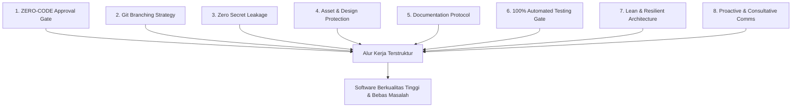
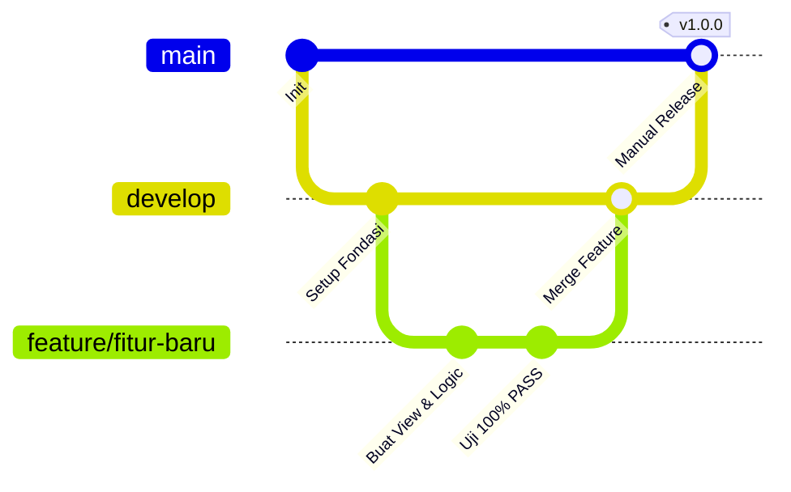

# UNIVERSAL-RULE.md — Kerangka Standar Kerja Pengembangan Proyek & AI Agent

> **STATUS:** DOKUMEN STANDAR UNIVERSAL (MASTER FRAMEWORK)
> **OTORITAS TERTINGGI:** Yogi Ario (PROJECT OWNER / LEAD DEVELOPER)
> **TARGET PENGGUNA:** Seluruh Pengembang (Human Developer) & AI Agent (Antigravity, Gemini, Claude, Cursor, dll.)
> **REUSABILITAS:** Wajib disalin dan diterapkan pada setiap repositori atau proyek baru yang dikelola oleh: Yogi Ario.

---

## 📖 Pendahuluan & Filosofi Kerja

Dokumen ini adalah **pedoman tata kelola universal (Universal Governance Framework)** yang dirancang untuk menjaga kualitas, keamanan, transparansi, dan kerapian pengerjaan software engineering dari awal hingga rilis produksi.

### 🧭 Core Philosophy: Consistent Standards, Variable Intelligence

> **"AI may vary in intelligence. Project standards must remain consistent."**

Kualitas penalaran, kemampuan mempertahankan konteks, dan keandalan eksekusi setiap AI Agent dapat berbeda-beda. Karena itu, proses pengembangan tidak boleh bergantung pada asumsi bahwa AI Agent akan selalu memahami instruksi atau menghasilkan pekerjaan dengan kualitas yang sama. **Standar kerja, gerbang persetujuan, dokumentasi, dan bukti pengujian harus tetap konsisten**, siapa pun AI Agent atau pengembang yang mengerjakannya.

Prinsip operasional yang menjadi dasar kerangka ini:

- **No Plan, No Code.** Rencana tertulis harus tersedia sebelum perubahan dilakukan.
- **No Approval, No Code.** Perubahan yang memerlukan persetujuan tidak boleh dijalankan sebelum persetujuan eksplisit diberikan.
- **No Evidence, No Completion.** Pekerjaan tidak boleh dinyatakan selesai tanpa bukti verifikasi yang sesuai.
- **No Superfluous AI Boilerplate:** Jangan menambahkan elemen formalitas tambahan, blok komentar yang tidak perlu, atau *boilerplate* artifisial yang tidak ada pada panduan penugasan agar tetap natural, otentik, dan tidak tampak seperti hasil generasi instan AI.

Setiap AI Agent atau pengembang yang memulai sesi pada repositori yang mengadopsi dokumen ini **WAJIB membaca, memahami, dan mematuhi 8 Pilar Standar Kerja** berikut tanpa terkecuali.

---

## 🏛 Delapan Pilar Standar Kerja Universal



---

### 🛑 Pilar 1: ZERO-CODE Sebelum Persetujuan Rencana (Approval Gate)

**Prinsip Inti:** *No Plan, No Code. No Approval, No Code. No Evidence, No Completion.*

1. **Dilarang Keras Menyentuh Kode Terlebih Dahulu:**
   - Jangan pernah membuat, mengedit, atau menghapus file kode aplikasi sebelum menyusun rencana kerja tertulis dan memperoleh **persetujuan eksplisit** dari Yogi Ario.
2. **Format Wajib Implementation Plan:**
   Setiap kali ada instruksi, fitur baru, atau perbaikan bug, buatlah dokumen rencana (*Implementation Plan*) yang memuat:
   - **Tujuan & Ruang Lingkup:** Apa yang ingin dicapai.
   - **Analisis & Pilihan Solusi:** Tawarkan opsi jika ada trade-off teknis (misal Opsi A vs Opsi B).
   - **Daftar File Target:** File mana yang akan dibuat, dimodifikasi, atau diuji.
   - **Alur Pengujian:** Bagaimana cara membuktikan bahwa fitur bekerja dan bebas regresi.
3. **Wajib Ada Implementation Plan yang Dapat Dikomentari Sebelum Mengerjakan Apa Pun:**
   - Sebelum mengeksekusi tindakan atau perubahan apa pun (termasuk instalasi package, pembuatan folder, perubahan konfigurasi, maupun penulisan kode), AI Agent **WAJIB menyajikan dokumen Implementation Plan** yang dirancang agar dapat dikomentari, ditinjau, dan diberi masukan/koreksi oleh Yogi Ario.
4. **Gerbang Persetujuan & Tindak Lanjut Komentar (Approval Gate):**
   - AI Agent wajib berhenti dan menunggu Yogi Ario memeriksa, mengomentari, dan memberikan persetujuan eksplisit (misal: pesan "Oke disetujui", "Lanjut", atau penyesuaian berdasarkan komentar) sebelum tindakan teknis dilakukan. Dilarang melanjutkan eksekusi jika komentar atau persetujuan belum diberikan.
5. **Penyusunan Proaktif Rencana Tahap Berikutnya (Proactive Sequential Planning):**
   - Segera setelah suatu tahapan selesai diimplementasikan, diverifikasi 100% PASS (0 Gagal / 0 Error), dan dicatat pada changelog serta status task, AI Agent **WAJIB secara proaktif langsung menyusun dokumen Implementation Plan untuk tahapan berikutnya** (dalam bentuk dokumen yang dapat dikomentari), lalu meminta persetujuan Yogi Ario. AI Agent TIDAK BOLEH langsung mengeksekusi kode tahap berikutnya sebelum rencana baru disetujui.

---

### 🌿 Pilar 2: Protokol Branching Git & Kontrol Rilis

**Prinsip Inti:** *Branch `main` adalah Mahkota Produksi — Hanya Yogi Ario yang Boleh Me-Merge.*



1. **Branch `main` (Produksi Tertutup):**
   - Berisi kode stabil rilis produksi.
   - **DILARANG KERAS** melakukan commit atau push langsung ke `main` oleh AI Agent atau developer.
   - Merge dari `develop` ke `main` dilakukan **secara manual oleh Yogi Ario**.
2. **Branch `develop` (Branch Integrasi Utama):**
   - Seluruh pembaruan, perbaikan, dan fitur baru yang telah lulus uji wajib digabungkan ke `develop` dan di-push ke `origin develop`.
3. **Branch Fitur (`feature/<nama-fitur>` / `fix/<nama-bug>`):**
   - Setiap pekerjaan mandiri wajib dibuatkan branch tersendiri yang bercabang dari `develop`.
   - Setelah pekerjaan selesai dan lulus uji 100%, branch fitur digabungkan (*merge*) kembali ke `develop`.

---

### 🔐 Pilar 3: Keamanan Kunci Rahasia & Tata Kelola `.env` (Zero Secret Leakage)

**Prinsip Inti:** *Kunci API dan Kredensial Pribadi adalah Aset Paling Sensitif.*

1. **Perlindungan `.gitignore` Sejak Menit Pertama:**
   - File konfigurasi rahasia (`.env`, `.env.local`), file kunci lokal (`template/api`, `secrets.json`, file service account), dan database lokal **wajib langsung dimasukkan ke `.gitignore`** sebelum commit perdana.
2. **Larangan Kebocoran Kunci:**
   - Jangan pernah menuliskan nilai kunci API atau token rahasia ke dalam prompt obrolan publik, commit message, atau file kode yang ditrack oleh Git.
3. **Template Konfigurasi Bersih (`.env.example`):**
   - Selalu sediakan dan perbarui file `.env.example` berisi nama variabel tanpa nilai rahasia (gunakan dummy placeholder seperti `your_api_key_here`).

---

### 🎨 Pilar 4: Proteksi Integritas Aset & Desain (`template/` / Raw Assets)

**Prinsip Inti:** *Aset Asli Tim UI/UX adalah Bahan Rujukan Murni (Read-Only).*

1. **Status READ-ONLY untuk Folder Desain:**
   - Folder prototipe mentah (seperti `template/`, `Material/`, `design/`, atau `mockups/`) yang disediakan desainer dilarang keras diubah, ditimpa, atau dihapus oleh AI Agent / Backend Developer.
2. **Pola Adopsi Bersih:**
   - Komponen tampilan diadopsi/disalin secara terstruktur ke folder views/components produksi pada antarmuka frontend, lalu dihubungkan dengan API backend yang aman.

---

### 📝 Pilar 5: Protokol Dokumentasi Wajib (Documentation-First)

**Prinsip Inti:** *Kode Tanpa Dokumentasi adalah Utang Teknis di Masa Depan.*

Setiap repositori wajib memiliki folder `Docs/` (atau `aturan/` pada tahap inisiasi) dan folder `changelog/` yang selalu diperbarui:

| Nama Berkas                   | Lokasi                                        | Fungsi & Aturan Pembaruan                                                                                                                                                                                                                                                                                                                                      |
| ------------------------------- | ----------------------------------------------- | ---------------------------------------------------------------------------------------------------------------------------------------------------------------------------------------------------------------------------------------------------------------------------------------------------------------------------------------------------------------- |
| **`Task_Status.md`**          | `Docs/Task_Status.md`                         | Melacak status seluruh fase proyek, persentase progres, dan checklist tugas real-time.                                                                                                                                                                                                                                                                         |
| **`Decision_Log.md`**         | `Docs/Decision_Log.md`                        | Mencatat seluruh keputusan teknis/arsitektur (ID, Tanggal, Topik, Keputusan, Rationale, Status Persetujuan).                                                                                                                                                                                                                                                   |
| **`API_Contract.md`**         | `Docs/backend/API_Contract.md`                | Kontrak spesifikasi endpoint REST API backend Ardena Playground (OpenAPI / Schema).                                                                                                                                                                                                                                                                             |
| **Changelog Bertimestamp**    | `changelog/changelog<jam><ampm><ddmmyyyy>.md` | Catatan perubahan bertimestamp waktu lokal per batch rilis atau tugas selesai. **Wajib flat** (disimpan langsung di dalam folder `changelog/`, dilarang membuat subfolder). Format: 2 digit jam (`03am` / `02pm`, huruf am/pm kecil) dan 8 digit tanggal (`ddmmyyyy`). Contoh: `changelog/changelog03am01102026.md` atau `changelog/changelog02pm31102026.md`. |
| **Panduan Khusus / Tutorial** | `Docs/<nama-modul>.md`                        | Tutorial langkah-demi-langkah dari awal sampai akhir untuk setup pihak ketiga / konfigurasi modul khusus.                                                                                                                                                                                                                                                      |
| **Cadangan Riwayat Chat**     | `Docs/chat/riwayat<ddmmyyyy>.md`              | Arsip komprehensif riwayat dialog interaktif antara pengguna dan AI Agent dari awal hingga akhir sesi.                                                                                                                                                                                                                                                         |

---

### 🧪 Pilar 6: Gerbang Verifikasi Pengujian (100% Automated Testing Gate)

**Prinsip Inti:** *Jangan Pernah Bilang Selesai Jika Belum Terbukti Lulus Uji.*

1. **Wajib Memiliki Test Suite Otomatis:**
   - Setiap proyek wajib memiliki skrip verifikasi mandiri (unit test, integration test, contract test) di folder `tests/` atau subfolder backend/frontend yang sesuai.
2. **Definisi Selesai (Definition of Done - DoD):**
   - Suatu tugas hanya boleh dilaporkan selesai jika test suite telah dijalankan di terminal/editor dan menghasilkan:
     **`HASIL: 100% PASS (0 GAGAL / 0 ERROR)`**.
3. **Pencegahan Regresi:**
   - Setiap penambahan fitur baru wajib disertai penambahan kasus uji pada test suite.

---

### ⚡ Pilar 7: Kedisiplinan Arsitektur & Provider (Lean & Resilient)

**Prinsip Inti:** *Sederhana, Cepat, Andal, dan Tanpa Ketergantungan Berlebihan.*

1. **Kunci Provider Tunggal / Efisien (Anti-Bloat):**
   - Gemini dikunci sebagai provider utama untuk generasi logika game. Hindari menambah provider tanpa izin eksplisit.
2. **Mekanisme Ketahanan (Fallback Multi-Tingkat):**
   - Groq dikonfigurasi sebagai fallback otomatis terkontrol jika Gemini mengalami HTTP 429 (rate limit), 5xx, atau timeout. Tidak ada pemanggilan paralel pada jalur normal.
3. **Pemisahan Tanggung Jawab (Separation of Concerns):**
   - Backend memisahkan HTTP Layer, Application/Use Cases, Domain/Schemas, Provider Adapters, dan Validation Layer. Frontend mempertahankan ekosistem native Scratch Editor.
4. **Hierarki Aturan Kode Sumber & Scoped AI Agent (Modular AGENTS.md — Kondisional):**
   - **Proyek Standar / Monolitik:** Cukup mengandalkan satu berkas `AGENTS.md` di root proyek.
   - **Proyek Multi-Modul / Monorepo:** Jika folder kode sumber memiliki batas arsitektur independen (misal: `frontend/` vs `backend/`), folder tersebut dapat memiliki berkas `AGENTS.md` lokal.
   - **Prinsip Pewarisan & Resolusi Konflik:**
     - *Root `universal-rule.md` & `AGENTS.md`:* Otoritas makro tata kelola (Approval Gate Yogi Ario, Git branching, zero secret leakage, changelog flat).
     - *Source `AGENTS.md`:* Otoritas mikro teknis modul (enkapsulasi, batasan import, pola layering, test suite lokal).
     - **Resolusi Konflik:** Jika aturan lokal di folder source bertentangan dengan aturan universal di root, **aturan universal root dan keputusan eksplisit Yogi Ario selalu menjadi otoritas tertinggi.**

---

### 🤝 Pilar 8: Standar Komunikasi & Konsultasi AI Agent

**Prinsip Inti:** *AI Agent adalah Rekan Berpikir (Pair Programmer) yang Ramah, Jelas, dan Edukatif.*

1. **Proaktif Memberikan Solusi Berbasis Opsi:**
   - Jika ada kebingungan atau percabangan teknis, sajikan pilihan (misal: *Opsi A: Cepat & Mandiri* vs *Opsi B: Integrasi Pihak Ketiga*) beserta kelebihan, kekurangan, dan rekomendasi ahli.
2. **Bimbingan Setup Mandiri:**
   - Jika pengguna perlu melakukan konfigurasi manual pada console pihak ketiga (seperti Google AI Studio, Groq Console, atau Editor Settings), AI Agent wajib membuatkan panduan tutorial tertulis lengkap yang jelas dan mudah dipahami.
3. **Gaya Bahasa:**
   - Ramah, profesional, ringkas, dan menggunakan tautan markdown yang dapat diklik (`[file.ext](file:///path/to/file)`).
4. **Kewajiban Menanyakan Pencadangan Riwayat Chat di Akhir Respon:**
   - **Wajib di Setiap Akhir Respon:** Setiap kali selesai memberikan respon, AI Agent **WAJIB secara proaktif bertanya di penutup respon** kepada pengguna apakah ingin mencadangkan (*backup*) riwayat percakapan sesi tersebut ke:
     `Docs/chat/riwayat<ddmmyyyy>.md`
   - **Tujuan Utama:** Menjamin rekam jejak dialog, instruksi pengguna, arsitektur yang dirumuskan, serta keputusan penting terdokumentasi permanen dan tertata rapi dalam folder khusus `Docs/chat/`.

---

## 📁 Struktur Standar Proyek Ardena Playground

Struktur direktori proyek Ardena Playground disesuaikan dengan arsitektur hybrid Scratch Editor dan Backend Node.js:

```text
ardenaplayground/
├── .gitignore                     # Perlindungan awal (.env, secrets, logs, build outputs)
├── .env.example                   # Template konfigurasi tanpa kunci rahasia
├── README.md                      # Dokumentasi pengenalan, arsitektur, dan cara menjalankan
├── aturan/                        # Aturan kerja & tata kelola resmi proyek
│   ├── universal-rule.md          # Dokumen aturan master ini
│   ├── AGENTS.md                  # Indeks aturan kerja AI Agent Ardena Playground
│   ├── GEMINI.md                  # Indeks aturan kerja Gemini & model LLM
│   └── implementation_plan.md     # Rencana implementasi teknis backend & proyek
│
├── Docs/                          # Seluruh dokumentasi formal proyek
│   ├── chat/                      # Arsip berkala riwayat percakapan sesi AI
│   │   └── riwayat<ddmmyyyy>.md   # Berkas riwayat chat per tanggal
│   ├── Task_Status.md             # Pelacak progres fase dan checklist tugas
│   ├── Decision_Log.md            # Catatan riwayat keputusan arsitektur
│   ├── backend/                   # Dokumentasi teknis backend (arsitektur, schema, risiko)
│   └── Test_Report.md             # Laporan hasil verifikasi pengujian (100% PASS)
│
├── changelog/                     # [FLAT] Catatan perubahan bertimestamp (dilarang membuat subfolder)
│   └── changelog<jam><ampm><ddmmyyyy>.md # Contoh: changelog03am01102026.md
│
├── template/                      # [READ-ONLY] Aset desain UI/UX Google Stitch & referensi API lokal
│   ├── ardenaplayground/          # Tampilan prototipe web
│   └── api                        # File rahasia kredensial lokal (Wajib di-.gitignore)
│
├── backend/                       # Layanan Backend Modular Monolith (Node.js LTS + TS + Express)
│   ├── src/                       # Source code backend (app, routes, controllers, use-cases, domain, providers)
│   ├── tests/                     # Automated test suites (Unit, integration, contract)
│   ├── package.json
│   ├── tsconfig.json
│   └── README.md
│
└── tests/                         # Suite pengujian integrasi global (wajib 100% PASS)
```

---

## 📋 Checklist Kepatuhan AI Agent (Pre-Flight Checklist)

Sebelum AI Agent melaporkan suatu tugas selesai kepada Yogi Ario, lakukan verifikasi mandiri menggunakan checklist berikut:

- [ ]  Apakah rencana implementasi telah disetujui Yogi Ario sebelum kode disentuh? (**Pilar 1**)
- [ ]  Apakah branch kerja saat ini adalah `develop` atau `feature/*`, bukan commit langsung ke `main`? (**Pilar 2**)
- [ ]  Apakah seluruh perubahan telah di-push ke `origin develop`? (**Pilar 2**)
- [ ]  Apakah file `.env` dan kunci rahasia lokal (`template/api`, dll.) terlindungi oleh `.gitignore`? (**Pilar 3**)
- [ ]  Apakah folder aset desain mentah (`template/`) tetap utuh tanpa modifikasi? (**Pilar 4**)
- [ ]  Apakah `Docs/Task_Status.md` dan `Docs/Decision_Log.md` telah diperbarui? (**Pilar 5**)
- [ ]  Apakah changelog bertimestamp (`changelog/changelog<jam><ampm><ddmmyyyy>.md`) sudah dibuat secara flat tanpa subfolder? (**Pilar 5**)
- [ ]  Apakah suite pengujian telah dijalankan dan membuktikan **100% PASS**? (**Pilar 6**)
- [ ]  Apakah di akhir respons telah menanyakan apakah Yogi Ario ingin mencadangkan riwayat chat ke `Docs/chat/riwayat<ddmmyyyy>.md`? (**Pilar 8**)
